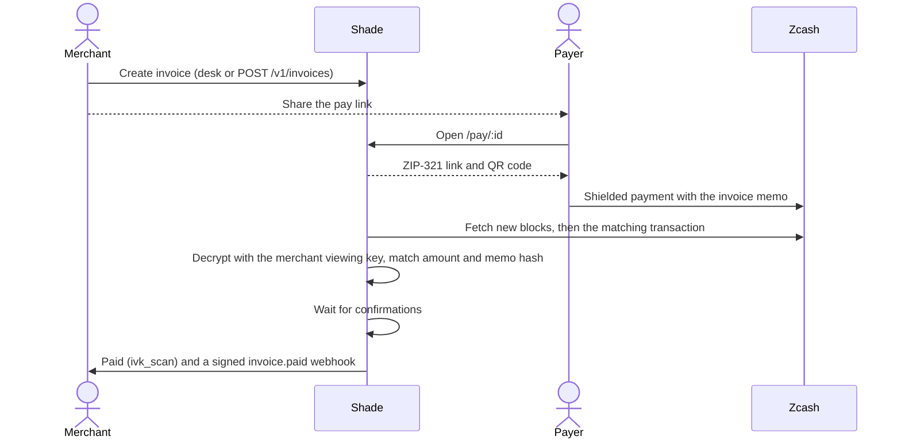
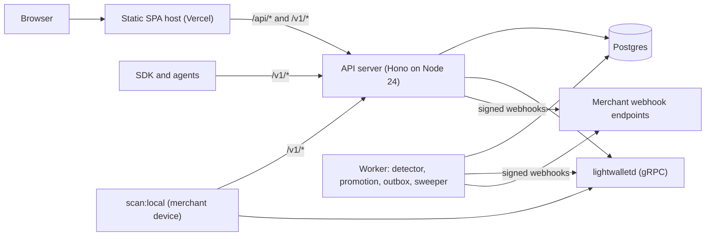
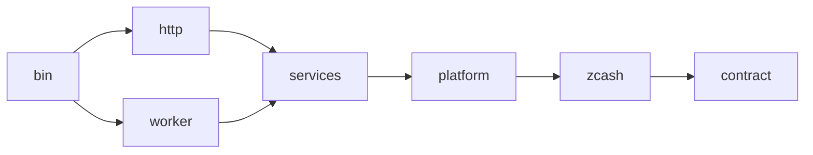
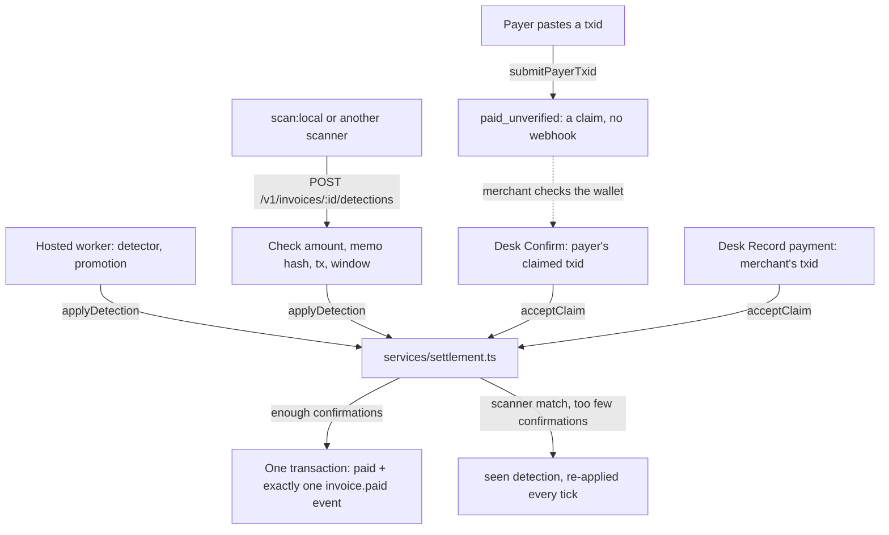
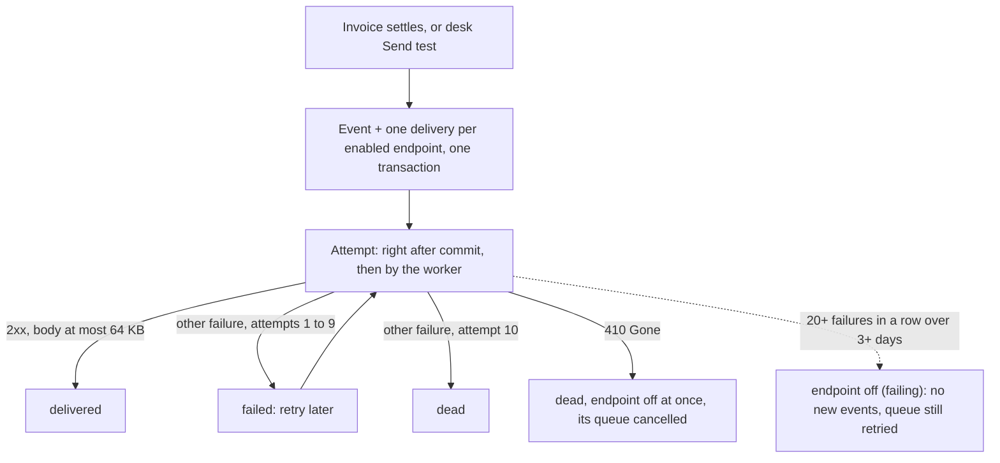
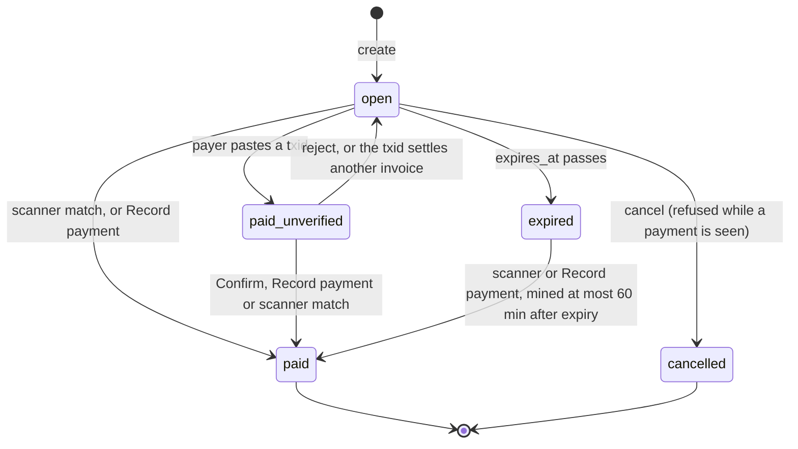
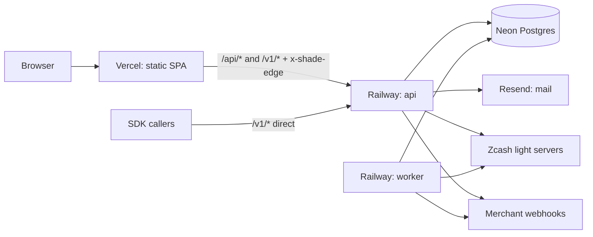
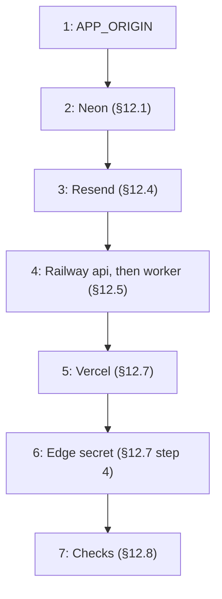

# AGENTS.md — Shade engineering context

For AI coding agents and engineers who change Shade. Read all of it before you change code.

- **[`prd.md`](prd.md) is the product source of truth.** This file says how Shade is built, where it departs from the PRD
  (§2 wins over prd.md wording) and the rules that keep Shade safe (§5).
- When this file and the code disagree, fix one of them in the same change.

## 1. Product

Shade is the vendor layer on Zcash, which already hides the money. A merchant creates a private invoice, gets a webhook
when shielded ZEC lands, shares and revokes a time-boxed receipt view, and gives an AI agent a jar: a spending cap it
cannot pass.

**Shade is not** a wallet, a mixer, a rollup, a new coin, multi-chain or home-made privacy. It never holds seeds or
spending keys; payers use their own shielded wallet (Zingo, Zodl, …) through ZIP-321 payment URIs.

### 1.1 Goals (PRD §0, §16)

- A working pay loop on Zcash testnet: create invoice → shielded pay → webhook `invoice.paid` → viewing grant → revoke →
  agent jar empty fails.
- One real shielded testnet payment detected. `@shade/sdk` with the PRD §16 calls. A README a stranger can run.
- Honesty first: _a demo that lies about "on-chain" is a failed build_ (PRD §0.8).

### 1.2 The four objects (PRD §4)

| Object      | Meaning                                                    | Implementation                                             |
| ----------- | ---------------------------------------------------------- | ---------------------------------------------------------- |
| **Tag**     | `name.shade` → a merchant Unified Address                  | `tags` table, network-bound; `GET /v1/tags/:name` resolves |
| **Invoice** | "Pay this much ZEC for this memo" → ZIP-321 URI + pay page | `invoices`; status machine in §6.1                         |
| **Jar**     | An agent's spending cap; the owner can kill it             | `jars`; each charge is an `authorized` invoice             |
| **Grant**   | Time-boxed, revocable receipt view for an auditor          | `grants`; Shade-served view + CSV export                   |

A receipt is a paid invoice + its txid + its memo hash.

### 1.3 Users (PRD §6)

| Who             | Job                                                         | Surface                                 |
| --------------- | ----------------------------------------------------------- | --------------------------------------- |
| Merchant / SaaS | Invoice → webhook `invoice.paid` → fulfil                   | Desk (web app) + `/v1` API + SDK        |
| Agent runtime   | Charge a capped jar per call; stop when it is empty         | `/v1/jars/:id/charge` with an `ag_` key |
| Human owner     | Set caps, read activity, revoke grants, kill jars           | Desk                                    |
| Auditor         | Open a grant, export receipts, lose access at expiry/revoke | `/view#<token>`                         |
| Payer           | Pay privately from their own wallet                         | `/pay/:id`                              |
| Fair judge      | Understand the loop in 90 seconds                           | Landing page, `docs/demo.md`            |

### 1.4 Journeys

**Invoice** (hosted detection):



The merchant's own scanner (`scan:local`) can replace Shade's detector; on testnet neither reads NU7 transactions today
(§3). Fallbacks, both settled as `merchant_accept` (§4.8): the payer pastes the txid (`paid_unverified`) and the
merchant presses _Confirm_, or the merchant enters a txid from their wallet with _Record payment_.

**Jar:** the owner creates a jar (a cap) and its agent key. The agent calls `charge` per paid API call; over the cap:
`402 JAR_EMPTY` (_Jar empty. The agent cannot spend._). Killing the jar: _Stops new charges. Move leftover ZEC in your
wallet._

**Grant:** the owner grants a label (`payroll`) or `all` for 10 minutes to 90 days and shares the view link once; the
auditor sees receipts and downloads a CSV. After revoke the view shows a revoked notice and export is 410.

## 2. Intentional PRD deviations (this table wins over prd.md wording)

| PRD item                                | Shade v1                                                     | Why                                                          |
| --------------------------------------- | ------------------------------------------------------------ | ------------------------------------------------------------ |
| Next.js `apps/web` + `apps/api`         | Vite SPA `frontend/` + Hono `backend/`                       | Clear split: one API (SPA, SDK, worker); same-origin cookies |
| "Chain: Orchard / Unified Addresses"    | UA **with an Orchard receiver**; payments land in Ironwood   | NU6.3 (mainnet 2026-07-28) closed the Orchard pool           |
| §15 "We use Zcash Orchard today…"       | `COPY.quantum` (shielded pool; follows key upgrades)         | Factual accuracy; never claim quantum-safe                   |
| IVK only on merchant device (§0, §11.1) | Opt-in **hosted detection** (sealed UFVK) + `scan:local`     | Sole maintained Node scanner needs a UFVK; PRD §11 allows it |
| §8.3 "exported UFVK/IVK slice"          | Shade-served receipt view + CSV export; revoke ⇒ 410         | No protocol-level scoped or time-boxed viewing key           |
| Grant `days`                            | `days` or `expires_in_sec` (10 min – 90 days)                | PRD §12.4 demo uses a 10-minute grant                        |
| §7 jar "fund", "Kill returns the rest"  | Spending limit (`COPY.jarIsLimit`); kill: the §15 line       | PRD §8.2/§15: no spending key, no fake clawback              |
| `sk_live_` only                         | `sk_test_` testnet, `sk_live_` mainnet, `ag_` its jar's      | Test keys cannot act on mainnet                              |
| `X-Shade-Signature` = HMAC of raw body  | Kept, plus `X-Shade-Signature-V2`, `X-Shade-Event-Id` (§4.9) | Replay protection without breaking the PRD shape             |
| §17.1 fake-paid mock (`DEMO_FAKE_PAID`) | Never built: no rehearsal, no "charge four times" button     | §17.6: delete before submit. Demo: real agent and receiver   |
| Optional memo                           | Unique memo: `<memo> (shade:<REF>)` or `shade:<REF>`         | Unambiguous scanner matching; unguessable memo hashes        |
| Payer wallets Zodl / Zucchini (§0, §10) | Testnet demo payer: Zingo. Zodl on mainnet                   | Zodl store builds: mainnet only; Zucchini: desktop extension |
| `/demo`, MCP tools, Zucchini button     | Deferred (not in §9/§16)                                     | Scope: "If a task is not in §9, do not build it"             |
| §9 invoices: create, get, cancel only   | Plus `GET /v1/invoices` (`?status=`, `?expires_after=`)      | `scan:local` pages its candidates; SDK `invoices.list`       |
| §11.1 "Merchant … scans" (no endpoint)  | `POST /v1/invoices/:id/detections`, checked, then settled    | Viewing key stays on the merchant device (PRD §0, §11.1)     |
| §9 charge creates a child invoice       | Desk charge list, cancel; also `/v1/invoices/:id/cancel`     | PRD §6: owner reads activity; refund while the jar is open   |
| §9 webhooks: `POST /v1/webhooks` only   | Plus `GET`, `DELETE`; desk Send test, delivery log           | At most 5 per network, so scripts replace one; PRD §12.3     |
| §9 jars: create, charge, kill           | Plus `GET /v1/jars/:id`, callable by the jar's `ag_` key     | An agent reads its budget first instead of hitting a 402     |
| §11 fallback: paste, then confirm       | Plus desk **Record payment** with the merchant's txid (§4.8) | Detection may be off or fail (§3); payers may not paste      |
| §7 grant dialog "tagged payroll"        | "Scope: invoices labelled payroll" (`grantDialogCopy`)       | Invoices carry labels; tags are `name.shade` handles         |
| §9 `sk_live_`/`ag_` keys (no issuing)   | `/api/desk/keys`: list, issue (fresh session, 10/h), revoke  | Shown once (§5.4); an agent key binds to one open jar        |
| §0.3 "mainnet is a checkbox"            | Network switch; mainnet: fresh session + `SHADE_NETWORKS`    | The checkbox. Disabled network ⇒ 403 `NETWORK_DISABLED`      |
| §8.1 webhook body                       | Adds `id`, `created_at`, `network`, `verification` (§4.9)    | Dedupe by `id`; `verification` says how it was paid          |
| Not in the PRD                          | `Idempotency-Key` on invoice, jar, charge `POST`s (§4.10)    | Agent retries must not charge a jar twice (§6.2)             |

## 3. Zcash facts Shade depends on

Verified 2026-10-02; NU7 and endpoints 2026-10-06. Re-verify before you upgrade anything.

**Network upgrades**

- NU6.3 _Ironwood_: mainnet height 3,428,143 (2026-07-28), testnet 4,134,000. Shielded payments to Orchard receivers
  now land in the Ironwood pool (v6 transactions, version group `0xD884B698`); the same Orchard IVK decrypts both pools;
  UAs do not change.
- **NU7** (ZIP 218, 259, 235): testnet since height 4,465,026 (2026-10-04); mainnet about 2026-11-05 (height decided
  about 2026-10-20). Branch id `0x77190AD9`; no new transaction format (v5/v6 stay valid, v4 does not); 25 s target
  spacing (testnet ran about 9 s per block on 2026-10-06); reorg limit 99 → 600 blocks, so the detector rescans 600
  blocks after a reorg (`REORG_RESCAN_BLOCKS`); default transaction expiry 40 → 120 blocks; 60% of fees burned at block
  level (senders pay the same); no ZSAs or memo bundles.
- Never hard-code block time. zcashd is end-of-life; the network runs Zebra/Zakura.

**Chain access**: lightwalletd gRPC (`cash.z.wallet.sdk.rpc.CompactTxStreamer`, lightwallet-protocol v0.5.0), no full
node (PRD §0.6).

- Testnet `testnet.zec.rocks:443`, fallback `zaino.testnet.unsafe.zec.rocks:443` (HTTP 503 on 2026-10-06: no working
  fallback then). Mainnet `zec.rocks:443`, fallback `zec-node.cakewallet.com:443` (`na.zec.rocks`, `eu.zec.rocks` also
  answered).
- ZainoD 0.6.0 (the testnet fallback) answers an unknown txid with gRPC `INTERNAL`, like a backing-node failure, so
  during a primary outage an unknown txid is 503 `CHAIN_UNAVAILABLE`, never not-found (fail closed). It also gives a
  **mempool** transaction the tip as its height, so `RawTransaction.height` alone does not prove mining: a tx counts as
  mined only when the compact block at that height lists it (`GetBlock`); Shade asks the next server when one lacks the
  block and fails closed when none has it.
- Blockchair has **no** Zcash testnet API and its JSON heuristic misclassified transparent transactions: not used.

**Formats**

- Txids and block hashes: lowercase **display-order** hex in Shade. lightwalletd's `TxFilter.hash`, `BlockID.hash` and
  `CompactBlock.hash` are protocol (little-endian) order; the client reverses them. `RawTransaction.height`: `0` =
  mempool, `2^64−1` = mined on a non-main chain.
- Unified Addresses (ZIP-316 Rev 0): Bech32m (no 90-char limit) over F4Jumble(TLV items ‖ 16-byte HRP padding); HRPs
  `u`/`utest`; viewing keys `uview`/`uviewtest` (full), `uivk`/`uivktest` (incoming). Rev 2 (`zu`, `uvf`, …) is Draft.
  Shade requires an Orchard receiver (typecode `0x03`), strips transparent receivers by re-encoding, and rejects
  t-addresses, TEX (`tex`/`textest`, ZIP-320), Sapling-only `zs…`, spending keys and seed phrases with plain messages.
- ZIP-321: exactly `zcash:<shielded UA>?amount=<canonical>&memo=<base64url, no padding>`; no `message` or `label`
  (Zucchini rejects them; a duplicated memo bloats QR codes).
- ZIP-302 memos: 512 bytes; text is UTF-8, zero-padded; an empty memo is `0xF6` + 511 zero bytes.
  `memo_hash = "sha256:" + hex(SHA-256(memo_field))`. Vectors: `""` → `fe079fdd…643d`, `"order_1042"` → `c8c635ab…7b20`.

**Keys, blocks, confirmations, fees**

- A UFVK (full viewing key) reveals incoming **and outgoing** activity, a UIVK (incoming viewing key) incoming only;
  both cover every diversified address of the account. Memo contents are sender-controlled and unverified (ZIP-310).
- Compact blocks carry a 52-byte ciphertext prefix per action: trial decryption gives the value, not the memo. The memo
  needs the full transaction (`GetTransaction`), which tells the lightwalletd operator which txid Shade cares about.
- ZIP-315 recommends 10 confirmations for untrusted incoming funds; Shade defaults to 1 on testnet (demo), 10 on
  mainnet. Paid is final: no un-pay after a reorg.
- The sender pays fees (ZIP-317) on top of the invoice amount; a 2-action payment costs 0.0001 ZEC.

**Scanner library** `@ledgerhq/zcash-utils` **2.5.0** (exact pin; newest release on 2026-10-06): a napi addon
(win32/darwin/linux-gnu, glibc ≥ 2.34, no musl), UFVK only, decrypts Sapling/Orchard/Ironwood, reads the system CA
bundle.

- **It cannot read NU7 transactions** (verified 2026-10-06 on real post-activation testnet transactions: its parser
  fails with "invalid consensus branch id 0x77190ad9"). Compact-block trial decryption still completes, so a pass
  without matches succeeds; the first payment to the key fails the pass (`scanner_unsupported_upgrade`, cursor kept).
  Testnet detection is down until a release built on `zcash_protocol` ≥ 0.11 ships (settle with Record payment or the
  payer's paste, §4.8); mainnet breaks the same way at mainnet NU7 unless the pin is bumped first. Shade's own `tx.ts`
  treats the branch id as opaque and keeps working.
- Re-verify with a real payment after every network upgrade before changing the pin.
- The adapter skips a memo group whose memo cannot be a ZIP-302 text memo (no Shade invoice carries one) instead of
  failing every later pass on it.

## 4. Architecture



The SPA host (`https://shade-zcash.vercel.app` in the reference deploy, §12) proxies `/api/*` and `/v1/*`, keeping the
browser same-origin; SDK callers use `/v1` directly or through it. API and worker are one image run as two processes.
Prefixes and guards: §4.10.

### 4.1 Repository layout

```
frontend/          @shade/frontend: Vite 8 + React 19 SPA (TanStack Router + Query, Tailwind v4)
backend/           @shade/backend: Hono API, worker, migrations, Zcash integration
  migrations/      plain SQL applied in filename order (0001–0013; never edit an applied file, §4.5)
  src/contract/    wire contract: DTO types, error codes, product COPY (the frontend imports it as @shade/contract)
  src/zcash/       protocol code: ZIP-316/321/302, tx parser, lightwalletd client, scanner adapter
  src/platform/    config, logger, db, migrations runner, crypto, mailer, SSRF-safe egress, rate limit, auth,
                   HTTP middleware (idempotency included), webhook signing
  src/services/    domain services (merchants, invoices, settlement, jars, grants, webhooks, tags, keys, viewing keys)
  src/http/        Hono routes and the app factory
  src/worker/      detector, promotion, outbox drainer, sweeper; matching (shared with scan:local), local scan, repo
  src/bin/         server, worker, migrate, scan-local, gen-seal-key entry points
  test/            integration + HTTP contract tests, fixtures, support (harness, fake chain, test db)
  sdk/             @shade/sdk: public TypeScript client, webhook verification, demo scripts
docs/demo.md       the 90-second demo script
AGENTS.md, prd.md, README.md
```

### 4.2 Dependency direction



A layer may import what its arrows reach, directly or through other arrows (`bin` imports `platform`); never import
against an arrow. The frontend depends only on `contract` (types and constants); the SDK on nothing (it declares its own
camelCase types).

### 4.3 Frontend

- Static SPA: TanStack Router file routes; TanStack Query owns all server state (no other store). Self-hosted fonts; no
  third-party requests at runtime.
- Same origin as the API (Vite dev proxy; `vercel.json` routes in production), so the Better Auth session cookie is
  first-party and host-only.
- Routes: `/`, `/login`, `/signup`, `/verify-email`, `/reset-password`, `/desk/*`, `/pay/$id`, `/view` (token in the URL
  fragment only), `/docs`. Desk nav: **Invoices · Jars · Grants · Webhooks** + Settings (receive addresses & network,
  profile, detection, tags, API keys).
- Guards and headers read the session with a plain `GET /api/auth/get-session` (`api/session.ts`); only auth and desk
  pages import the Better Auth client (`api/auth.ts`), so the pay page never loads it.
- After client-side navigation, focus moves to the page's h1 (`components/page-focus.ts`).

### 4.4 Backend

- Hono on `@hono/node-server`; Node 24 runs the TypeScript directly (type stripping): **erasable syntax only**.
- Services get `{ db, config, logger, chain, scanner, mailer, clock }` injected.
- zod validates all input at the HTTP boundary. Errors are `AppError(status, code, message)`, mapped to
  `{ error, message, request_id }`.
- A receive-address change, new API key or viewing-key upload emails a security notice to the merchant's sign-in
  address (`services/notifications.ts`): after commit, best effort, no secrets.

### 4.5 Database

- Postgres 15+ (Neon, Supabase or any; §12.1). Without `DATABASE_URL`, development uses PGlite in `backend/.data/pglite`
  (one process: the worker runs inline). Tests use in-memory PGlite; race tests use real Postgres via
  `TEST_DATABASE_URL`.
- Migrations: plain SQL in `backend/migrations`, applied in filename order, recorded by bare filename with checksums in
  `_migrations`. **Never edit an applied file; add a new one.** Sole exception: the 0001 header (Grok template text),
  rewritten before the first v1 deployment. v0 databases recorded no checksums; `platform/migrate.ts` accepts and
  replaces the old checksum of a database a v1 runner opened before the edit (`SUPERSEDED_CHECKSUMS`).
- Files (details in each header): 0001–0004 v0 history · 0005 v1 domain schema · 0006 Better Auth 1.7.7 delta · 0007
  legacy cleanup (v0 `paid` rows without a txid cancelled; `paid_at` CHECK) · 0008 `cursor_time` · 0009 memo-group
  uniqueness · 0010 detector candidate indexes · 0011 `scan_from` · 0012–0013 `jars.charge_count`, kept by triggers on
  `invoices`.
- New CHECK/FK constraints on existing tables: `NOT VALID`, after backfilling.
- On Postgres the server and worker refuse to start while a migration is pending (`npm run db:migrate`); on PGlite the
  server migrates itself.
- After the SQL files the migrator repairs receive addresses saved before v1 checked them
  (`services/stored-addresses.ts`): it strips transparent receivers by re-encoding and clears a merchant address with
  no Orchard receiver so the desk asks again (idempotent, compare-and-set).
- Driver contract: `int8 → number` (throws if unsafe), `numeric → string`, `timestamptz → Date`. Amounts:
  `numeric(20,8)` ZEC in SQL, `bigint` zatoshis in code. Business time is the injected clock, passed as a SQL
  parameter. `db.tx` retries once on deadlock or serialization failure; inside it use only its handle (the root `db`
  throws).

### 4.6 Authentication and authorization

Principals (keys and tokens: §5.4):

- **Merchant (desk):** Better Auth 1.7.7 email + password session cookie (`shade.*`, HttpOnly, SameSite=Lax, Secure in
  prod): own merchant; verified email when required; sensitive actions need a session < 15 min old.
- **Merchant (API):** `sk_test_…` / `sk_live_…` bearer key: own merchant, one network.
- **Agent:** `ag_…` bearer key bound to one jar: only `POST /v1/jars/<jar>/charge`, `GET /v1/jars/<jar>`.
- **Auditor:** `gv_…` grant token in the URL fragment: one grant's receipts until expiry or revoke.
- **Payer:** holds the pay link: public invoice view, txid claim.

Rules:

- `/api/auth/*` bodies ≤ 16 KB (413 `PAYLOAD_TOO_LARGE`); names ≤ 128 characters; passwords 12–128 characters; profile
  images refused.
- A session expires 7 days after its last refresh (Better Auth extends one in use at most daily). Desk requests read
  it from the database (no cookie cache), so revocation is immediate; a password reset revokes all sessions.
- Auth emails (verification, password reset) go out in the background after the response, so timing does not reveal
  whether an account exists; a failed send is logged, never returned. Links expire after 1 hour.
- **Verification never signs anyone in** (`autoSignInAfterVerification: false`). The link confirms the email and lands
  on `/desk?verified=1`, which sends a signed-out visitor to `/login` with "Email confirmed. Sign in to open your
  desk."; a bad link adds `error=…` and lands on `/verify-email`.
- **Contested sign-up** (verification required). Attack: someone signs up first with the owner's email; their password
  works once the owner confirms. So a sign-up for a never-confirmed account deletes its password and sessions, clears
  its chosen name (pay pages show it as the shop name) and mails a set-password link ("Finish setting up Shade"). For a
  confirmed account it changes nothing and answers the same. Any completed password reset also confirms the email
  (only the mailbox gets the link).
- **Residual risk (accepted):** an owner who clicks the confirmation email of an attacker's sign-up before signing up
  makes the attacker's password valid. The mail says to ignore unexpected sign-ups; a full fix needs a set-password
  step as the first confirmation.
- CSRF: `/api/*` has no CORS; the origin check (§4.10) guards it, backed by the SameSite cookie. `/v1/*` ignores
  cookies and allows CORS `*` without credentials.

### 4.7 Zcash integration (backend/src/zcash)

- `address.ts`: full ZIP-316 codec, merchant address policy, `parseUfvk`.
- `zip321.ts`, `memo.ts`, `money.ts`, `txid.ts`: URIs, memo fields/hashes, zatoshi math, byte order.
- `tx.ts`: structural v4/v5/v6 parser (counts transparent ins/outs, Sapling, Orchard and Ironwood actions; branch id
  opaque).
- `lightwalletd.ts`: pure-TypeScript gRPC over `node:http2`, failover across endpoints, 10 s per attempt; each new
  session checks `chainName`, so a URL never answers for the wrong network.
- `scanner.ts`: sole importer of `@ledgerhq/zcash-utils`, loaded lazily so the server boots where the binary cannot
  load. It reduces each transaction to incoming payments `{txid, block, pool, amountZat, memoHash}`; memo text never
  leaves the module.

### 4.8 Payment detection and settlement



**Settlement.** `services/settlement.ts` (`applyDetection`, `acceptClaim`) is the only code that sets `paid`; it
enqueues exactly one `invoice.paid` event in the same transaction.

- Both paths first take a per-(merchant, network, txid) transaction advisory lock, so Confirm and a scanner match of
  one txid serialise; the loser gets `txid_in_use` (hosted worker) or 409 `TXID_IN_USE` (`/v1` detections, Confirm),
  never a 500.
- The scanner reports one payment per memo group (a transaction's outputs carrying one memo). Detections and settled
  txids are unique per (merchant, network, txid, memo hash) (migration 0009): one transaction can pay several invoices
  with their own memos; one memo group settles at most one.
- A scanner match gets `txid_in_use` if its txid already settled another invoice with the same memo hash or the
  merchant confirmed it elsewhere; this invoice's `seen` detection of it becomes `late`. Confirm cannot check amount or
  memo, so it guards the whole txid, refusing one used by another invoice or another invoice's `seen` or `settled`
  detection.

**Hosted detector** (per merchant and network with a viewing key and candidate invoices)

- A pass holds the key's 120 s lease (one worker per key) and scans from the higher of the start height and the cursor
  minus max(10, minimum confirmations + 2) blocks (600 after a reorg) to the tip, at most the key's pass size.
- Start height: 2 blocks below the lowest candidate height: its `created_height` or, without one (light server down at
  creation), the last block with a timestamp ≤ `created_at` − 120 s (a search over block times) minus 12 (timestamps
  are not monotonic). Never a block-spacing estimate; a failed block lookup fails the pass.
- Match: exact amount + memo hash; height ≥ `created_height` − 1 when known; block time in [`created_at` − 120 s,
  `expires_at` + 60 min]. An expired invoice wins only when no live one matches; several matches are `ambiguous_match`
  and settle nothing.
- A match stays `seen` until it has the network's minimum confirmations. Promotion re-checks up to 200 `seen`
  detections (any source) per tick: block still on the main chain ⇒ re-applied with the current tip; tx mined
  elsewhere ⇒ re-applied there; reported from the mempool and still there ⇒ wait; otherwise ⇒ `orphaned`.
- A failed pass keeps the cursor and backs off (20 s, doubling to 5 min); the merchant sees `last_error`
  (`ScanErrorCode`: `chain_unavailable`, `scan_failed`, `key_unavailable`, `scanner_unsupported_upgrade`,
  `ambiguous_match`, `txid_in_use`).
- 2 scans at once, 50 keys per tick, ≤ 20,000 blocks per pass. A pass that times out (60 s, never past its lease minus
  15 s) halves that key's pass size, down to 1,000 blocks; completed passes double it back (`scanChunks`, per worker
  process), so a backlog still advances.
- Candidates: non-jar invoices `open` or `paid_unverified`, plus `expired` ones with `expires_at` after the scan's chain
  time − 70 minutes. Chain time: `cursor_time` (block time of the last successful scan's end block); before the key's
  first successful scan, its first upload (`scan_from`, else the row's `created_at`); for a cursor without a time,
  unknown (every expired invoice stays a candidate). Never wall-clock time, so a lagging detector still matches a
  payment mined before expiry.

**`scan:local`** plans and matches the same way and reports to `POST /v1/invoices/:id/detections`. Its chain time is
the block time at its local cursor (now on a first run); it fetches unpaid invoices, then expired ones with
`expires_after` = that time − 70 minutes, and fails rather than scan a partial list (over 200 pages). A
`404 TX_NOT_FOUND` answer (Shade's light server has not seen the tx yet) fails the pass, so the next one reports it
again. Its cursor is `.shade-scan-<network>.json` in the working directory; each pass rescans 12 blocks behind it.

**Payer paste** (`POST /api/public/invoices/:id/txid`, open or claimed invoice before expiry): the tx must exist on the
invoice's network and be able to pay a shielded receiver (Ironwood actions or Sapling outputs); if mined, it must not
predate the invoice (`created_height`, else `created_at` − 10 min). It sets `claimed_txid` and `paid_unverified` (a new
paste replaces the claim); it never reserves a txid or fires a webhook.

**Confirm and Record payment** (`acceptClaim`, `merchant_accept`). Confirm settles the payer's claimed txid. Record
payment (`{ txid }`) settles an `open` or `paid_unverified` invoice with a txid from the merchant's wallet when
detection is off or cannot read the chain; the txid passes the paste checks and replaces any claim. Past expiry its
block time must be ≤ 60 minutes after `expires_at` (else 409 `EXPIRED`), rechecked under the row lock. Both need the tx
mined with the network's minimum confirmations (else 409 `TX_NOT_MINED`) and unused by other invoices (`TXID_IN_USE`);
other invoices' claims of it go back to `open`. Shade cannot see the amount or memo, so the desk asks the merchant to
check them.

### 4.9 Webhooks



- Transactional outbox (`webhook_events` + `webhook_deliveries`); each attempt holds a 60 s lease.
- Retries after 5 s, 5 min, 30 min, 2 h, 5 h, 10 h, 14 h, 20 h, 24 h (±10 % jitter): 10 attempts over about 3 days.
  `Retry-After` on 429/503 can only lengthen a wait, to at most twice the step. A non-2xx, a body over 64 KB, a
  redirect, a timeout or a network error is a failure.
- Per-endpoint `whsec_` secrets, AES-256-GCM at rest. Deleting an endpoint wipes its secret and cancels its queued
  deliveries. Delivery is at-least-once: receivers dedupe by `id`.
- Egress (`platform/ssrf.ts`): HTTPS, ports 443/8443, no URL credentials, every resolved address public unicast,
  connection pinned to the vetted IP, no redirects, 10 s timeout, 64 KB response cap. `SHADE_WEBHOOK_ALLOW_PRIVATE`
  (development only) lifts the https, port and address rules.

#### Webhook events

- `services/settlement.ts` enqueues `invoice.paid` in the settling transaction (a unique index keeps one per invoice);
  the desk Send test enqueues `webhook.test`.
- Body (`WebhookEvent`, stored once, re-sent byte for byte): `id` (`evt_…`), `type`, `created_at`, `network`,
  `invoice_id`, `amount_zec`, `memo_hash`, `txid`, `paid_at`, `verification` (`ivk_scan` or `merchant_accept`); on
  `webhook.test` every field from `invoice_id` on is null.
- Headers: `content-type: application/json`, `user-agent: Shade-Webhooks/1`, `X-Shade-Event-Id`,
  `X-Shade-Signature: sha256=<hex HMAC-SHA256(secret, raw body)>`,
  `X-Shade-Signature-V2: t=<unix seconds of this attempt>,v1=<hex HMAC-SHA256(secret, t + "." + raw body)>`. The HMAC
  key is the UTF-8 of the whole `whsec_…` string (`platform/webhook-signing.ts`).
- The SDK's `verifyWebhook` requires V2 (default tolerance 300 s); it accepts the body-only signature, which never
  expires, only with `allowLegacySignature` when V2 is absent.

### 4.10 API surface

Source of truth: `backend/src/http/{app,public,desk,v1}.ts`, bodies in `http/support.ts`, shapes in
`backend/src/contract/types.ts`. Integrators read `/docs` (`frontend/src/features/docs/docs-content.ts`) and
[`backend/sdk/README.md`](backend/sdk/README.md); keep both in step with `/v1`.

| Prefix                         | Principal                       | Guards                                           |
| ------------------------------ | ------------------------------- | ------------------------------------------------ |
| `/healthz`, `/readyz`          | none                            | none                                             |
| `/api/auth/*` (GET, POST)      | Better Auth                     | edge, origin, 16 KB body cap, Better Auth limits |
| `/api/config`, `/api/public/*` | anyone (pay link, grant token)  | edge, origin, per-IP limits                      |
| `/api/desk/*`                  | desk session cookie¹            | edge, origin, session, per-shop limits           |
| `/v1/*`                        | `sk_test_` / `sk_live_` / `ag_` | CORS `*` without credentials, key, per-key limit |

¹ Email verified when `AUTH_REQUIRE_EMAIL_VERIFICATION` is on (production default); else 403 `EMAIL_UNVERIFIED`.

- **Edge:** with `EDGE_SHARED_SECRET` set, `/api/*` needs a matching `x-shade-edge`. **Origin:** unsafe `/api/*`
  methods need `Origin` = `APP_ORIGIN` (outside production also its `localhost` ⇄ `127.0.0.1` twin) or, with no
  `Origin`, `Sec-Fetch-Site: same-origin`. Either failure: 403 `FORBIDDEN_ORIGIN`.
- **Limits** (Postgres fixed windows; IPv6 per /64): per shop `desk:req` 600/min, `desk:mut` 120/min (mutations),
  `desk:whtest` 5/min, `desk:keys` 10/h; per key `v1:key` 600/min; per IP `v1:auth:ip` 60 failed `/v1`
  authentications/min (then 429; valid keys never count), plus the per-IP limits in the tables.
- Responses carry `cache-control: no-store`, `x-request-id` (an inbound `X-Request-Id` matching
  `^[A-Za-z0-9._:-]{1,64}$` is kept) and Hono's secure headers.
- Bodies ≤ 16 KB (413); a non-empty body must be `application/json` (415); bodiless POSTs take any content type; an
  empty body validates as `{}`.
- Paged lists (invoices, jar charges, webhook deliveries): `Page<T> = { items, next_cursor }`, `?cursor=&limit=`
  (default 25, 1–100). Other lists are plain arrays.
- A `/v1` key sees only its own network (other resources are 404); a key for a network the server does not enable gets
  403 `NETWORK_DISABLED`.
- `Idempotency-Key` (1–255 printable ASCII), kept per API key for 24 h: a replay returns the stored answer with
  `idempotent-replayed: true`; the same key with another method, path or body is 422 `IDEMPOTENCY_MISMATCH`; one still
  running is 409 `IDEMPOTENCY_IN_PROGRESS`. Replayed: the idempotent transaction's 2xx and 4xx outcomes except 400 and
  429 (e.g. 402 `JAR_EMPTY`). Not stored: checks before it (validation, 403 `NETWORK_DISABLED`, 409 `NO_ADDRESS`),
  429, 5xx.

**Health.** `GET /healthz` → `{ ok: true }` (Docker `HEALTHCHECK`). `GET /readyz` →
`{ ok, database, pending_migrations, workers: { <loop>: { last_seen_at, age_sec } } }` for loops `detector`,
`promotion`, `outbox`, `sweeper`; 503 when the database is down or a migration is pending. Worker age is reported, not
judged.

**`/api/auth/*`**: Better Auth's own handler and error shape. `/sign-up/email` (5 per hour per IP), `/sign-in/email`
(5/min), `/sign-out`, `/get-session`, `/verify-email` (mailed link), `/request-password-reset` (3/h), `/reset-password`,
`/send-verification-email` (3/h); other paths 100/min.

**Public (`/api`)**

| Method | Path                        | Purpose                                        | Limit                       |
| ------ | --------------------------- | ---------------------------------------------- | --------------------------- |
| GET    | `/config`                   | `AppConfig` for the SPA                        | none                        |
| GET    | `/public/invoices/:id`      | `PublicInvoice` for the pay page               | 120/min per IP              |
| POST   | `/public/invoices/:id/txid` | payer pastes a txid → `paid_unverified` (§4.8) | 10/min/IP; 5/10 min/invoice |
| POST   | `/public/grants/view`       | `{ token }` → `GrantView`                      | 30/min per IP (shared)      |
| POST   | `/public/grants/export`     | `{ token }` → CSV; 410 once revoked or expired | 30/min per IP (shared)      |

**Desk (`/api/desk`).** F = fresh session (created within 15 min, else 403 `SESSION_NOT_FRESH`). Creates use the shop's
current desk network; list routes take `?network=` (default: that network; tags and keys: every network).

| Method      | Path                                 | Purpose                                                  |
| ----------- | ------------------------------------ | -------------------------------------------------------- |
| GET         | `/me`                                | `Me`: user, shop, networks, hosted detection             |
| PUT         | `/settings/profile`                  | shop display name                                        |
| PUT         | `/settings/address`                  | receive address per network (§6.5). F                    |
| PUT         | `/settings/network`                  | desk network. F for mainnet                              |
| GET, POST   | `/invoices`                          | list non-jar (`?status=`, paged); create (201)           |
| POST        | `/invoices/:id/cancel`               | cancel an open invoice, or a jar charge                  |
| POST        | `/invoices/:id/accept`               | Confirm a claim, or Record payment `{ txid }` (§4.8)     |
| POST        | `/invoices/:id/reject`               | reject a payer claim (back to `open`)                    |
| GET, POST   | `/jars`                              | list (open first, max 200); create (201)                 |
| POST        | `/jars/:id/kill`                     | kill                                                     |
| GET         | `/jars/:id/charges`                  | charges (paged)                                          |
| POST        | `/jars/:id/charges/:chargeId/cancel` | refund to the cap (open jars only); returns the jar      |
| GET, POST   | `/grants`                            | list (active first, max 200); create (201; F if > 1 day) |
| POST        | `/grants/:id/revoke`                 | revoke                                                   |
| GET, POST   | `/webhooks`                          | list (deleted ones hidden); add (201; F)                 |
| POST        | `/webhooks/test`                     | send `webhook.test` to enabled endpoints (5/min)         |
| GET         | `/webhooks/deliveries`               | delivery log (paged)                                     |
| DELETE      | `/webhooks/:id`                      | delete; cancels its queued deliveries (204)              |
| GET, POST   | `/tags`                              | claimed `name.shade` handles; claim one (201)            |
| GET, POST   | `/keys`                              | list (no tokens, live first); issue (201; F; 10/h)       |
| POST        | `/keys/:id/revoke`                   | revoke                                                   |
| GET         | `/viewing-keys`                      | `ViewingKeyStatus` per network                           |
| PUT, DELETE | `/viewing-keys/:network`             | upload a UFVK, sealed (F); delete (204)                  |

**`/v1`.** CORS: methods `GET, POST, DELETE, OPTIONS`; request headers `authorization, content-type, idempotency-key,
accept`; exposes `x-request-id, retry-after, idempotent-replayed`; max-age 600. Agent keys get 403 `FORBIDDEN` on every
keyed route except `POST /v1/jars/<their jar>/charge` and `GET /v1/jars/<their jar>`; merchant keys may charge too.
I = `Idempotency-Key` honoured.

| Method    | Path                          | Purpose                                              |
| --------- | ----------------------------- | ---------------------------------------------------- |
| GET       | `/v1/tags/:name`              | resolve `name.shade`; no key needed; 60/min per IP   |
| GET, POST | `/v1/invoices`                | list non-jar (filters below, paged); create (201; I) |
| GET       | `/v1/invoices/:id`            | get                                                  |
| POST      | `/v1/invoices/:id/cancel`     | cancel an open invoice, or a jar charge              |
| POST      | `/v1/invoices/:id/detections` | report a scanner match (body below; §4.8)            |
| POST      | `/v1/jars`                    | create (201; I)                                      |
| GET       | `/v1/jars/:id`                | one jar (its own agent key may read it)              |
| POST      | `/v1/jars/:id/charge`         | charge → `JarChargeResult` (201; I; 402 `JAR_EMPTY`) |
| POST      | `/v1/jars/:id/kill`           | kill                                                 |
| POST      | `/v1/grants`                  | create (201)                                         |
| POST      | `/v1/grants/:id/revoke`       | revoke                                               |
| GET, POST | `/v1/webhooks`                | list (no secrets); add one (201)                     |
| DELETE    | `/v1/webhooks/:id`            | delete; cancels its queued deliveries (204)          |
| POST      | `/v1/tags`                    | claim a name (201)                                   |

`GET /v1/invoices` filters: `?status=` (comma list), `?expires_after=` (ISO 8601 date-time). A detection has `txid`,
`amount_zec`, `memo_hash`, `pool` and optional `source` (`merchant_device`, default, or `external_scanner`). `token`,
`view_url` and `secret` appear once, in the create response (§5.4).

#### API errors

Every non-2xx JSON answer outside `/api/auth/*` and `/readyz` is `ApiErrorBody`:
`{ error, message, request_id, issues?, remaining_zec?, retry_after? }`. `issues` (on `INVALID_REQUEST`): field paths
and messages, never the submitted value. `remaining_zec`: with `JAR_EMPTY` and `JAR_CLOSED`. `retry_after` and a
`retry-after` header: with 429 and 503 `CHAIN_UNAVAILABLE`. Catalogue: `backend/src/contract/errors.ts` (each code's
status in its comment; the code throws exactly those). The frontend adds `NETWORK_ERROR` and `UNEXPECTED_RESPONSE`
(`frontend/src/api/client.ts`); the SDK has its own client codes (`backend/sdk/src/errors.ts`).

| Status | Codes                                                                                              |
| ------ | -------------------------------------------------------------------------------------------------- |
| 400    | `INVALID_REQUEST`, `BAD_ADDRESS`, `BAD_AMOUNT`, `BAD_MEMO`, `BAD_TAG`, `BAD_EXPIRY`, `BAD_LABEL`,  |
|        | `BAD_SCOPE`, `BAD_DURATION`, `BAD_TXID`, `BAD_MEMO_HASH`, `BAD_POOL`, `BAD_URL`, `BAD_VIEWING_KEY` |
| 401    | `UNAUTHORIZED`                                                                                     |
| 402    | `JAR_EMPTY`                                                                                        |
| 403    | `FORBIDDEN`, `FORBIDDEN_ORIGIN`, `EMAIL_UNVERIFIED`, `SESSION_NOT_FRESH`, `NETWORK_DISABLED`       |
| 404    | `NOT_FOUND`, `TX_NOT_FOUND`                                                                        |
| 409    | `IDEMPOTENCY_IN_PROGRESS`, `NO_ADDRESS`, `ADDRESS_MANAGED_BY_KEY`, `NOT_OPEN`, `PAYMENT_PENDING`,  |
|        | `ALREADY_PAID`, `EXPIRED`, `CANCELLED`, `TXID_IN_USE`, `TX_NOT_MINED`, `JAR_CLOSED`, `TAG_TAKEN`,  |
|        | `TAG_LIMIT`, `INVOICE_LIMIT`, `JAR_LIMIT`, `GRANT_LIMIT`, `ENDPOINT_LIMIT`, `NO_ENDPOINTS`,        |
|        | `HOSTED_DETECTION_DISABLED`                                                                        |
| 410    | `GRANT_REVOKED`, `GRANT_EXPIRED`                                                                   |
| 413    | `PAYLOAD_TOO_LARGE`                                                                                |
| 415    | `UNSUPPORTED_MEDIA_TYPE`                                                                           |
| 422    | `IDEMPOTENCY_MISMATCH`, `VIEWING_KEY_ADDRESS_MISMATCH`, `TX_NOT_SHIELDED`, `AMOUNT_MISMATCH`,      |
|        | `MEMO_MISMATCH`, `OUTSIDE_WINDOW`                                                                  |
| 429    | `RATE_LIMITED`                                                                                     |
| 500    | `INTERNAL`                                                                                         |
| 503    | `CHAIN_UNAVAILABLE`                                                                                |

## 5. Security and privacy rules (non-negotiable)

1. Never store seeds or spending keys; reject them on input with a plain message; never echo or log them.
2. Never log memos, tokens, API keys, grant tokens, webhook secrets, viewing keys, passwords or request bodies, nor
   txids, amounts or memo hashes together with merchant or invoice ids.
3. Viewing keys: sealed to the worker's X25519 key (the API tier cannot decrypt), wiped on delete; the UI discloses
   what a UFVK reveals. Decrypted memos stay inside `zcash/scanner.ts`.
4. Secrets are shown once: API keys, grant tokens, webhook secrets. Tokens are high-entropy and stored as SHA-256.
5. Webhooks: no payer address, no memo plaintext; egress only through the SSRF-safe `platform/ssrf.ts`.
6. Public pay data is minimal (`PublicInvoice`): no tag, jar, txid, claim or memo hash.
7. Grant tokens travel in the URL fragment and request bodies, never paths or query strings. Pay and view pages get
   `Referrer-Policy: no-referrer` and `X-Robots-Tag: noindex, nofollow` from `frontend/vercel.json` (another static
   host must add them, §12.7); `robots.txt` disallows `/pay/`, `/view` and `/desk`.
8. Production refuses to boot without `DATABASE_URL`, `APP_ORIGIN`, `BETTER_AUTH_SECRET` or `SHADE_ENCRYPTION_KEY`,
   with private webhook targets (`SHADE_WEBHOOK_ALLOW_PRIVATE`), or with console mail while email verification is
   required. In any environment `MAIL_TRANSPORT=resend` needs `RESEND_API_KEY` and a `MAIL_FROM` on a public domain
   (not localhost, reserved or IP).
9. Rate limits on every public and authenticated surface (Postgres fixed windows; Better Auth database storage).
10. Copy: never show Groth16, Halo, nullifier, proving key, note commitment, "generating proof", "syncing sapling tree"
    or raw enum values (the list heads `backend/src/contract/copy.ts`); use its strings.
11. State privacy limits honestly: the lightwalletd operator sees which txids Shade looks up; pool-crossing payments
    reveal the crossing amount; one static UA links a merchant's pay pages for anyone comparing them.

## 6. Domain rules

### 6.1 Invoice state machine



- `paid` and `cancelled` are terminal. A claimed (`paid_unverified`) invoice cannot be cancelled.
- An open invoice reads as `expired` once `expires_at` passes; the sweeper writes the status later, but not while a
  payment for it is `seen`.
- Jar charges are `authorized` (`jar_ledger`), never payable. Cancelling one sets `cancelled` and refunds the cap while
  the jar is open.

### 6.2 Jars

One statement checks `spent + amount ≤ cap` and `status = open`, debits the jar and inserts the charge. Over the cap ⇒
`402 JAR_EMPTY`; killed ⇒ `409 JAR_CLOSED` (also when a charge loses a race with kill). Both carry `remaining_zec`.
Agent retries are safe with `Idempotency-Key`.

### 6.3 Grants

- Scope `all` or an invoice label. Only verified receipts (`ivk_scan`, `merchant_accept`) and live jar charges; never
  payer claims.
- 10 minutes – 90 days (`days` 1–90, default 7, or `expires_in_sec`; not both).
- Revoke is immediate for everything Shade serves (_Revoke stops new access from us. Delete the file on their machine
  too._). Unknown token ⇒ 404; a revoked or expired grant's view shows a notice and its export is 410.
- View and CSV export return at most the newest 500 receipts (`RECEIPT_LIMIT`, `services/grants.ts`). CSV cells a
  spreadsheet would run as formulas get a leading apostrophe.

### 6.4 Per-merchant limits

Caps per merchant and network keep one account from making unbounded shared work; each is a 409 whose message the UI
shows as-is.

- Soft (counted before the insert without a lock; a concurrent burst can pass by a few rows): 10,000 unpaid non-jar
  invoices (`open` and not past expiry, or `paid_unverified`) ⇒ `INVOICE_LIMIT`; 100 open jars ⇒ `JAR_LIMIT`; 100
  active grants ⇒ `GRANT_LIMIT`.
- Exact (under the merchant row lock): 5 tag names per merchant across networks ⇒ `TAG_LIMIT`; 5 enabled webhook
  endpoints per network ⇒ `ENDPOINT_LIMIT`.
- Jar and grant lists return ≤ 200 rows: all open jars or active grants first, then the newest ended ones, so a live
  row can always be killed or revoked. The API-key list returns every live key, then ≤ 200 revoked ones.
- Desk request limits: §4.10. The Jars page polls only the jar list (every 3 s) and refetches a jar's charges when its
  spend or charge count changes.

### 6.5 Receive addresses and viewing keys

Shade can only compare an address's Orchard receiver with the key's own address (`key_address`); it cannot tell another
diversified address of the same account from another wallet's address.

- _Use this key's address_ on (`use_key_address`, the upload default): the receive address is the key's, and
  `PUT /api/desk/settings/address` answers 409 `ADDRESS_MANAGED_BY_KEY`.
- Off: any shielded address is saved; if an active key exists and the address is not its own, the save succeeds with a
  `notice` that Shade cannot confirm the address belongs to the key (payments to another account's address are not
  detected).
- An upload with the option off is refused (422 `VIEWING_KEY_ADDRESS_MISMATCH`; the previous key and address stay)
  when an address is on file, it is not this key's own, and the key is not the active one. Re-uploading the active key
  keeps its address.
- Re-uploading the **same** key (same fingerprint), also within 90 days of a delete, keeps its scan progress (cursor
  height, hash, chain time), so invoices that expired while the key was unusable still match; a key that never
  completed a scan keeps its first upload time (`scan_from`). This fixes `key_unavailable`. A different key uploaded in
  between starts fresh.

## 7. Configuration

[`backend/.env.example`](backend/.env.example) documents every variable and its default (`backend/.env.worker.example`:
the worker-only key); an empty value means the default. `loadConfig` (`platform/config.ts`) reads `NODE_ENV`, `HOST`,
`PORT`, `APP_ORIGIN`, `DATABASE_URL`, `DATABASE_URL_UNPOOLED`, `BETTER_AUTH_SECRET`, `SHADE_ENCRYPTION_KEY`,
`VIEWING_KEY_SEAL_PUBLIC_KEY`, `VIEWING_KEY_SEAL_PRIVATE_KEYS` (worker only, §12.2), `SHADE_NETWORKS`,
`LIGHTWALLETD_TESTNET_URL`, `LIGHTWALLETD_MAINNET_URL`, `SHADE_MIN_CONFIRMATIONS_TESTNET`,
`SHADE_MIN_CONFIRMATIONS_MAINNET`, `SHADE_SCAN_INTERVAL_SEC`, `SHADE_WORKER`, `MAIL_TRANSPORT`, `MAIL_FROM`,
`RESEND_API_KEY`, `AUTH_REQUIRE_EMAIL_VERIFICATION`, `TRUST_PROXY`, `TRUST_PROXY_DIRECT`, `EDGE_SHARED_SECRET`,
`SHADE_WEBHOOK_ALLOW_PRIVATE` (dev only), `EXPLORER_TX_URL_TESTNET`, `EXPLORER_TX_URL_MAINNET`, `LOG_LEVEL`.

- Development generates secrets and the seal keypair into `backend/.data/dev-secrets.json`.
- `NODE_ENV` defaults to `development`; only the Docker image sets `production`. `NODE_ENV=test` (e2e backend):
  in-memory PGlite when `DATABASE_URL` is empty, per-process secrets, worker off, no email verification by default.
- Backend scripts that start a process (`dev`, `start`, `worker`, `db:migrate`, `scan:local`, `demo:agent`,
  `demo:receiver`) load `backend/.env` if it exists (`--env-file-if-exists`); variables already set win. `keys:seal`,
  `typecheck` and `test` do not.
- The frontend has no runtime configuration; on Vercel, `vercel.json` reads the `SHADE_EDGE_SECRET` project variable
  at the edge (§12.7).

Read outside `loadConfig`:

- `VITE_API_PROXY_TARGET` (`frontend/vite.config.ts`): dev proxy target for `/api`, `/v1`; default
  `http://127.0.0.1:8787`.
- `SHADE_API_URL` (`backend/src/bin/scan-local.ts`, `backend/sdk/examples/agent.ts`): API origin; default
  `http://localhost:5173` (dev proxy).
- `SHADE_API_KEY` (`scan-local.ts`): merchant key `sk_test_…`/`sk_live_…`. `SHADE_UFVK` (`scan-local.ts`): the
  receiving account's full viewing key, never sent. Both required, never printed.
- `LIGHTWALLETD_TESTNET_URL`, `LIGHTWALLETD_MAINNET_URL` (read directly by `scan-local.ts`): light servers for the
  local scan; defaults in §3.
- `SHADE_AGENT_KEY` (`backend/sdk/examples/agent.ts`, `demo:agent`): the jar's `ag_…` key, required, never printed.
  `SHADE_WEBHOOK_SECRET` (`backend/sdk/examples/receiver.ts`, `demo:receiver`): the endpoint's `whsec_…` secret.
- `POSTGRES_PASSWORD` (`backend/docker-compose.yml`): bundled Postgres password from the shell or `backend/.env`,
  default `shade`; the backend never reads it.
- `SHADE_EDGE_SECRET` (`frontend/vercel.json`, Vercel project variable): sent as `x-shade-edge`; equals
  `EDGE_SHARED_SECRET`.
- `TEST_DATABASE_URL` (the four `backend/test/**/*.pg.test.ts` suites): disposable Postgres for race tests (CI: a
  `postgres:17` service). `SHADE_LIVE_TESTS` (`backend/test/zcash/live.test.ts`): `1` runs live checks against public
  light servers.
- `CI` (`frontend/playwright.config.ts`, set by GitHub Actions): no server reuse, one retry, HTML report.

## 8. Development workflow

```bash
npm install                     # Node ≥ 24
npm run dev                     # backend :8787 (PGlite, inline worker) + frontend :5173 (proxying /api and /v1)
npm run typecheck && npm run lint && npm test
npm run build                   # the SDK, then the frontend (the backend has no build step)
npm run db:migrate              # against DATABASE_URL_UNPOOLED, else DATABASE_URL (else the dev PGlite)
npm run demo:agent -w @shade/backend -- --jar <jar_id>     # PRD §12 step 5 (SHADE_AGENT_KEY)
npm run demo:receiver -w @shade/backend                     # local webhook receiver (SHADE_WEBHOOK_SECRET)
npm run scan:local -w @shade/backend -- --network testnet   # merchant-device scanner (SHADE_API_KEY, SHADE_UFVK)
npm run -s keys:seal -w @shade/backend                      # seal keypair (-s keeps npm's banner out of redirects)
```

Rules for agents:

- Read this file, `prd.md` and the module you touch; stay inside its ownership; respect §4.2.
- The wire contract is `backend/src/contract`. Change it deliberately and update backend, frontend, SDK and docs
  together.
- Every new dependency needs a reason in the PR/commit message.
- Behavior changes need tests. Chain-touching tests use the fake chain/scanner; live tests run only with
  `SHADE_LIVE_TESTS=1`.
- Commit prefixes (PRD where they fit): `inv: …`, `jar: …`, `grant: …`, `pay: …`, plus `chore:`, `docs:`, `test:`,
  `sec:`, `ci:`, `contract:`, `feat(<area>):`, `fix(<area>):`.
- **Formatting:** Prettier (`.prettierrc`): `printWidth: 100`, double quotes, semicolons, `trailingComma: "all"`.
  Markdown keeps its line breaks; `AGENTS.md` and `README.md` wrap prose at 120 by hand. `.prettierignore` skips
  `prd.md`, `package-lock.json`, `frontend/src/routeTree.gen.ts`, build output and reports. Run `npm run format` before
  committing; CI fails on `format:check`.
- **Lint** (`eslint.config.mjs`, flat config): `@eslint/js` and typescript-eslint recommended, then
  `eslint-config-prettier` last. `@typescript-eslint/consistent-type-imports` is an error (with `verbatimModuleSyntax`,
  type-only imports need `import type`). Unused variables are errors unless prefixed `_`. `eqeqeq` always, except
  `== null`. `no-console` is an error in `backend/src/**` except `bin/**` and tests, off elsewhere. In `frontend/src`
  the React Hooks rules apply and `react-refresh/only-export-components` warns.
- **TypeScript** (`tsconfig.base.json`): `strict`, `noUncheckedIndexedAccess`, `noImplicitOverride`,
  `noFallthroughCasesInSwitch`, `isolatedModules`, `verbatimModuleSyntax`, `erasableSyntaxOnly` (no enums, parameter
  properties or namespaces), `noEmit`, ES2023. Backend and SDK: `NodeNext` resolution, relative imports end in `.ts`
  (the SDK build rewrites them to `.js`). Frontend: `Bundler` resolution, imports without extensions.
- **Aliases:** `@/` is `frontend/src`; frontend code imports through it, not `../`. `@shade/contract` is not a package:
  it resolves to `backend/src/contract/index.ts` through the same alias in `frontend/vite.config.ts`,
  `frontend/vitest.config.ts` and the `paths` of `frontend/tsconfig.json` (change all three together). The contract is
  bundled into the browser, so it stays pure: types and constants, no imports from other layers or Node built-ins.
- **Generated routes:** `@tanstack/router-plugin` generates `frontend/src/routeTree.gen.ts` when Vite runs; it is
  committed, never edited. After adding or renaming a route file, run `npm run dev` or the frontend build so
  `typecheck` sees the new tree.
- **Files:** kebab-case names. Frontend routes are flat dot-separated files (`desk.settings.keys.tsx`, `pay.$id.tsx`)
  rendering pages from `src/features/<area>/<name>-page.tsx`; shared UI in `src/components`, helpers in `src/lib`, API
  calls and query options in `src/api`. Frontend tests sit next to their file (`*.test.ts(x)`); backend tests in
  `backend/test/<layer>/`, real-Postgres suites `*.pg.test.ts`. New source files open with a `/** … */` comment saying
  what they own (many older ones do not).
- **Names:** services are `createXService(deps)` returning an `XService` interface. Ids are `newId(prefix)`:
  `<prefix>_` + 12 random bytes base64url (`inv`, `jar`, `grn`, `key`, `mer`, `tag`, `vk`, `det`, `evt`, `whd`, `whe`).
  Secrets carry their kind: `sk_test_`, `sk_live_`, `ag_`, `gv_`, `whsec_`. Wire JSON snake_case, SDK results
  camelCase, error codes SCREAMING_SNAKE from `contract/errors.ts`, user-facing strings from `contract/copy.ts`.
  Rate-limit buckets: `<surface>:<what>[:<key>]` (`pub:inv:ip`, `v1:key`, `desk:mut`).

## 9. Validation requirements (definition of done for any change)

- `npm run typecheck`, `npm run lint`, `npm test` and `npm run build` pass.
- New behavior has tests (happy and failure paths).
- Check UI changes at 390 px and on desktop, with keyboard navigation.
- No secrets, memos or keys in logs.
- Update `AGENTS.md`, [README](README.md) and docs when architecture, API, env vars or workflows change.

## 10. Production readiness checklist

- [ ] `NODE_ENV=production` in the API's and worker's environment. The Docker image sets it;
      `npm start -w @shade/backend`, `npm run worker -w @shade/backend` and `backend/.env.example` do not. Without it
      the backend boots in development mode (no email verification, cookies without `Secure`, inline worker, generated
      secrets in `backend/.data/`).
- [ ] `DATABASE_URL` (pooled) + `DATABASE_URL_UNPOOLED` set; `npm run db:migrate` as a release step (§12.1).
- [ ] `APP_ORIGIN`, `BETTER_AUTH_SECRET`, `SHADE_ENCRYPTION_KEY` set.
- [ ] Seal keypair (`npm run -s keys:seal -w @shade/backend`): `VIEWING_KEY_SEAL_PUBLIC_KEY` on the API,
      `VIEWING_KEY_SEAL_PRIVATE_KEYS` only in the worker's environment (compose: `backend/.env.worker`, never the shared
      `backend/.env`). The worker runs as its own process (§12.5, §12.6, or the `node --env-file` command in §12.3);
      its heartbeat shows in `/readyz`.
- [ ] Mail: `MAIL_TRANSPORT=resend`, `RESEND_API_KEY` and a `MAIL_FROM` on a domain verified in Resend (§12.4).
      Production refuses `console` while email verification is on, so the `.env.example` value does not boot;
      `AUTH_REQUIRE_EMAIL_VERIFICATION=false` is for a local trial only (production console mail then sends nothing and
      logs only the subject).
- [ ] The frontend proxies `/api/*` and `/v1/*` to the backend (`dest` of the `vercel.json` routes); CSP and security
      headers active.
- [ ] Client IPs behind the Vercel proxy: `EDGE_SHARED_SECRET` (16+ chars) on the API = Vercel project variable
      `SHADE_EDGE_SECRET` (never committed; deploy the frontend first, as the backend then refuses `/api/*` without the
      header). `TRUST_PROXY_DIRECT` and `TRUST_PROXY` as in §12.2 (`TRUST_PROXY=x-forwarded-for` on a host that passes
      Vercel's headers through). Never set `TRUST_PROXY` without the edge secret: direct callers could forge the
      header. In production the API warns at boot when its proxy settings would put all clients in one rate-limit
      bucket or let them choose their IP.
- [ ] Mainnet only after `SHADE_NETWORKS=testnet,mainnet` is set deliberately; confirmations reviewed.
- [ ] Own lightwalletd/Zaino for mainnet privacy (public operators see looked-up txids).

## 11. Testing and CI

### 11.1 Layout

- Vitest projects (root `vitest.config.ts`):
  - `backend` (`backend/test/<layer>/`): `http` (HTTP contract through the real app: `app`, `desk`, `public`, `v1`),
    `services` (settlement, jars, grants, limits, webhooks, …), `platform` (config, crypto, db, migrations, middleware,
    SSRF, auth, …), `worker` (detector, matching, promotion, outbox, sweeper, local scan, CLIs), `zcash` (codecs vs
    test vectors, tx parser, light-server client, scanner). Real-Postgres race suites `*.pg.test.ts` skip without
    `TEST_DATABASE_URL`.
  - `sdk` (`backend/sdk/test`): client, webhook verification, example scripts run as processes.
  - `frontend` (`frontend/src/**/*.test.ts(x)`): components and pages, Testing Library on happy-dom.
- Playwright (`frontend/e2e`): `smoke.spec.ts` signs up, sets an address, creates an invoice, opens the pay page and a
  grant view; `pay-layout.spec.ts` checks the pay page at 320, 390 and 1280 px with the API mocked in the browser
  (Vite server only).
- `backend/test/support/harness.ts`: in-memory PGlite with every migration (`test-db.ts` clones one migrated image per
  process), fake chain and scanner (`fake-chain.ts`; refuses `NODE_ENV=production`), a capturing mailer, real services,
  Better Auth and Hono app, and a clock tests can advance.
- `backend/test/zcash/grpc-replay.ts`: a local HTTP/2 server replaying recorded lightwalletd answers. Fixtures:
  `backend/test/fixtures/zcash` (`vectors/`, recorded lightwalletd responses, transactions, Ironwood notes).
- Tests that guard more than their module: `backend/test/sdk-contract.test.ts` (the real SDK against the real app,
  every field vs the wire body); `test/platform/postgres-path.test.ts` (the production `pg` Pool over the wire protocol
  into PGlite); `scanner-native.test.ts` (loads the real `@ledgerhq/zcash-utils` binary, skips where it cannot);
  `frontend/src/index-html.test.ts` (`index.html` without third-party URLs, `robots.txt`, the `vercel.json` routes for
  any https backend origin, the root `.vercelignore` allowlist); `frontend/src/features/docs/docs-content.test.ts`
  (fails when the `/docs` endpoint table and the routes in `backend/src/http/v1.ts` differ).

### 11.2 Running

- `npm test` runs `vitest run` over the three projects; one project: `npx vitest run --project backend [filter]`.
  Backend and SDK run in `node`; backend timeouts: 30 s per test, 60 s per hook. Vitest globals are off, so
  `frontend/src/test/setup.ts` registers Testing Library cleanup and restores mocks, stubbed globals and the URL after
  each test.
- Real Postgres: `TEST_DATABASE_URL` = a disposable database. The four `*.pg.test.ts` suites (`test/pg/server`,
  `test/pg/services`, `test/platform/platform`, `test/worker/worker`) each create, migrate and drop their own schema
  (`options=-c search_path=<schema>`); `test/pg/services` pauses transactions at chosen statements to force
  interleavings.
- Live testnet checks: `SHADE_LIVE_TESTS=1 npx vitest run --project backend test/zcash/live` (network required; keys
  from the library's test-only derivation of the public BIP-39 test mnemonic).
- `npm run test:e2e` (first `npx playwright install chromium`): Chromium, one worker, 90 s per test. Playwright starts
  the backend with `node src/bin/server.ts` in `backend/` (not `npm run dev`, which loads `backend/.env`) with
  `NODE_ENV=test`, empty `DATABASE_URL` (in-memory PGlite), `SHADE_WORKER=off`, no email verification and console mail,
  then the Vite dev server. Outside CI it reuses running servers (`reuseExistingServer`), so with `npm run dev` up the
  tests write to the development database: stop it first. In CI: no reuse, one retry, an HTML report.
- `npm run format:check` (`prettier --check .`) is the first CI gate after `npm ci`; `npm run format` rewrites.

### 11.3 CI (`.github/workflows/ci.yml`)

Pushes to `main` and pull requests; read-only token; one run per ref (older runs cancelled); actions pinned by commit
SHA; 20 min per job; Node 24 with the npm cache.

- `check`: `npm ci`, `format:check`, `lint`, `typecheck`, `test`, `build`, with a `postgres:17` service for
  `TEST_DATABASE_URL` (the race suites run).
- `docker` (after `check`): secret env files are gitignored and the `.example` files are not; compose gives the seal
  private key to the worker only (below); `docker build`; the native scanner reaches `testnet.zec.rocks` from inside the
  image (glibc, CA bundle) and sees a tip above 4,000,000; the image refuses to boot with no configuration.
- `.github/scripts/check-compose-env.mjs` reads `docker compose config --format json` after CI copies `.env.example` to
  `.env`, plants `VIEWING_KEY_SEAL_PRIVATE_KEYS` in that shared file and writes a different value to `.env.worker`. It
  fails unless `migrate` and `api` get no seal private key, `worker` gets the `.env.worker` value, and all three point
  `DATABASE_URL` and `DATABASE_URL_UNPOOLED` at the bundled Postgres.
- `e2e` (after `check`): `npx playwright install --with-deps chromium`, `npm run test:e2e`; on failure it uploads
  `frontend/playwright-report` (kept 7 days).
- `ci` never sets `SHADE_LIVE_TESTS`; its one live network call is the docker job's scanner check.
  `.github/workflows/live.yml` runs the live checks daily and on demand, since the chain changes without a commit (an
  upgrade the pinned scanner cannot parse, a light server that stops answering). On 2026-10-06 it fails on the Zaino
  testnet fallback (HTTP 503, §3) until that server returns or is replaced in `DEFAULT_LIGHTWALLETD_URLS`.

## 12. Deployment

The deploy procedure; §10 is its checklist. Reference deploy: **Vercel** (SPA), **Railway** (API and worker: two
services from `backend/Dockerfile`), **Neon** (Postgres), **Resend** (mail), driven from their CLIs (`vercel`,
`railway`, `neon`, `resend`) at the repository root. CLI facts checked against docs and sources on 2026-10-06
(`@railway/cli` 5.63.3, `vercel` 62.4.0, `neon` 8.0.11, `resend-cli` 2.23.0); re-check before relying on a flag.



Deploy order:



`APP_ORIGIN` first: every backend process, the pre-deploy migration included, refuses to boot without it. Use the custom
domain, or create the Vercel project first (§12.7 steps 1–2) and read its production domain (`vercel.app` names are
first come, first served). Changing it later means redeploying both Railway services.

### 12.1 Database (Neon or Supabase)

- `DATABASE_URL`: pooled, for the API and worker (`pg` pool, 10 connections per process). Neon's PgBouncer pooler
  (transaction mode) is fine: nothing else in Shade needs session state.
- `DATABASE_URL_UNPOOLED`: direct. `db:migrate` prefers it and holds a session advisory lock for the whole run; without
  it each migration file takes a transaction-scoped lock (a transaction-mode pooler would pin a session lock to a random
  server connection).
- Create (pg 17 matches CI; aws-us-east-1 pairs with Railway `us-east4-eqdc4a`; `neon orgs list` gives the org):

  ```bash
  neon projects create --name shade --region-id aws-us-east-1 --pg-version 17 --org-id <org> --no-secrets --output json
  ```

  URLs: `neon cs --project-id <id> --pooled --ssl verify-full` (pooled), `neon cs --project-id <id> --ssl verify-full`
  (direct), piped straight into `railway variable set … --stdin`.

- Use `sslmode=verify-full`: `pg` treats `require` as verify-full anyway but warns, and ignores
  `channel_binding=require`. Never add `sslrootcert=system` (`pg` would read a file named `system`). Never run
  `neon set-context` or `neon link` in the repo (they write `.neon` and edit `.gitignore`).
- The worker queries every 20 s, so the compute never scales to zero: the Free plan's 100 CU-hours last about 16 days
  at 0.25 CU, then the database is suspended until the next month. Use Launch (about $20/month at 0.25 CU) for longer.
- Release step, before new API or worker processes start: `node src/bin/migrate.ts` (the Railway pre-deploy command) or
  `npm run db:migrate`. It loads the full production config, applies pending files, then repairs pre-v1 receive
  addresses. Exit 0 up to date, 1 failed, 2 bad config; concurrent runners are serialised.

#### Supabase (verified 2026-10-13)

- `DATABASE_URL`: the transaction pooler URI (port 6543). `DATABASE_URL_UNPOOLED`: the session pooler URI (port 5432),
  which keeps one server session per client for the migration lock.
- Supabase certificates chain to its own CA (`*.pooler.supabase.com` is issued by "Supabase Intermediate 2021 CA"), so
  `pg` refuses them under `sslmode=verify-full` and `require`. `sslmode=verify-full&sslrootcert=<Supabase CA file>`
  would authenticate the server, but the image ships no such file; until it does, use `sslmode=no-verify` (encrypted,
  server not authenticated).

### 12.2 Secrets and variables

| Variable                                | API | Worker | Value                                                                 |
| --------------------------------------- | --- | ------ | --------------------------------------------------------------------- |
| `APP_ORIGIN`                            | ✓   | ✓      | the public web origin exactly (`https://host`, no path); decide first |
| `DATABASE_URL`, `DATABASE_URL_UNPOOLED` | ✓   | ✓      | pooled / direct, `sslmode=verify-full` (Supabase: §12.1)              |
| `BETTER_AUTH_SECRET`                    | ✓   | ✓      | 32+ chars (`.env.example` one-liner)                                  |
| `SHADE_ENCRYPTION_KEY`                  | ✓   | ✓      | 32 bytes base64 (`.env.example` one-liner); encrypts webhook secrets  |
| `MAIL_TRANSPORT`, `MAIL_FROM`           | ✓   | ✓      | `resend`; `Shade <no-reply@<verified domain>>`, not `resend.dev`      |
| `RESEND_API_KEY`                        | ✓   | ✓      | a `sending_access` key for that domain (§12.4)                        |
| `SHADE_NETWORKS`                        | ✓   | ✓      | `testnet` (mainnet only deliberately)                                 |
| `PORT`                                  | ✓   |        | `8787` (Railway injects its own otherwise)                            |
| `TRUST_PROXY_DIRECT`                    | ✓   |        | `x-real-ip` on Railway from the start (its edge sets it, §12.5)       |
| `EDGE_SHARED_SECRET`                    | ✓   |        | Vercel's `SHADE_EDGE_SECRET` value, once the frontend has it (§12.7)  |
| `TRUST_PROXY`                           | ✓   |        | `none`; `x-vercel-forwarded-for` only after the §12.8 check passes    |
| `VIEWING_KEY_SEAL_PUBLIC_KEY`           | ✓   | (opt.) | hosted detection only (`npm run -s keys:seal -w @shade/backend`)      |
| `VIEWING_KEY_SEAL_PRIVATE_KEYS`         |     | ✓      | hosted detection only; **never** on the API or as a shared variable   |

- The worker reads no proxy settings and needs no seal public key (if both halves are set, boot checks they match).
  Seal rotation: new public key on the API; new private key first in the worker's comma list; keep each old private
  key while viewing keys sealed to it remain.
- Keep `BETTER_AUTH_SECRET`, `SHADE_ENCRYPTION_KEY`, the edge secret and the seal private key in a password manager:
  without the encryption key no webhook secret can be read; without the seal private key no uploaded viewing key can be
  opened.
- Without a seal public key in production (or where the scanner cannot load), hosted detection is off
  (`features.hosted_detection: false`; upload is 409 `HOSTED_DETECTION_DISABLED`).
- `docker run` and compose read the same values from `backend/.env` and (worker only) `backend/.env.worker`. Never
  leave an empty `NODE_ENV=` line.
- Never put secrets on a command line; pipe them:
  `printf %s "$V" | railway variable set KEY --stdin --service <svc> --skip-deploys`,
  `printf %s "$V" | vercel env add KEY production --sensitive --force --yes`. Never run `railway variable list` (it
  prints values), `railway run env` or `printenv` against these services; list keys only.

### 12.3 Backend image (`backend/Dockerfile`)

- Build from the repository root: `docker build -f backend/Dockerfile -t shade-backend .`. `.dockerignore` sends only
  the workspace manifests, the lockfile, `backend/src` and `backend/migrations` (never `.env*`, `.data` or tests).
- `node:24-bookworm-slim` (Debian, glibc ≥ 2.34) + `ca-certificates` for the scanner; `NODE_ENV=production`;
  `npm ci --omit=dev --omit=optional --workspace=@shade/backend --ignore-scripts` (no build step); user `node`;
  `WORKDIR /app/backend` (§12.5's `/app/backend/src/bin/…` paths rely on it); port 8787. The `/healthz` `HEALTHCHECK`
  is for the API; the worker serves no HTTP.
- API: `node src/bin/server.ts` (default CMD; binds 0.0.0.0 in production). Worker: `node src/bin/worker.ts` (exit 2
  without `DATABASE_URL`). Migrations: `node src/bin/migrate.ts`. On SIGTERM the API stops within 15 s, the worker
  within 30 s.
- Worker loops claim work under leases (per viewing key, per webhook delivery) and start after a jittered delay
  (`worker/index.ts`), so old and new workers can overlap during a deploy.
- Plain Docker, API then worker:

  ```bash
  docker run --env-file backend/.env -p 8787:8787 shade-backend
  docker run --no-healthcheck --env-file backend/.env --env-file backend/.env.worker shade-backend node src/bin/worker.ts
  ```

  Outside Docker, set `NODE_ENV=production` in both processes and start the worker from `backend/` with
  `node --env-file=.env --env-file=.env.worker src/bin/worker.ts` (`npm run worker` loads only `backend/.env`).

### 12.4 Mail (Resend)

Do this before §12.5: both Railway services refuse to boot without `MAIL_TRANSPORT=resend`, `RESEND_API_KEY` and a
`MAIL_FROM` on a public domain. Boot cannot tell whether Resend verified the domain, and auth mail errors are only
logged, so verify before sign-ups matter.

1. The user creates a first `full_access` key in the Resend dashboard and runs `resend login` (the CLI cannot mint its
   own first key).
2. `resend domains create --name <mail domain> --region us-east-1` (a subdomain such as `mail.<domain>` keeps the
   apex's mail records separate). Add the printed records at the DNS host: DKIM `TXT resend._domainkey…`, `MX send…` →
   `feedback-smtp.us-east-1.amazonses.com` priority 10, SPF `TXT send…` `v=spf1 include:amazonses.com ~all`, and a
   `_dmarc` TXT. Vercel DNS: `vercel dns add <zone> <name> <type> <value> [priority]`.
3. `resend domains verify <id>`, then poll `resend domains get <id> --json` until `verified`. Turn tracking off (auth
   mail in a privacy product): `resend domains update <id> --no-open-tracking --no-click-tracking`.
4. Shade's key: `resend api-keys create --name shade-prod --permission sending_access --domain-id <id> --json`, piped
   into `railway variable set RESEND_API_KEY --stdin` for both services (shown once). `MAIL_FROM`:
   `Shade <no-reply@<mail domain>>`. Free plan: 100 emails a day, 3,000 a month.

### 12.5 Railway (API and worker)

Two services, `api` and `worker`, in one project, built from `backend/Dockerfile` with the repository root as context
and deployed from the local tree with `railway up`. Plan: Hobby (two always-on processes; Free plan limits do not fit).
Region: `us-east4-eqdc4a`, next to Neon aws-us-east-1.

- **No `railway.json`/`railway.toml`:** Railway closed Config as Code to new services (it stops reading those files on
  2026-12-01), so a committed file would be ignored. Service settings are an environment patch applied with the CLI.
- **Create** (repo root): `railway init --name shade --workspace <id> --json`, `railway add --service api --json`,
  `railway add --service worker --json`, then `railway status --json` for the environment and service ids.
  `railway add` re-links the directory to the newest service, so every later command passes `--service`.
- **Configure** with a JSON patch on stdin keyed by service **id** (the `--service-config` flag form is ignored when
  stdin is not a terminal, as with scripts and agents):

  ```bash
  railway environment edit --json -m "shade services" <<'JSON'
  {"services":{
    "<API_ID>":{"build":{"builder":"DOCKERFILE","dockerfilePath":"backend/Dockerfile"},
      "deploy":{"preDeployCommand":["node /app/backend/src/bin/migrate.ts"],"healthcheckPath":"/healthz",
        "healthcheckTimeout":120,"restartPolicyType":"ON_FAILURE","restartPolicyMaxRetries":10,
        "sleepApplication":false,"drainingSeconds":20}},
    "<WORKER_ID>":{"build":{"builder":"DOCKERFILE","dockerfilePath":"backend/Dockerfile"},
      "deploy":{"startCommand":"node /app/backend/src/bin/worker.ts",
        "preDeployCommand":["node /app/backend/src/bin/migrate.ts"],"restartPolicyType":"ALWAYS",
        "sleepApplication":false,"drainingSeconds":35}}}}
  JSON
  ```

  Verify with `railway environment config --json` (Railway drops unknown keys silently). The API keeps the image CMD;
  the worker's start command is exec form (no shell). Only the API has a healthcheck (a path would fail the worker's
  deploy). `drainingSeconds` covers the 15 s / 30 s shutdowns (Railway's default grace is 0). Both run the migrator
  before deploy (idempotent, serialised); a failing migration stops that deploy and the old version keeps running.
  Region: `railway scale --service api us-east=1`, the same for `worker`, `<region>=0` for any other.

- **Variables** per service (§12.2): `railway variable set … --service <svc> --skip-deploys`, secrets via `--stdin`;
  `EDGE_SHARED_SECRET` and `TRUST_PROXY` wait for §12.7. Also `RAILWAY_DOCKERFILE_PATH=backend/Dockerfile` on both as a
  fallback for the build setting.
- **Deploy** the API, then the worker: `railway up --service api --ci`, then `railway up --service worker --ci`. `--ci`
  waits for the result (exit 0 on SUCCESS); without it a non-terminal run returns right after the upload. `railway up`
  uploads the repository root minus `.gitignore`d paths (`.env*`, `.data`, `.claude` stay local). Check
  `railway status --json` first: an unlinked `railway up` started by an agent creates a new project.
- **Domain:** `railway domain --service api --port 8787 --json` gives `https://<name>.up.railway.app`, the `dest` origin
  for `frontend/vercel.json`; the worker gets none. Logs: `railway logs --service api -n 200`, `--build --latest`,
  `--http --json`. Redeploy without an upload: `railway redeploy --service api --yes`.
- Railway's edge overwrites `X-Forwarded-For` and `X-Real-IP` with the connecting address (Railway staff, 2026-10:
  "current behaviour, not a versioned guarantee"): Vercel's egress for proxied requests, the real caller for direct
  ones. Hence `TRUST_PROXY_DIRECT=x-real-ip`, and `TRUST_PROXY` only after §12.8.

### 12.6 Docker compose (`backend/docker-compose.yml`, project `shade`) — one-machine alternative

`cp backend/.env.example backend/.env`, `cp backend/.env.worker.example backend/.env.worker` (it must exist; empty value
without hosted detection), then `docker compose -f backend/docker-compose.yml up --build`. Plain HTTP on 8787 with its
own Postgres (`postgres:17`, volume `pgdata`): add a TLS proxy and back the volume up yourself. `migrate` runs once
Postgres is healthy; `api` and `worker` start after it succeeds. Only `worker` loads `backend/.env.worker` (no health
check, 40 s stop grace); `migrate` and `api` get `VIEWING_KEY_SEAL_PRIVATE_KEYS` blanked; all three get `DATABASE_URL`
and `DATABASE_URL_UNPOOLED` forced to the bundled Postgres (`environment:` wins over `env_file:`). CI checks both
(§11.3).

### 12.7 Frontend (Vercel)

1. Run every `vercel` command from the repository root, never `frontend/`: the build reads `backend/src/contract`
   through the `@shade/contract` alias. `vercel deploy` uploads the working tree and ignores `.gitignore`; the root
   `.vercelignore` is an allowlist (root `package.json`, `package-lock.json`, `tsconfig.base.json`, the workspace
   manifests, `backend/tsconfig.json`, `frontend/`, `backend/src/contract`) that keeps `backend/.data`, `.env*` and
   `.claude` out (a frontend test pins it).
2. `vercel project add shade`, then (`vercel link --yes` never sets a root directory):

   ```bash
   vercel api /v9/projects/shade -X PATCH -F rootDirectory=frontend -F nodeVersion=24.x -F framework=vite -F sourceFilesOutsideRootDirectory=true
   ```

   then `vercel link --yes --project shade` (writes the gitignored `.vercel/`). `frontend/vercel.json` supplies
   `framework: vite`, `npm run build` and output `dist`. The production domain (custom, or Vercel's:
   `vercel project inspect shade`) is `APP_ORIGIN`.

3. Replace the placeholder `https://api.example.com` in the `dest` of the `/api/(.*)` and `/v1/(.*)` routes with the
   Railway domain, then `vercel deploy --prod`. Both routes set `x-shade-edge` from the project variable
   `SHADE_EDGE_SECRET`, never a literal (a frontend test enforces it and accepts any https origin).
4. Edge secret: generate once (`node -e "process.stdout.write(require('crypto').randomBytes(32).toString('hex'))"`),
   pipe it to `vercel env add SHADE_EDGE_SECRET production --sensitive --force --yes` and redeploy the frontend
   (variables reach only new deployments). Then set the same value as `EDGE_SHARED_SECRET` on the Railway API and
   `railway redeploy --service api --yes`. From then on `/api/*` without the header is 403 `FORBIDDEN_ORIGIN`; `/v1/*`
   stays directly reachable: SDK users set `baseUrl` to the Railway API origin (direct) or `APP_ORIGIN` (through
   Vercel).
5. Domain: `vercel domains add <domain> shade`; DNS on Vercel: `vercel dns add …`; elsewhere the records from
   `vercel domains verify <domain> --project shade`.

`vercel.json` uses Vercel's legacy `routes` array (a test asserts no `rewrites`/`headers`/`redirects` beside it): CSP
and security headers on every path, immutable caching for `/assets/*`, `no-referrer` and `noindex, nofollow` on
`/pay/*` and `/view`, `noindex, nofollow` on `/desk*`, then the two proxy routes, the filesystem, 404 for a missing
asset, the SPA fallback to `/index.html`. Another static host must reproduce all of it (the Vite dev server and the API
send none of these page headers). Shade answers `cache-control: no-store`, so Vercel's external-rewrite caching keeps
nothing.

### 12.8 After deploy

- `https://<api>.up.railway.app/healthz` is 200; `/readyz` is 200 with `pending_migrations: []` and fresh `age_sec` for
  `detector`, `promotion`, `outbox`, `sweeper`. The API boot log lists its `client IP sources`.
- `https://<APP_ORIGIN>/api/config` is 200 (the edge header arrives); `https://<api>.up.railway.app/api/config` is 403.
- **Client-IP check** (decides `TRUST_PROXY`; the rate limiter writes the address it used into `rate_limits.bucket`):
  1. Set `TRUST_PROXY=x-vercel-forwarded-for` on the API; redeploy.
  2. Send (a) `curl https://<APP_ORIGIN>/api/public/invoices/inv_iptest0000000000000`, (b) the same with
     `-H "x-vercel-forwarded-for: 203.0.113.77"`, (c)
     `curl -H "x-real-ip: 203.0.113.78" https://<api>.up.railway.app/v1/tags/iptestdirect`.
  3. On the direct URL: `select bucket from rate_limits where window_start > now() - interval '15 minutes'`.
  4. Keep `x-vercel-forwarded-for` only if (a) and (b) both recorded your public IP, never `203.0.113.77`; otherwise
     (Vercel sends no such header, or passes a client's value through) set `TRUST_PROXY=none` and redeploy: proxied
     users then share a bucket per Vercel egress address, which is bounded, unlike a header a client can choose. (c)
     must record your own IP (Railway's `X-Real-IP`), never `203.0.113.78` or a `100.64.` address.
  5. Repeat after any change at Vercel or Railway.
- A real sign-up on `APP_ORIGIN` gets its verification email. Mainnet stays off until `SHADE_NETWORKS` includes it
  deliberately, ideally with your own light server.

## 13. Dependencies

Node ≥ 24 (root and backend `engines`; the published SDK targets Node ≥ 20). npm workspaces, one committed
`package-lock.json` (lockfile v3). Ranges live in the `package.json` files; every caret range resolves to its floor
version in the lockfile today.

### 13.1 Runtime

- **Backend:** `hono` 4 (routing, middleware, CORS, secure headers, body limit); `@hono/node-server` (Node HTTP
  adapter, `bin/server.ts`); `pg` (Postgres pool, migration connection); `@electric-sql/pglite` (embedded Postgres for
  development and tests); `kysely` (only Better Auth's PGlite dialect, `pglite-dialect.ts`); `zod` 4 (env config, HTTP
  body validation); `pino` (JSON logs with key redaction); `ipaddr.js` (client IPs, IPv6 /64 rate-limit buckets, SSRF
  checks); `@noble/hashes` (BLAKE2b for F4Jumble, `zcash/f4jumble.ts`); `@ledgerhq/zcash-utils` `2.5.0` (native UFVK
  scanner, imported only by `zcash/scanner.ts`).
- **Both workspaces:** `better-auth` `1.7.7` (desk sessions; `better-auth/react` client in the SPA).
- **Frontend:** `react`/`react-dom` 19; `@tanstack/react-router` (file routes); `@tanstack/react-query` 5 (all server
  state); `qrcode` (QR of the ZIP-321 URI, `lib/qr.ts`); `lucide-react` (icons); `clsx` and `tailwind-merge` (`cn()` in
  `lib/cn.ts`: conditional classes, Tailwind conflicts); `@fontsource-variable/*` (self-hosted Figtree and Newsreader).
- `@shade/sdk` has no runtime dependencies (`fetch`, WebCrypto). Resend's HTTP API is called with `fetch` and
  lightwalletd over `node:http2`: no client libraries.

### 13.2 Toolchain (devDependencies)

- Root: TypeScript `~6.0.3` (`typecheck` in every workspace, the SDK build), Vitest 5, Prettier 3, concurrently
  (`npm run dev`), `@types/node` 24, and ESLint 10 with `@eslint/js`, `typescript-eslint`, `eslint-plugin-react-hooks`,
  `eslint-plugin-react-refresh`, `eslint-config-prettier` and `globals`.
- Backend: `@types/pg` only (no build tool).
- Frontend: Vite 8, `@vitejs/plugin-react`, `@tanstack/router-plugin`, Tailwind CSS 4 with `@tailwindcss/vite`,
  Playwright, happy-dom, Testing Library (`dom`, `react`, `user-event`), and the React and `qrcode` type packages.

### 13.3 Version policy (as practised)

- Caret ranges; the lockfile decides what runs (CI and the Docker image install with `npm ci`).
- Exact `@ledgerhq/zcash-utils` `2.5.0`: its native binaries decide which network upgrades decrypt (the NU7 branch id
  is missing, §3), so it moves only after a real payment re-verifies the new version. It ships every platform's `.node`
  file itself, so the image can install with `--omit=optional --ignore-scripts`.
- Tilde `typescript` `~6.0.3` (patch updates only); no reason is recorded.
- Exact `better-auth` `1.7.7` in both workspaces: its schema is tied to the version (`0006` was derived with
  `better-auth/db/migration` `getMigrations()` against a database migrated through 0005). Bump it deliberately:
  re-derive against the latest schema and add a migration for any delta.
- Backend runtime packages must not need install scripts or optional dependencies (the image skips both).

## 14. Key decisions

1. **Hono API + Vite SPA, same-origin through a proxy.** _Why:_ one API for SPA, SDK and worker; a first-party,
   host-only cookie (§4.3). _So:_ `/api/*` has no CORS and checks `Origin`; every host must proxy both prefixes; per-IP
   limits behind the proxy need `TRUST_PROXY` with `EDGE_SHARED_SECRET` (§10).
2. **PGlite for development and tests.** _Why:_ `npm install && npm run dev` needs no Postgres, Zcash node or wallet;
   each test harness gets a fresh database. _So:_ one process per data directory (lock file), so the worker runs inline
   and the standalone worker refuses PGlite; Better Auth runs without transactions there; concurrency is tested only on
   real Postgres; both engines share one driver contract (§4.5).
3. **Viewing keys sealed to the worker's X25519 key** (§5.3). _So:_ the API holds only the public key (ephemeral-static
   ECDH, HKDF-SHA256, AES-256-GCM, bound to merchant and network, key id for rotation); the private key lives only in
   the worker's environment (compose and a CI check enforce it); without a public key, hosted detection is off.
4. **Pure-TypeScript gRPC over `node:http2`.** _Why:_ four unary calls (`GetLightdInfo`, `GetLatestBlock`, `GetBlock`,
   `GetTransaction`) need only a minimal protobuf codec (no other reason recorded). _So:_ Shade owns failover, the
   per-session `chainName` check, byte-order reversal, fixed error codes without URLs or txids, and server quirks (§3);
   tests replay recorded answers from a local HTTP/2 server.
5. **`@ledgerhq/zcash-utils` as the only scanner.** _Why:_ the only maintained Node scanner; it takes a UFVK. _So:_
   hosted detection needs a key that also reveals outgoing payments (the UI says so; `scan:local` keeps the key local);
   a Debian image, not Alpine (glibc ≥ 2.34); pin, lazy loading and NU7 limits: §3, §4.7, §13.3.
6. **Transactional outbox for webhooks.** _Why:_ `invoice.paid` commits with the settlement (§4.8). _So:_ at-least-once
   delivery (dedupe by `id`); the stored body is re-sent byte for byte with a fresh V2 signature per attempt (§4.9).
7. **Rate limits as fixed windows in Postgres.** _Why:_ one atomic upsert per check, no other store (Better Auth uses
   the database too). _So:_ API processes share counters; each limited request costs a write; the sweeper purges
   windows older than an hour; buckets are only as good as the client IP (§10).
8. **Better Auth for the desk.** _Why:_ email + password with verification, reset and rate limits in one place
   (`platform/auth.ts`). _So:_ its tables (camelCase, quoted) come from `0001` and the 1.7.7 delta `0006`, so a version
   bump needs a schema check; Shade adds its own hardening (§4.6).
9. **TypeScript run directly by Node 24.** _Why:_ type stripping removes the backend build step. _So:_ erasable syntax
   and `.ts` relative imports (§8); the image copies sources as they are; the SDK is the one package compiled to
   `dist`, for Node ≥ 20 consumers.
