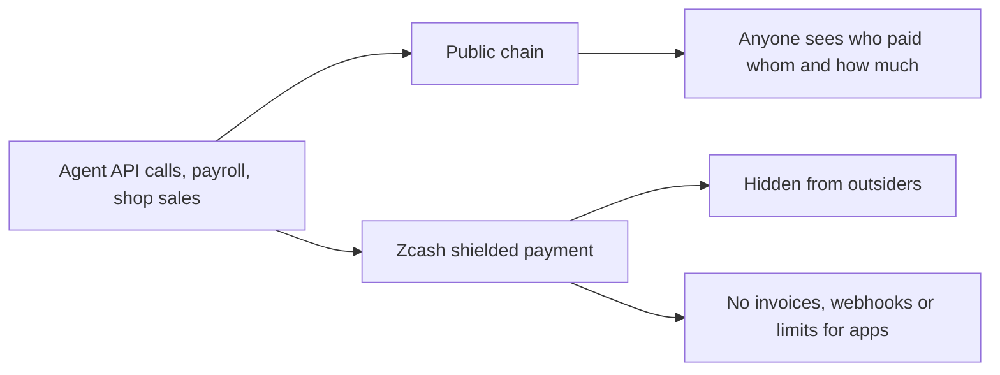
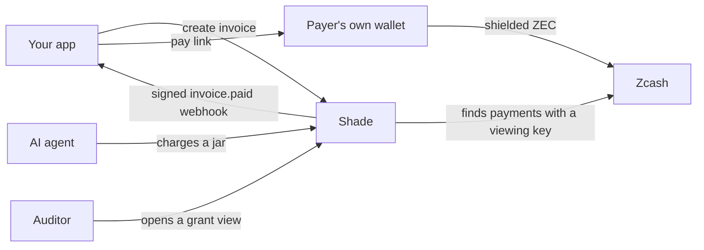
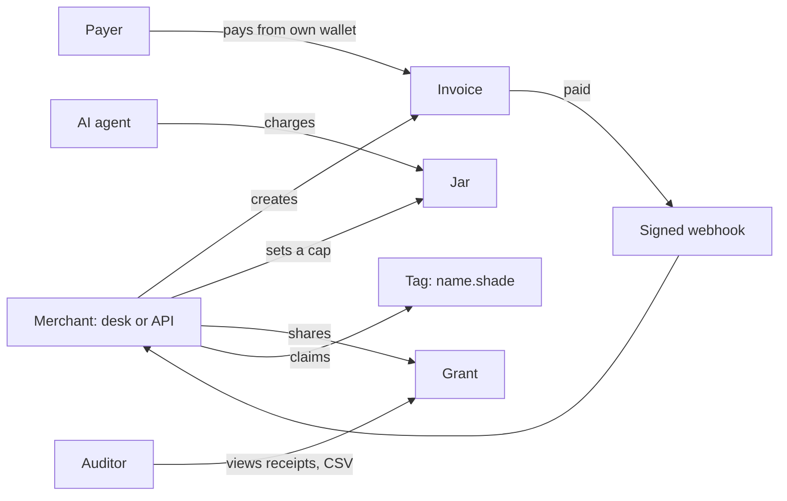
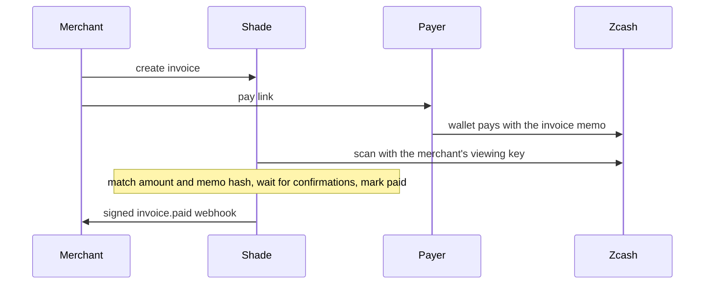
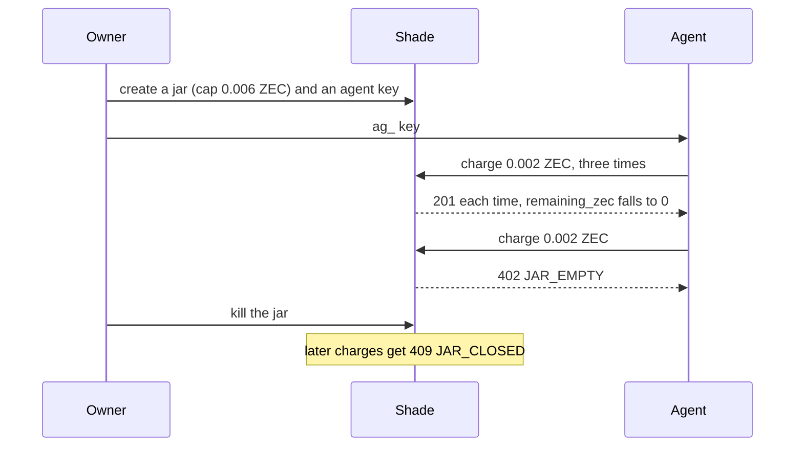
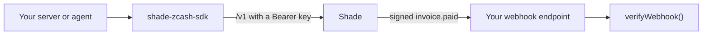
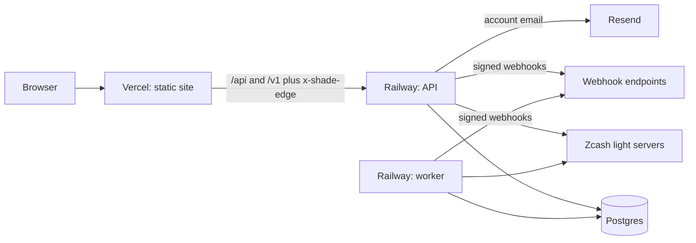

# Shade

Shade is the vendor layer on Zcash: private invoices, payment webhooks, agent spending limits and receipt views.

_Pay in the dark. Prove in the light. Keys stay yours._

**Live (testnet):** <https://shade-zcash.vercel.app> · **SDK:**
[`shade-zcash-sdk`](https://www.npmjs.com/package/shade-zcash-sdk) on npm

Shade is not a wallet and never holds seed phrases or spending keys. Payers use their own shielded wallet through
[ZIP-321](https://zips.z.cash/zip-0321) payment links. Testnet by default. Amounts are in ZEC.

## The problem



## The solution



A viewing key reads payments but cannot spend them. Shade seals a key uploaded under **Settings → Detection** so only
its worker can open it, or `scan:local` keeps the key on your machine.

## Features



| Feature  | What it does                                                   |
| -------- | -------------------------------------------------------------- |
| Invoice  | A pay page with a QR code and a ZIP-321 payment link           |
| Webhooks | Signed `invoice.paid` events, retried for about 3 days         |
| Jar      | A spending cap for an AI agent. The owner can kill it.         |
| Grant    | Revocable auditor receipt view and CSV, 10 minutes to 90 days  |
| Tag      | A `name.shade` name for a merchant's receive address           |
| Desk     | Merchant dashboard: Invoices, Jars, Grants, Webhooks, Settings |

## How a payment works



Default confirmations: 1 on testnet, 10 on mainnet. A scan match sets `verification: ivk_scan`. The fallbacks set
`verification: merchant_accept`: **Confirm** (or reject) the txid (transaction id) a payer pasted, or **Record payment**
with a txid from your wallet, the way on testnet for now ([Known issue](#known-issue-testnet-detection-after-nu7)). Open
invoices expire or can be cancelled; a payment mined up to 60 minutes after expiry still counts.

## Agent jars



## For developers



```ts
import { Shade, verifyWebhook } from "shade-zcash-sdk";

const baseUrl = "http://localhost:5173"; // your Shade origin (development)
const shade = new Shade({ apiKey: process.env.SHADE_API_KEY!, baseUrl });
const invoice = await shade.invoices.create({ amountZec: "0.01", memo: "order_1042" });
// Send the payer to invoice.payUrl.

// Raw body, not parsed JSON. Throws if the signature is wrong or over 5 minutes old.
const event = await verifyWebhook(rawBody, request.headers, process.env.SHADE_WEBHOOK_SECRET!);
if (event.type === "invoice.paid") {
  // Fulfil event.invoiceId. Deliveries can repeat: dedupe by event.id.
}

// An agent with its ag_ key: over the cap this throws ShadeError code "JAR_EMPTY".
const agent = new Shade({ apiKey: process.env.SHADE_AGENT_KEY!, baseUrl });
const { remainingZec } = await agent.jars.charge(jarId, { amountZec: "0.002", memo: "api:search" });
```

Endpoints:

- **Invoices:** `POST /v1/invoices` · `GET /v1/invoices` · `GET /v1/invoices/:id` · `POST /v1/invoices/:id/cancel`
- **Own scanner:** `POST /v1/invoices/:id/detections` reports a payment your own scanner found
- **Jars:** `POST /v1/jars` · `GET /v1/jars/:id` · `POST /v1/jars/:id/charge` · `POST /v1/jars/:id/kill`
- **Grants:** `POST /v1/grants` · `POST /v1/grants/:id/revoke`
- **Webhooks:** `POST /v1/webhooks` · `GET /v1/webhooks` · `DELETE /v1/webhooks/:id`
- **Tags:** `POST /v1/tags` · `GET /v1/tags/:name` (no key needed)

Keys go in `Authorization: Bearer <key>` and are shown once. `sk_test_…` (testnet) and `sk_live_…` (mainnet), from
**Settings → API keys**, call all of `/v1`. An `ag_…` key, from **Jars → Agent key**, takes its jar's network and
can only charge and read its own jar.

- `Idempotency-Key` on invoice, jar and charge creation: a retry never creates or charges twice.
- Without the SDK, check `X-Shade-Signature-V2: t=…,v1=…`. `v1` is the hex HMAC-SHA256 of `t`, a dot and the raw
  body, keyed with the whole `whsec_…` secret. Reject an old `t`. `X-Shade-Signature` is the older body-only form.
- Install the SDK with `npm install shade-zcash-sdk` (Node 20+, no runtime dependencies; source in `backend/sdk`).
  Shade is self-hosted, so always pass `baseUrl`.
- Reference: [backend/sdk/README.md](backend/sdk/README.md) and `/docs` in the web app (webhook checks in Node,
  Python and Go).

## Run it locally

You need **Node 24+** (`.nvmrc`) and npm, but no Postgres or Zcash node.

```bash
npm install
npm run dev
```

- <http://localhost:5173> is the web app. It proxies `/api` and `/v1` to the API on <http://localhost:8787>
  (`/healthz`, `/readyz`), which runs the worker (payment scanner, webhook retries) and reads public testnet light
  servers.
- Data: embedded Postgres (PGlite) and generated dev secrets in `backend/.data/`. Emails print to the backend console.
- A `PORT` set in your shell moves the API. Unset it, or set `VITE_API_PROXY_TARGET` to the API's address.

### Try the full flow

1. Sign up at <http://localhost:5173/signup>, then sign in.
2. **Settings → Receive addresses & network:** paste a testnet Unified Address (`utest1…`). Without a wallet, use the
   public test address below to create invoices and view pay pages. It belongs to the BIP-39 test mnemonic
   (`abandon … about`), so **anyone can spend what it holds: never send real funds to it**.

   ```text
   utest16gxxqp2n35ze6p2qzlxx2sd0e9s6favez0spnxe6f8useeew37hkm5zrk90373268u70e3l6en9dav8ytzp2q5lnj4gvjcprkg63xcxc
   ```

   To pay for real, use your own address in [Zingo](https://zingolabs.org) on testnet, with free test ZEC (TAZ) from
   the [faucet](https://zcashfaucet.jinolabs.xyz).

3. **Invoices → New invoice → Open pay page:** QR code, **Open in wallet** and **Pay by hand** (address, amount, exact
   memo).
4. **Webhooks:** add `SHADE_WEBHOOK_ALLOW_PRIVATE=true` to `backend/.env` (development only) and restart. Add
   `http://127.0.0.1:8790/`, put its `whsec_…` secret (shown once) in `SHADE_WEBHOOK_SECRET` and run
   `npm run demo:receiver -w @shade/backend`. **Send test** makes the receiver print `webhook.test`.
5. **Pay** from your wallet. When it shows the payment confirmed, check the amount and memo there, then press **Record
   payment** on the invoice row and paste the txid. The receiver prints `invoice.paid`.
6. **Grants → New grant:** open the view link in a private window and download the CSV. **Revoke** ends both.
7. **Jars → New jar** (cap `0.006`), then **Agent key**. Put the `ag_…` key in `SHADE_AGENT_KEY` and run
   `npm run demo:agent -w @shade/backend -- --jar <jar_id> --times 4` (the jar id is on its card): three charges,
   then `402 JAR_EMPTY`.

On Windows, set variables in `backend/.env` (the scripts load it) or in PowerShell: `$env:SHADE_AGENT_KEY = "ag_…"`.

### Useful commands

```bash
npm run typecheck && npm run lint && npm run build   # build: SDK and frontend
npm test           # fake chain, no network; set TEST_DATABASE_URL to add the race tests on Postgres
npm run test:e2e   # Playwright (first run: npx playwright install chromium)
npm run scan:local -w @shade/backend -- --network testnet   # scan on your machine (SHADE_API_KEY, SHADE_UFVK)
SHADE_LIVE_TESTS=1 npx vitest run --project backend test/zcash/live   # live testnet checks
```

- Stop `npm run dev` before `npm run test:e2e`: outside CI the tests reuse servers on :8787 and :5173 and write to
  your dev database.
- `demo:agent` and `scan:local` call `SHADE_API_URL` (default `http://localhost:5173`). Set it to use a deployed Shade.

## Deploy



- **Vercel** serves `frontend/` (root directory, files outside it included, Node 24.x). The two proxy routes in
  `frontend/vercel.json` point at the API (now the live Railway one; change them for your own deploy).
- **Railway** runs `backend/Dockerfile` as the API (healthcheck `/healthz`) and the worker
  (`node /app/backend/src/bin/worker.ts`). Migrate first: pre-deploy command `node /app/backend/src/bin/migrate.ts`
  or `npm run db:migrate`. On Postgres, neither starts while a migration is pending.
- **Postgres 15+** (reference: Neon; Supabase: [AGENTS.md](AGENTS.md) §12.1): `DATABASE_URL` pooled,
  `DATABASE_URL_UNPOOLED` direct, not a transaction-mode pooler.
- Set `NODE_ENV=production` (the Docker image does; `npm start` does not), or the backend runs in development mode
  (no email verification, generated secrets). Production refuses to start without `DATABASE_URL`, `APP_ORIGIN`,
  `BETTER_AUTH_SECRET`, `SHADE_ENCRYPTION_KEY` and, with email verification on (the default), `MAIL_TRANSPORT=resend`,
  `RESEND_API_KEY` and `MAIL_FROM`. Use a `MAIL_FROM` domain verified in Resend.
- Give Vercel's `SHADE_EDGE_SECRET` and the API's `EDGE_SHARED_SECRET` one value, Vercel first (then redeploy it):
  once the API has it, `/api/*` without `x-shade-edge` gets 403.
- On Railway, the API also needs `TRUST_PROXY_DIRECT=x-real-ip`, and `TRUST_PROXY=none` until the client-IP check in
  [AGENTS.md](AGENTS.md) §12.8 passes.
- Hosted detection (optional) needs a keypair from `npm run -s keys:seal -w @shade/backend`: public key on the API,
  private key (it opens every uploaded viewing key) on the worker only.
- One machine: copy `backend/.env.example` to `backend/.env` and `backend/.env.worker.example` to
  `backend/.env.worker`, then run `docker compose -f backend/docker-compose.yml up --build` (Postgres, migrations,
  API, worker). Add TLS and backups yourself.
- Full steps and checklist: [AGENTS.md](AGENTS.md) §12 and §10.

## Known issue: testnet detection after NU7

Testnet turned on the NU7 network upgrade at height 4,465,026 (2026-10-04). Shade's pinned scanner,
`@ledgerhq/zcash-utils` 2.5.0 (newest release on 2026-10-06), cannot read NU7 transactions: hosted detection and
`scan:local` fail when a payment arrives (**Settings → Detection** shows the error; nothing is marked paid by mistake).
Use **Record payment** or **Confirm** until a new release passes a real payment test. Mainnet NU7 (about 2026-11-05)
breaks the same way unless the scanner is updated first.

## Honest limits

- Kill stops new jar charges. It does not move ZEC: move leftover ZEC in your wallet.
- Revoke stops Shade from serving a grant. It cannot erase a file the auditor already downloaded.
- Hosted detection needs a full viewing key, which also reveals outgoing payments. Use a receive-only account, or run
  `scan:local` on your own machine.
- The public light server Shade asks can see which transactions Shade looks up. Run your own for mainnet.
- A merchant's pay pages all show one address, so anyone who compares two can link them.
- A txid the payer pastes never marks an invoice paid. The invoice stays `paid_unverified` until a scan matches it or
  the merchant confirms it.
- **Confirm** and **Record payment** check that the transaction is shielded, newer than the invoice and mined. Shade
  cannot see its amount or memo: check both in your wallet first.
- Moving ZEC between Zcash pools reveals the amount moved.
- Paid is final, even if the chain later reorganizes.
- Payments use Zcash's shielded pool today. When Zcash upgrades keys, Shade follows. Shade makes no quantum-safe claim.

## Repository and docs

`frontend/`: Vite + React web app. `backend/`: Hono API, worker, Postgres migrations and Zcash code. Docs:
[AGENTS.md](AGENTS.md) (engineering guide), [backend/sdk/README.md](backend/sdk/README.md) (SDK),
[docs/demo.md](docs/demo.md) (the 90-second demo script) and [prd.md](prd.md) (product requirements).
