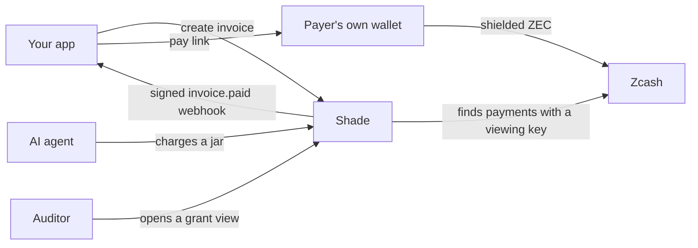
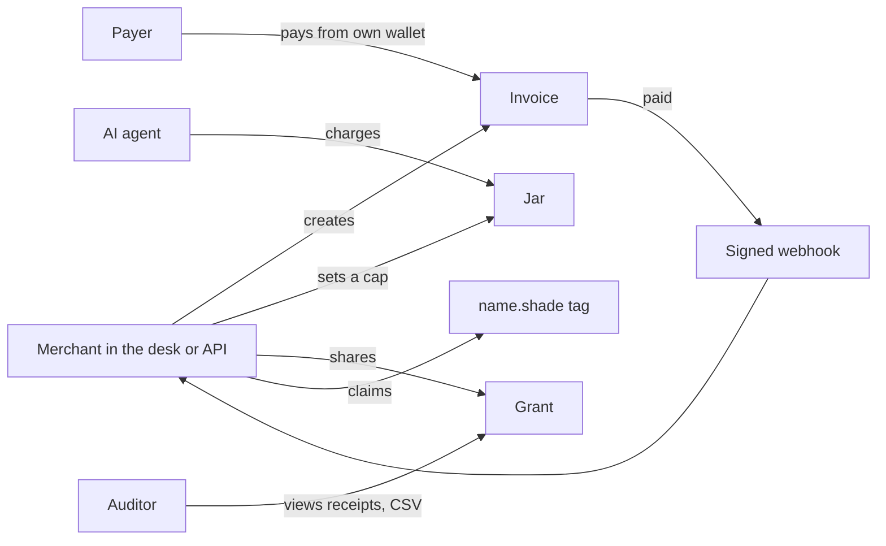
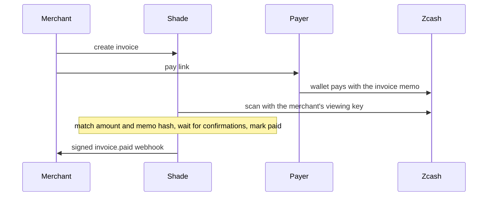
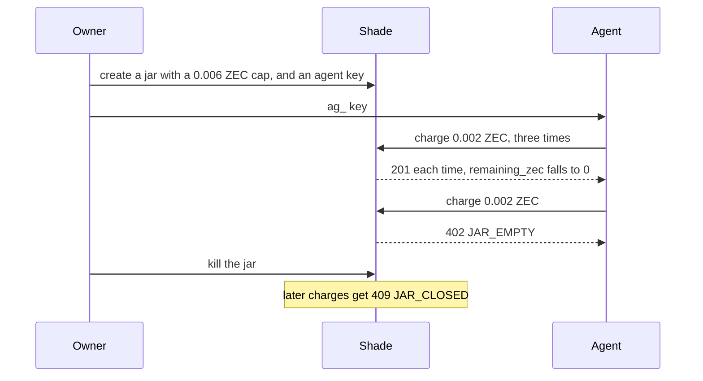
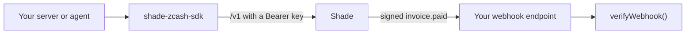
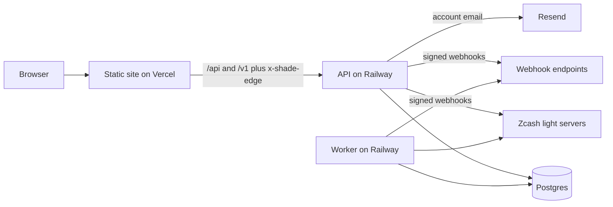

# Shade

_Pay in the dark. Prove in the light. Keys stay yours._

Shade lets online shops and SaaS apps take private Zcash payments and put their AI agents on a spending cap.

Zcash already hides who paid whom and how much. On top of that, Shade makes invoices with a pay page and posts a signed
webhook to your server when shielded ZEC arrives. It refuses an AI agent's charge once the agent hits its cap. An
auditor gets a receipt view that lasts from 10 minutes to 90 days.

Shade is not a wallet. It never holds seed phrases or spending keys, and payers use their own shielded wallet through
[ZIP-321](https://zips.z.cash/zip-0321) payment links. Amounts are in ZEC, and testnet is the default network.

Try it on testnet at <https://shade-zcash.vercel.app>. The TypeScript SDK is
[`shade-zcash-sdk`](https://www.npmjs.com/package/shade-zcash-sdk) on npm.

## The problem

On a public chain, anyone can read who paid whom and how much. That covers a shop's sales, a payroll run and an agent
paying for API calls. Zcash shielded payments hide all of it, but the protocol gives apps no invoices, webhooks or
spending limits.


## How Shade fixes it

Your app creates an invoice and sends the payer a link. The payer's own wallet pays in shielded ZEC. Shade finds the
payment with your viewing key and tells your app with a signed `invoice.paid` webhook.



A viewing key can read payments but cannot spend them. When you upload one under **Settings → Detection**, Shade
encrypts it with a public key whose private half lives only on its background worker, so the API cannot read it. To
keep the key off Shade entirely, run `scan:local` on your own machine.

## Features

Merchants work in the desk, which is Shade's web dashboard, or call the `/v1` API.



| Feature  | What it does                                                                           |
| -------- | -------------------------------------------------------------------------------------- |
| Invoice  | A pay page with a QR code and a ZIP-321 payment link                                   |
| Webhooks | Signed `invoice.paid` events, retried for about 3 days                                 |
| Jar      | A spending cap for an AI agent. The owner can kill it.                                 |
| Grant    | A receipt view and CSV for an auditor, from 10 minutes to 90 days. Revoke it any time. |
| Tag      | A `name.shade` name that points to a merchant's receive address                        |
| Desk     | The merchant dashboard, with Invoices, Jars, Grants, Webhooks and Settings             |

## How a payment works

The payer's wallet writes the invoice memo into the payment. Shade matches the amount and a hash of the memo, then
waits for confirmations.



By default, Shade marks an invoice paid after 1 confirmation on testnet and 10 on mainnet. A scanner match sets
`verification` to `ivk_scan`.

You can also settle a payment by hand in the desk, which sets `verification` to `merchant_accept`. **Confirm** accepts
a transaction id, or txid, that the payer pasted on the pay page, and **Reject** turns it down. **Record payment** takes
a txid from your own wallet. On testnet these buttons are the only way to settle for now, because of
[a scanner problem](#known-issue-with-testnet-detection).

An invoice expires after 1 hour unless you pick a time between 1 minute and 7 days. You can cancel an open invoice. A
payment mined up to 60 minutes after expiry still counts.

## Agent jars

A jar is a spending cap that Shade records. No ZEC moves when you create, charge or kill a jar, and the money stays in
your wallet. Each charge checks the cap and debits the jar in one database statement, so ten charges sent at the same
moment still cannot pass the cap.



## For developers

Your server or agent calls the `/v1` API through the SDK. Your webhook endpoint checks each signed `invoice.paid` with
`verifyWebhook()`.



```ts
import { Shade, verifyWebhook } from "shade-zcash-sdk";

const baseUrl = "http://localhost:5173"; // your Shade origin, here the local dev web app
const shade = new Shade({ apiKey: process.env.SHADE_API_KEY!, baseUrl });
const invoice = await shade.invoices.create({ amountZec: "0.01", memo: "order_1042" });
// Send the payer to invoice.payUrl.

// Pass the raw body, not parsed JSON. This throws if the signature is wrong or over 5 minutes old.
const event = await verifyWebhook(rawBody, request.headers, process.env.SHADE_WEBHOOK_SECRET!);
if (event.type === "invoice.paid") {
  // Fulfil event.invoiceId. Deliveries can repeat, so dedupe by event.id.
}

// An agent uses its ag_ key. Over the cap, charge() throws a ShadeError with code "JAR_EMPTY".
const agent = new Shade({ apiKey: process.env.SHADE_AGENT_KEY!, baseUrl });
const { remainingZec } = await agent.jars.charge(jarId, { amountZec: "0.002", memo: "api:search" });
```

| Method   | Path                          | What it does                                 |
| -------- | ----------------------------- | -------------------------------------------- |
| `POST`   | `/v1/invoices`                | Create an invoice                            |
| `GET`    | `/v1/invoices`                | List invoices, newest first                  |
| `GET`    | `/v1/invoices/:id`            | Read one invoice                             |
| `POST`   | `/v1/invoices/:id/cancel`     | Cancel an open invoice or a jar charge       |
| `POST`   | `/v1/invoices/:id/detections` | Report a payment that your own scanner found |
| `POST`   | `/v1/jars`                    | Create a jar                                 |
| `GET`    | `/v1/jars/:id`                | Read a jar's cap, spend and remaining budget |
| `POST`   | `/v1/jars/:id/charge`         | Charge a jar                                 |
| `POST`   | `/v1/jars/:id/kill`           | Kill a jar                                   |
| `POST`   | `/v1/grants`                  | Create a grant                               |
| `POST`   | `/v1/grants/:id/revoke`       | Revoke a grant                               |
| `POST`   | `/v1/webhooks`                | Add a webhook endpoint                       |
| `GET`    | `/v1/webhooks`                | List webhook endpoints, without secrets      |
| `DELETE` | `/v1/webhooks/:id`            | Delete a webhook endpoint                    |
| `POST`   | `/v1/tags`                    | Claim a `name.shade` name                    |
| `GET`    | `/v1/tags/:name`              | Resolve a name. This one needs no key.       |

Send a key as `Authorization: Bearer <key>`. Shade shows each key once. Server keys come from **Settings → API keys**.
An `sk_test_…` key works on testnet and an `sk_live_…` key on mainnet, and both can call every route above. An agent
key, `ag_…`, comes from **Jars → Agent key**. It works on its jar's network and can only charge and read that one jar.

- Send an `Idempotency-Key` header when you create an invoice or a jar, or charge a jar. A retry with the same key
  within 24 hours gets the first answer back, and Shade never creates or charges twice.
- Without the SDK, check the `X-Shade-Signature-V2: t=…,v1=…` header. `v1` is the hex HMAC-SHA256 of `t`, a dot and
  the raw body, keyed with the whole `whsec_…` secret. Reject an old `t`. `X-Shade-Signature` is the older form, which
  signs the body alone.
- Install the SDK with `npm install shade-zcash-sdk`. It runs on Node 20 or newer, has no runtime dependencies and
  lives in `backend/sdk`. Its `baseUrl` defaults to the live testnet site. Pass your own origin when you run Shade
  yourself.
- The [SDK README](backend/sdk/README.md) documents every call. The web app's `/docs` page, live at
  <https://shade-zcash.vercel.app/docs>, shows webhook checks in Node, Python and Go.

## Run it locally

You need Node 24 or newer and npm. `.nvmrc` names the version. You do not need Postgres or a Zcash node.

```bash
npm install
npm run dev
```

- The web app runs on <http://localhost:5173> and forwards `/api` and `/v1` to the API on <http://localhost:8787>.
  The API also answers `/healthz` and `/readyz`.
- The API runs the worker in the same process. The worker scans public testnet light servers for payments and retries
  webhooks.
- `backend/.data/` holds the generated dev secrets and a PGlite database, which is Postgres embedded in Node. Emails
  print to the backend console.
- If your shell sets `PORT`, the API moves to that port. Unset it, or point `VITE_API_PROXY_TARGET` at the API.

### Try the full flow

1. Sign up at <http://localhost:5173/signup>, then sign in.
2. In **Settings → Receive addresses & network**, paste a testnet Unified Address, which starts with `utest1`. With
   no wallet yet, the public test address below is enough to create invoices and see pay pages. It belongs to the
   BIP-39 test mnemonic `abandon … about`, so **anyone can spend what it holds. Never send real funds to it.**

   ```text
   utest16gxxqp2n35ze6p2qzlxx2sd0e9s6favez0spnxe6f8useeew37hkm5zrk90373268u70e3l6en9dav8ytzp2q5lnj4gvjcprkg63xcxc
   ```

   To make a real testnet payment, use your own address in [Zingo](https://zingolabs.org) on testnet. The
   [faucet](https://zcashfaucet.jinolabs.xyz) gives out free test ZEC, called TAZ.

3. In **Invoices → New invoice**, create an invoice, then press **Open pay page**. The page shows a QR code, an
   **Open in wallet** button and **Pay by hand**, which lists the address, the amount and the exact memo.
4. Add `SHADE_WEBHOOK_ALLOW_PRIVATE=true` to `backend/.env` and restart. It lets a development server post to `http`
   and local addresses, and production refuses to start with it. Under **Webhooks**, add `http://127.0.0.1:8790/`.
   Put its `whsec_…` secret, which Shade shows once, in `SHADE_WEBHOOK_SECRET` and run
   `npm run demo:receiver -w @shade/backend`. Press **Send test**, and the receiver prints `webhook.test`.
5. Pay from your wallet. When the wallet shows the payment confirmed, check the amount and memo there. Then press
   **Record payment** on the invoice row and paste the txid. The receiver prints `invoice.paid`.
6. In **Grants → New grant**, create a grant. Open its view link in a private window and download the CSV. **Revoke**
   ends both.
7. In **Jars → New jar**, create a jar with a cap of `0.006`, then press **Agent key**. Put the `ag_…` key in
   `SHADE_AGENT_KEY` and run the command below with the jar id from the jar's card. You get three charges, then
   `402 JAR_EMPTY`.

   ```bash
   npm run demo:agent -w @shade/backend -- --jar <jar_id> --times 4
   ```

On Windows, put variables in `backend/.env`, which the scripts load, or set them in PowerShell first, like
`$env:SHADE_AGENT_KEY = "ag_…"`.

### Useful commands

```bash
npm run typecheck && npm run lint && npm run build   # build compiles the SDK and the frontend
npm test           # fake chain, no network. TEST_DATABASE_URL adds the Postgres race tests
npm run test:e2e   # Playwright. Run npx playwright install chromium once first
npm run scan:local -w @shade/backend -- --network testnet   # scan on your machine with SHADE_API_KEY and SHADE_UFVK
SHADE_LIVE_TESTS=1 npx vitest run --project backend test/zcash/live   # live testnet checks
```

- Stop `npm run dev` before `npm run test:e2e`. Outside CI, the tests reuse the servers on ports 8787 and 5173 and
  write to your dev database.
- `demo:agent` and `scan:local` call `SHADE_API_URL`, which defaults to `http://localhost:5173`. Set it to use a
  deployed Shade.

## Deploy

The reference deploy puts the web app on Vercel, the API and the worker on Railway, the database on a hosted Postgres
such as Neon or Supabase, and account email on Resend.



- Vercel serves `frontend/`. Set the project's root directory to `frontend`, allow files outside it and use Node
  24.x. The two proxy routes in `frontend/vercel.json` point at the live Railway API. Change them for your own deploy.
- Railway runs `backend/Dockerfile` as two services. The API uses the image's default command and a `/healthz`
  healthcheck. The worker starts with `node /app/backend/src/bin/worker.ts`.
- Run the migrations before new processes start, with the pre-deploy command `node /app/backend/src/bin/migrate.ts`
  or with `npm run db:migrate`. On Postgres, neither the API nor the worker starts while a migration is pending.
- Use Postgres 15 or newer. Set `DATABASE_URL` to a pooled connection and `DATABASE_URL_UNPOOLED` to a direct or
  session-mode one, never a transaction-mode pooler. Supabase's settings are in [AGENTS.md](AGENTS.md) §12.1.
- Set `NODE_ENV=production`. The Docker image sets it, and `npm start` does not. Without it the backend runs in
  development mode, with no email verification and generated secrets.
- Production refuses to start without `DATABASE_URL`, `APP_ORIGIN`, `BETTER_AUTH_SECRET` and `SHADE_ENCRYPTION_KEY`.
  With email verification on, which is the default, it also needs `MAIL_TRANSPORT=resend`, `RESEND_API_KEY` and a
  `MAIL_FROM` on a domain verified in Resend.
- Give Vercel's `SHADE_EDGE_SECRET` and the API's `EDGE_SHARED_SECRET` the same value. Set it on Vercel first and
  redeploy the frontend. Once the API has it, any `/api/*` request without the `x-shade-edge` header gets 403.
- On Railway the API also needs `TRUST_PROXY_DIRECT=x-real-ip`. Keep `TRUST_PROXY=none` until the client-IP check in
  [AGENTS.md](AGENTS.md) §12.8 passes.
- Hosted detection is optional. It needs a keypair from `npm run -s keys:seal -w @shade/backend`. The public key goes
  on the API. The private key opens every uploaded viewing key. Put it on the worker and nowhere else.
- For a single machine, copy `backend/.env.example` to `backend/.env` and `backend/.env.worker.example` to
  `backend/.env.worker`. Then `docker compose -f backend/docker-compose.yml up --build` starts Postgres, runs the
  migrations and starts the API and the worker. Add TLS and backups yourself.
- [AGENTS.md](AGENTS.md) §12 has every deploy step, and §10 is the checklist.

## Known issue with testnet detection

Testnet turned on the NU7 network upgrade at height 4,465,026 on 2026-10-04. Shade pins its scanner to
`@ledgerhq/zcash-utils` 2.5.0, the newest release on 2026-10-06, and that version cannot read NU7 transactions. Hosted
detection and `scan:local` both fail when a payment arrives. **Settings → Detection** shows the error, and Shade marks
nothing paid by mistake.

Settle testnet payments with **Record payment** or **Confirm** until a new scanner release passes a real payment test.
Mainnet turns on NU7 around 2026-11-05 and will break the same way unless Shade updates the scanner first.

## Honest limits

- Kill stops new jar charges. It moves no ZEC. Move leftover ZEC in your wallet yourself.
- Revoke stops Shade from serving a grant. It cannot erase a CSV the auditor already downloaded.
- Hosted detection needs a full viewing key, and that key also shows your outgoing payments. Use a receive-only
  account, or run `scan:local` on your own machine.
- The public light server that Shade asks can see which transactions Shade looks up. Run your own for mainnet.
- All of a merchant's pay pages show the same address. Anyone who compares two of them can link them.
- A txid the payer pastes never marks an invoice paid. The invoice stays `paid_unverified` until a scan matches it or
  the merchant confirms it.
- **Confirm** and **Record payment** check that the transaction is shielded, newer than the invoice, mined with
  enough confirmations and not used by another invoice. Shade cannot see its amount or memo. Your wallet can, so check
  both there first.
- Moving ZEC between Zcash pools reveals the amount moved.
- Paid is final, even if the chain later reorganizes.
- Payments use Zcash's shielded pool today. When Zcash upgrades keys, Shade follows. Shade makes no quantum-safe claim.

## Repository and docs

`frontend/` holds the Vite and React web app. `backend/` holds the Hono API, the worker, the Postgres migrations and
the Zcash code, and the SDK sits in `backend/sdk/`.

- [AGENTS.md](AGENTS.md) is the engineering guide.
- [backend/sdk/README.md](backend/sdk/README.md) documents the SDK.
- [docs/demo.md](docs/demo.md) is the 90-second demo script.
- [prd.md](prd.md) holds the product requirements.

The code is under the [MIT license](LICENSE).
