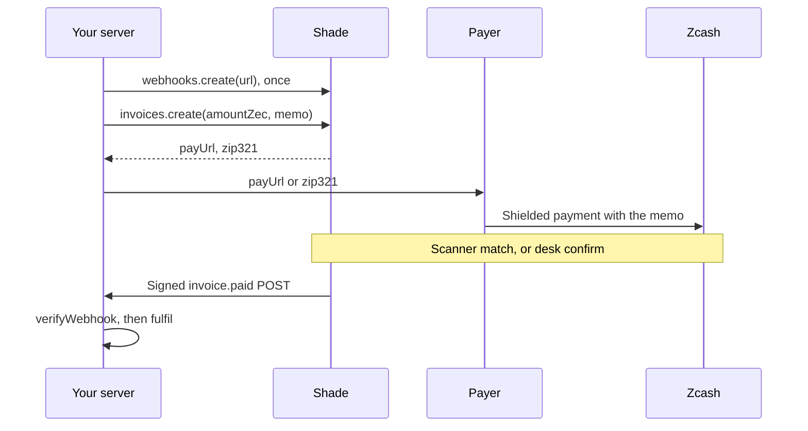
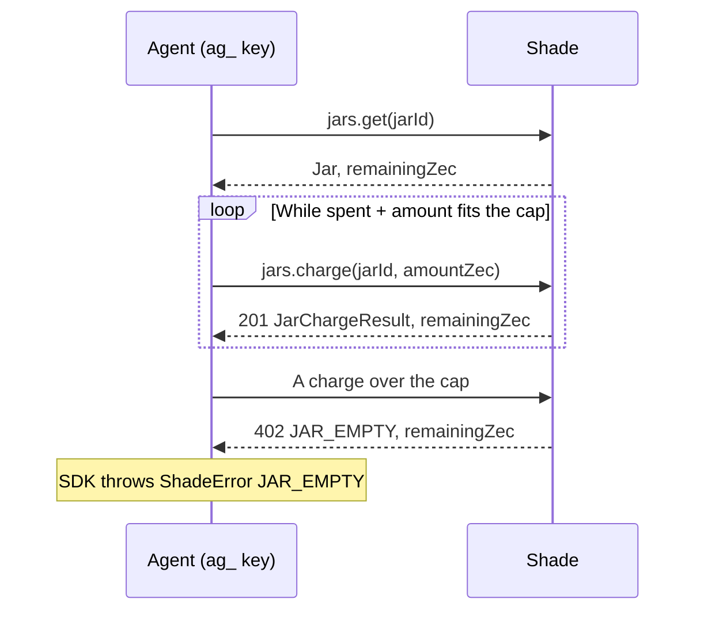
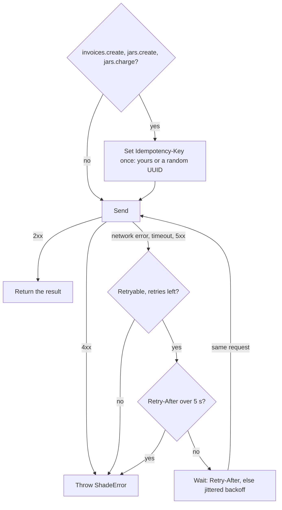
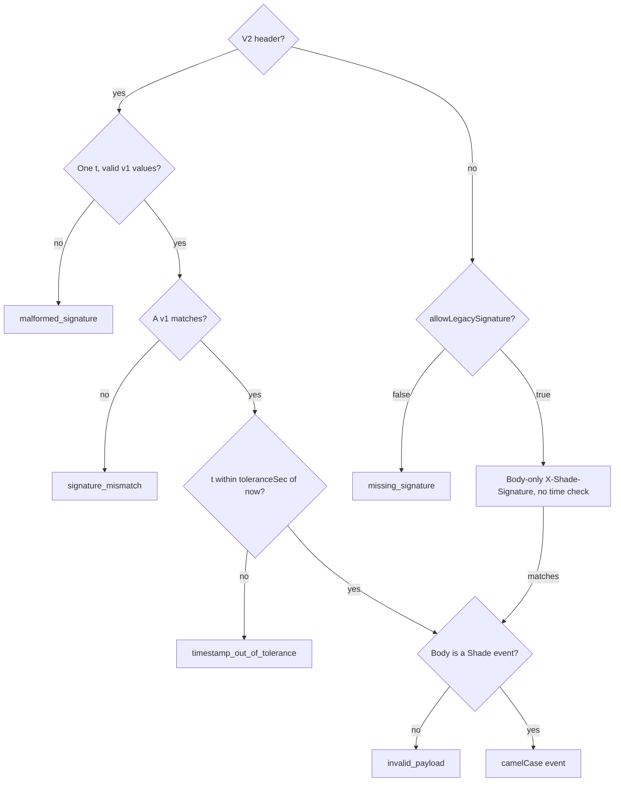

# shade-zcash-sdk

TypeScript client for the [Shade](https://github.com/billi-x4/Shade/blob/main/README.md) `/v1` API (private Zcash payments), for servers and agent runtimes:
invoices with a pay page (`payUrl`) and `zcash:` URI (`zip321`), signed `invoice.paid` webhooks, AI agent spending
caps (`jars`), auditor receipt links (`grants`) and `name.shade` handles for your receive address (`tags`).

No runtime dependencies (`fetch`, WebCrypto). Node 20+, edge runtimes and browsers (never with a key). The HTTP API is
snake_case (`pay_url`), the SDK camelCase (`payUrl`). Amounts are decimal ZEC strings (`"0.01"`), never floats; times
are ISO 8601 strings.

## Install

```bash
npm install shade-zcash-sdk
```

Inside the Shade repository it is the npm workspace `backend/sdk`: `npm run build -w shade-zcash-sdk` writes
`backend/sdk/dist` (ESM + `.d.ts`).

## Quick start

1. In the desk, add a receive address for your network (**Settings → Receive addresses & network**). Without one,
   `invoices.create`, `jars.create` and `tags.create` fail with 409 `NO_ADDRESS`.
2. Create a server key under **Settings → API keys** (`sk_test_…` on testnet; shown once).
3. Call Shade from your server:

```ts
import { Shade } from "shade-zcash-sdk";

const shade = new Shade({
  apiKey: process.env.SHADE_API_KEY!, // sk_test_… or sk_live_…
  baseUrl: "http://localhost:5173", // your Shade origin (here the local dev web app)
});

const invoice = await shade.invoices.create({ amountZec: "0.01", memo: "order 1042" });
// Send the payer to invoice.payUrl, or give their wallet invoice.zip321.
```

- `apiKey` (required): `sk_test_…` (testnet), `sk_live_…` (mainnet) or an agent's `ag_…` (own jar only). Resources on
  the other network answer 404.
- `baseUrl`: **your Shade origin**, without `/v1` (Shade is self-hosted): your web app (it proxies `/v1`) or API. The
  default, `https://shade-zcash.vercel.app`, is only the hosted service. A wrong one fails every call with
  `NETWORK_ERROR`, `UNEXPECTED_RESPONSE` (not Shade) or 401 `UNAUTHORIZED` (that Shade does not know your key).
- `timeoutMs` (default `10000`): per attempt, request and response body included.
- `maxRetries` (default `1`): extra attempts for retryable calls.
- `fetch` (default `globalThis.fetch`): any fetch-compatible function.

**Never put an `sk_…` or `ag_…` key in a browser.** `/v1` allows any origin (CORS `*`), so anyone reading the page can
use it.

## How a payment reaches you



- Fulfil only on `paid` (the `invoice.paid` event, or `status: "paid"` from `invoices.get`). `paid_unverified` means
  the payer pasted a txid: a claim, not proof. An `expired` invoice still turns `paid` if its payment was mined within
  60 minutes after expiry.
- For automatic detection, upload a full viewing key under **Settings → Detection** (it also reveals your outgoing
  payments), or keep it local with `npm run scan:local -w @shade/backend` (full command on that page). Otherwise you
  confirm each payment in the desk.
- **Testnet limit (verified 2026-10-06):** since NU7 reached testnet (2026-10-04), the scanner (hosted and
  `scan:local`) cannot read new testnet payments. Settle them in the desk: **Confirm** a txid the payer pasted, or
  **Record payment** with the txid from your wallet (`verification: "merchant_accept"`). Mainnet hits this at its NU7
  (planned for about 2026-11-05) unless Shade updates its scanner first ([AGENTS.md](https://github.com/billi-x4/Shade/blob/main/AGENTS.md)).

## Methods

Every method takes an optional last argument `{ signal }` to abort the call (`ShadeConnectionError` code `ABORTED`).
`invoices.create`, `jars.create` and `jars.charge` also take `{ idempotencyKey }`.

- `invoices.create({ amountZec, memo?, expiresInSec?, tag? })`: `POST /v1/invoices` → `PayableInvoice`. `memo`: up
  to 495 UTF-8 bytes; Shade appends a reference to make `chainMemo`, the memo the wallet writes on chain.
  `expiresInSec`: 60–604,800 (7 days), default 3,600 (1 hour). `tag`: a grant label such as `payroll` (letters,
  digits, `-`, `_`, up to 32 characters; `all` is reserved), not a `name.shade` tag.
- `invoices.get(id)`: `GET /v1/invoices/:id` → `Invoice`.
- `invoices.list({ status?, expiresAfter?, cursor?, limit? })`: `GET /v1/invoices` → `Page<PayableInvoice>`, newest
  first; pass `page.nextCursor` as `cursor` until it is `null`. `status`: one or an array
  (`["open", "paid_unverified"]`). `expiresAfter` (a `Date`, or ISO 8601 with `Z` or an offset, such as
  `"2026-10-06T12:00:00Z"`) keeps invoices that expire later. `limit`: 1–100, default 25. Excludes jar charges.
- `invoices.cancel(id)`: `POST /v1/invoices/:id/cancel` → `Invoice`.
- `invoices.reportDetection(id, { txid, amountZec, memoHash, pool, source? })`: `POST /v1/invoices/:id/detections` →
  `Invoice`. Reports a payment your own scanner (such as `scan:local`) found with your viewing key. `pool`:
  `ironwood`, `orchard` or `sapling`. `memoHash`: `sha256:` + hex SHA-256 of the 512-byte memo field. Shade checks
  the transaction on chain; amount and memo hash must equal the invoice's.
- `jars.create({ capZec, label })`: `POST /v1/jars` → `Jar`.
- `jars.get(jarId)`: `GET /v1/jars/:id` → `Jar`.
- `jars.charge(jarId, { amountZec, memo? })`: `POST /v1/jars/:id/charge` → `JarChargeResult`.
- `jars.kill(jarId)`: `POST /v1/jars/:id/kill` → `Jar`.
- `grants.create({ scope, days?, expiresInSec? })`: `POST /v1/grants` → `GrantCreated`: a `viewUrl` that shows an
  auditor your receipts until it expires or you revoke it (`token` and `viewUrl` shown once). `scope`: `"all"` or an
  invoice `tag`. `days` 1–90 (default 7) or `expiresInSec` 600–7,776,000 (10 min–90 days), not both.
- `grants.revoke(id)`: `POST /v1/grants/:id/revoke` → `Grant`. Stops new access from Shade; files the viewer already
  exported stay on their machine.
- `webhooks.create({ url })`: `POST /v1/webhooks` → `WebhookEndpointCreated`, with the `whsec_…` signing `secret`
  once. Store it to verify deliveries.
- `webhooks.list()`: `GET /v1/webhooks` → `WebhookEndpoint[]`. Secrets show only their last 4 characters
  (`secretHint`).
- `webhooks.delete(id)`: `DELETE /v1/webhooks/:id` → `void`. With `list`, a setup script can replace an endpoint
  instead of adding one per deploy.
- `tags.create({ name })`: `POST /v1/tags` → `Tag`, claiming `<name>.shade` for your receive address.
- `tags.resolve(name)`: `GET /v1/tags/:name` → `TagResolution`. Public (no API key); takes `"asharib"` or
  `"asharib.shade"`.

**Limits** (409): per network 5 enabled webhook endpoints (`ENDPOINT_LIMIT`), 100 open jars (`JAR_LIMIT`), 100
active grants (`GRANT_LIMIT`), 10,000 unpaid invoices (`INVOICE_LIMIT`); per account 5 `name.shade` tags
(`TAG_LIMIT`). Requests: 600/min per API key; `tags.resolve` 60/min per IP (429 `RATE_LIMITED`).

## Agent jars

A jar is a spending limit that Shade records. Shade holds no ZEC: creating, charging or killing a jar moves none, so it
stays in your wallet.

1. Create a jar in the desk (**Jars → New jar**) or with `jars.create`.
2. Press **Agent key** on the jar (shown once) and give that `ag_…` key to the agent.
3. The agent can read and charge its jar. Any other call with its key gets 403 `FORBIDDEN`.



- Each charge is an `authorized` child invoice (`invoiceId`). `invoices.cancel(invoiceId)` with a merchant `sk_…` key
  returns its amount to the cap. The agent's key gets 403; on a killed jar, 409 `JAR_CLOSED`.
- `jars.kill` stops new charges: later ones get 409 `JAR_CLOSED` with `remainingZec`.

## Errors

A non-2xx answer, or none, throws a `ShadeError`:

```ts
import { ShadeError } from "shade-zcash-sdk";

try {
  const charge = await shade.jars.charge(jarId, { amountZec: "0.002", memo: "api:search" });
  console.log(`authorized ${charge.amountZec} · left ${charge.remainingZec}`);
} catch (err) {
  if (!(err instanceof ShadeError) || err.code !== "JAR_EMPTY") throw err;
  // 402: over the cap; a smaller charge may still fit. err.message: "Jar empty. The agent cannot spend."
  console.log(`left ${err.remainingZec}`);
}
```

- `status`: HTTP status, or `0` when no response arrived.
- `code`: stable, such as `JAR_EMPTY`, `JAR_CLOSED`, `NOT_FOUND`, `BAD_AMOUNT`. The type `ShadeApiErrorCode` lists
  every server code; an unknown future code passes through unchanged.
- `message`: the server's text. `requestId`: quote it when you report a problem.
- `remainingZec`: on `JAR_EMPTY` (402) and `JAR_CLOSED` (409).
- `retryAfter`: seconds, on `RATE_LIMITED` (429) and `CHAIN_UNAVAILABLE` (503).
- `issues`: on `INVALID_REQUEST` (400), `{ path, message }[]`, never your input values.

The SDK sets four codes itself. The first three have status `0` and throw `ShadeConnectionError`, a `ShadeError`
subclass with the underlying error in `cause`:

- `TIMEOUT`: no complete response within `timeoutMs`.
- `NETWORK_ERROR`: no HTTP response (DNS, connection, TLS, or a wrong `baseUrl`).
- `ABORTED`: your `signal` aborted the call.
- `UNEXPECTED_RESPONSE` (HTTP status kept): not a Shade JSON body, such as a proxy error page.

Bad options (`apiKey`, `baseUrl`, `timeoutMs`, `maxRetries`) or arguments (an empty id, a bad `idempotencyKey`, both
`days` and `expiresInSec`) throw a `TypeError` before any request. `fetch` is unchecked: a bad one fails each call with
`NETWORK_ERROR`.

## Retries and idempotency



Retryable: `invoices.create`, `jars.create`, `jars.charge`, `invoices.get`, `invoices.list`, `jars.get`,
`webhooks.list`, `tags.resolve`; no other call. Backoff starts at 150–300 ms and doubles, up to 5 s. A longer
`Retry-After` is not waited out: the error carries `retryAfter`. `maxRetries: 0` turns retries off.

**Idempotency.** If an attempt reached Shade but its response was lost, the retry replays the stored answer: one call
never charges a jar twice. The default key, a random UUID per call, covers only that call's retries. If your process
can crash or restart between a charge and recording it, pass your own key, derived from the paid work and reused when
you retry it:

```ts
await shade.jars.charge(
  jarId,
  { amountZec: "0.002", memo: "api:search" },
  { idempotencyKey: `search-${jobId}` }, // jobId: your own id for the paid work
);
```

- Keys: 1–255 printable ASCII characters, no spaces. Shade keeps them 24 hours, per API key.
- A replay returns the stored 2xx or business error (such as 402 `JAR_EMPTY`). 400, 429 and 5xx answers are not
  stored, so a retry runs again.
- Same key, different request (path or body): 422 `IDEMPOTENCY_MISMATCH`.
- A duplicate sent while the first still runs waits, then gets the replay. On 409 `IDEMPOTENCY_IN_PROGRESS`, retry
  shortly.

## Verifying webhooks

Each delivery attempt is a JSON POST with:

- `X-Shade-Signature-V2: t=<unix seconds of this attempt>,v1=<hex HMAC-SHA256(secret, t + "." + raw body)>`
- `X-Shade-Signature: sha256=<hex HMAC-SHA256(secret, raw body)>`
- `X-Shade-Event-Id: <event id>`

The HMAC key is the UTF-8 bytes of the whole `whsec_…` string.



`await verifyWebhook(rawBody, headers, secret, options?)` returns the event or throws `WebhookVerificationError` with a
`reason` from the chart. Signatures are compared in constant time. Options:

- `toleranceSec` (default `300`): largest allowed gap between now and the V2 `t`, in seconds.
- `now` (default `Date.now`): clock in milliseconds.
- `allowLegacySignature` (default `false`): accept the body-only `X-Shade-Signature` when V2 is absent (with V2
  present it is ignored). It never expires, so a copied delivery could be replayed forever: use it only behind a proxy
  that drops V2.

Pass the **raw** body (string or bytes) as received: re-serialized JSON (`JSON.stringify(req.body)`) will not verify,
and a parsed body or a missing secret throws a `TypeError`. `headers` is fetch `Headers` or a plain object such as
Node's `req.headers`.

```ts
import { createServer } from "node:http";
import { verifyWebhook, WebhookVerificationError } from "shade-zcash-sdk";

createServer(async (req, res) => {
  const chunks: Buffer[] = [];
  for await (const chunk of req) chunks.push(chunk as Buffer);
  try {
    const secret = process.env.SHADE_WEBHOOK_SECRET!;
    const event = await verifyWebhook(Buffer.concat(chunks), req.headers, secret);
    if (event.type === "invoice.paid") {
      // skip a seen event.id (a unique constraint in your database), then fulfil event.invoiceId once
    }
    res.writeHead(200).end();
  } catch (err) {
    res.writeHead(err instanceof WebhookVerificationError ? 400 : 500).end();
  }
}).listen(8790);
```

Fetch-style frameworks (Hono, Next.js route handlers, Workers):
`await verifyWebhook(await request.text(), request.headers, secret)`.

### Events and delivery

An event has `id`, `type`, `createdAt`, `network`, `invoiceId`, `amountZec`, `memoHash`, `txid`, `paidAt` and
`verification`, never a payer address or plaintext memo (`memoHash` identifies the memo).

- `type`: `invoice.paid`, or `webhook.test` from **Send test** in the desk (every field from `invoiceId` on is null).
- `verification`: `ivk_scan` (a scanner with your viewing key matched amount and memo) or `merchant_accept` (you
  confirmed it in the desk; Shade could not check amount or memo).
- Shade may send an event more than once: dedupe by `event.id`.
- Answer 2xx within 10 s. Anything else except 410, timeouts and redirects included, is retried: up to 10 attempts over
  about three days.
- `410 Gone` turns the endpoint off at once and cancels its queued deliveries. At least 20 failed attempts in a row
  over 3 days with no success turn it off for new events (queued ones keep retrying). `webhooks.list` shows
  `disabledAt` and `disabledReason`. To resume, add the URL again (new secret).

`await signWebhook(secret, rawBody, timestampSec)` returns both signature headers exactly as Shade sends them, to test
your receiver.

## Examples

Two TypeScript scripts in `examples/`, run from the backend workspace. Both load `backend/.env` if it exists and never
print keys, secrets or memos. Windows cmd and PowerShell lack the `VAR=value command` form: put the variable in
`backend/.env` or set it first (PowerShell: `$env:SHADE_AGENT_KEY = "ag_…"`).

**Agent** (`examples/agent.ts`) charges a jar with its agent key until the cap or `--times` runs out. `SHADE_API_URL`
sets its `baseUrl` (default `http://localhost:5173`). Exit code: 0 if every call succeeded or it ended on `JAR_EMPTY`,
1 on any other error, 2 on bad usage. On a new jar with a 0.006 ZEC cap:

```bash
SHADE_AGENT_KEY=ag_… npm run demo:agent -w @shade/backend -- --jar <jar_id> --times 4 --amount 0.002 --memo api:search
```

```
authorized 0.002 · left 0.004
authorized 0.002 · left 0.002
authorized 0.002 · left 0
402 JAR_EMPTY · Jar empty. The agent cannot spend.
```

**Webhook receiver** (`examples/receiver.ts`) verifies deliveries, dedupes by event id and prints one line per event.
It answers 200 for verified events (duplicates too) and 400 when verification fails.

```bash
SHADE_WEBHOOK_SECRET=whsec_… npm run demo:receiver -w @shade/backend -- --port 8790
```

```
listening on http://127.0.0.1:8790
invoice.paid inv_… 0.01 verification=ivk_scan
```

- **Local backend:** start Shade with `SHADE_WEBHOOK_ALLOW_PRIVATE=1` (allows http and loopback targets; refused in
  production) and register `http://127.0.0.1:8790/`.
- **Deployed Shade** delivers only to public `https` URLs on port 443 or 8443: register a public HTTPS tunnel URL (such
  as from `cloudflared tunnel --url http://127.0.0.1:8790`). Add `--host 0.0.0.0` if the tunnel or a container reaches
  the receiver from another interface.

## Working on the SDK

```bash
npx vitest run --project sdk                   # unit tests (fake fetch) and the example scripts on loopback
npx tsc -p backend/sdk/tsconfig.json --noEmit  # type check
npm run build -w shade-zcash-sdk                    # build dist/
```

The SDK imports nothing from `backend/`. When `backend/src/contract` changes, update `src/wire.ts`, `src/types.ts` and
`src/mappers.ts`; `backend/test/sdk-contract.test.ts` (the real SDK against the real app) catches drift.

See also [AGENTS.md](https://github.com/billi-x4/Shade/blob/main/AGENTS.md) and [docs/demo.md](https://github.com/billi-x4/Shade/blob/main/docs/demo.md) (the demo script).
