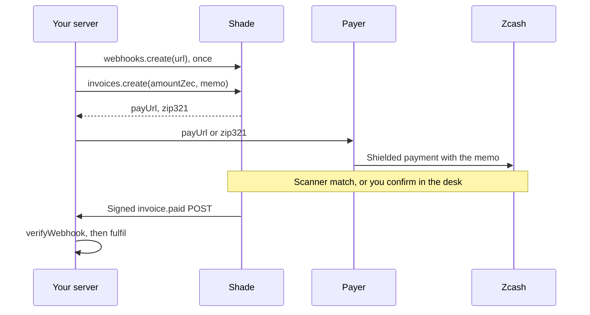
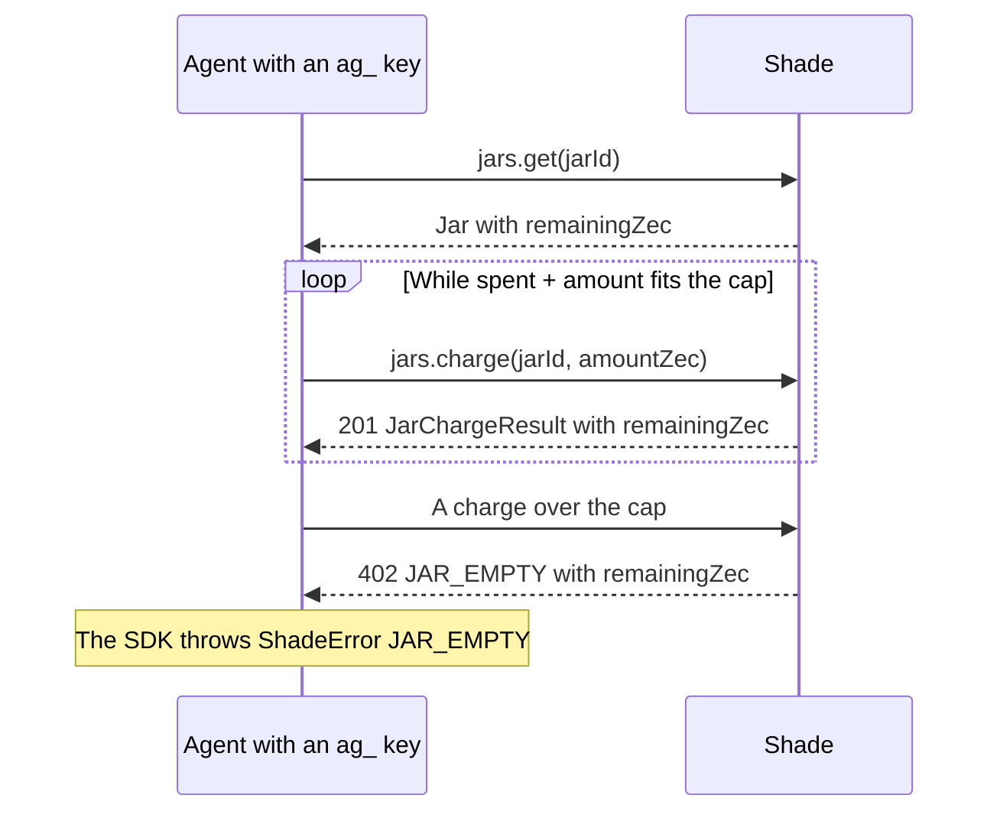
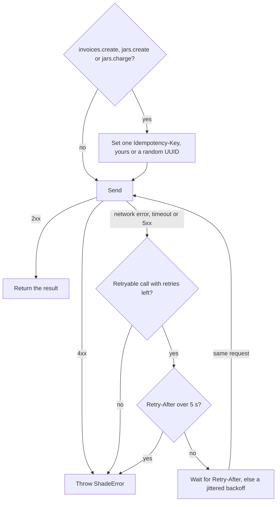
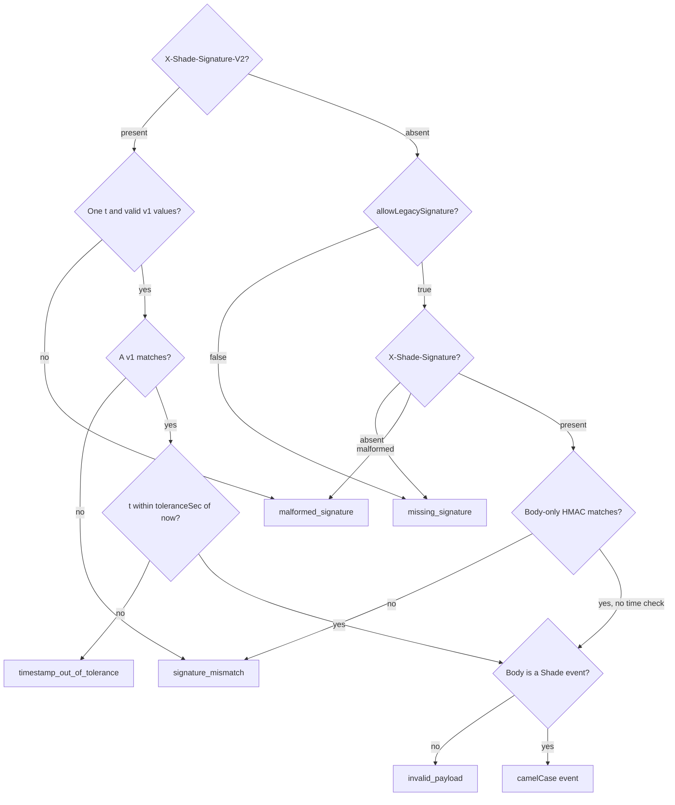

# shade-zcash-sdk

The TypeScript client for [Shade](https://github.com/billi-x4/Shade). Shade lets online shops and SaaS apps take
private Zcash payments and put their AI agents on a spending cap.

Call it from your server or agent to create invoices, verify `invoice.paid` webhooks, charge agent jars, share
receipts with an auditor and claim `name.shade` names. It wraps Shade's `/v1` HTTP API.

- It has no runtime dependencies. It needs `fetch` and WebCrypto, which Node 20 or newer, browsers and edge runtimes
  all provide.
- It ships as ESM with TypeScript types.
- The live testnet service runs at <https://shade-zcash.vercel.app>, and its API guide is at
  <https://shade-zcash.vercel.app/docs>.

## Install

```bash
npm install shade-zcash-sdk
```

## Quick start

1. Sign up at <https://shade-zcash.vercel.app/signup>, or on your own Shade.
2. In **Settings → Receive addresses & network**, add a testnet Unified Address. Without one, `invoices.create`,
   `jars.create` and `tags.create` fail with 409 `NO_ADDRESS`. With no wallet yet, use the public test address in the
   [Shade README](https://github.com/billi-x4/Shade#try-the-full-flow).
3. In **Settings → API keys**, create a server key. A testnet key starts with `sk_test_`, and Shade shows it once.
4. Save this as `first-call.mjs`:

   ```js
   import { Shade } from "shade-zcash-sdk";

   const shade = new Shade({ apiKey: process.env.SHADE_API_KEY });
   const invoice = await shade.invoices.create({ amountZec: "0.01", memo: "order 1042" });
   console.log(invoice.payUrl);
   ```

5. Run it with your key. It prints the invoice's pay page, such as `https://shade-zcash.vercel.app/pay/inv_…`.

   ```bash
   SHADE_API_KEY=sk_test_… node first-call.mjs
   ```

   In PowerShell, run `$env:SHADE_API_KEY = "sk_test_…"` first, then `node first-call.mjs`.

Send the payer to `invoice.payUrl`, or give their wallet the `zcash:` payment URI in `invoice.zip321`. The invoice's
`status` starts as `open`. On your own Shade, also pass `baseUrl`, as shown under Client options.

## How a payment reaches you



Fulfil an order only when the invoice is `paid`. The `invoice.paid` event tells you, and so does `invoices.get`.

| `status`          | Meaning                                                                                          |
| ----------------- | ------------------------------------------------------------------------------------------------ |
| `open`            | Waiting for payment                                                                              |
| `paid_unverified` | The payer pasted a txid on the pay page. That is a claim, not proof.                             |
| `paid`            | A scanner or you settled it. `txid` and `paidAt` are set.                                        |
| `expired`         | Past `expiresAt`. It still turns `paid` if its payment was mined within 60 minutes after expiry. |
| `cancelled`       | You cancelled it                                                                                 |
| `authorized`      | A jar charge. No ZEC moved.                                                                      |

`verification` says how Shade knows. `ivk_scan` means a scanner with your viewing key matched the amount and memo, and
`merchant_accept` means you confirmed the payment in the desk. A payer's claim carries `txid_unverified`, and a jar
charge carries `jar_ledger`. `detection` holds the latest scanner sighting, with `confirmations` and
`requiredConfirmations`.

Shade can find payments for you. Upload a full viewing key under **Settings → Detection**, and Shade's worker scans the
chain. That key also reveals your outgoing payments. To keep the key on your machine instead, run
`npm run scan:local -w @shade/backend` from the Shade repository. The Detection page shows the full command. Without a
scanner, you confirm each payment in the desk.

**Testnet limit, verified 2026-10-06.** NU7 reached testnet on 2026-10-04, and since then the scanner cannot read new
testnet payments, hosted or `scan:local`. Settle them in the desk. **Confirm** accepts a txid the payer pasted, and
**Record payment** takes the txid from your wallet. Both set `verification` to `merchant_accept`. Mainnet reaches NU7
around 2026-11-05 and breaks the same way unless Shade updates its scanner first.
[AGENTS.md](https://github.com/billi-x4/Shade/blob/main/AGENTS.md) §3 has the details.

## Client options

```ts
import { Shade } from "shade-zcash-sdk";

const shade = new Shade({
  apiKey: process.env.SHADE_API_KEY!, // sk_test_… or sk_live_…
  baseUrl: "http://localhost:5173", // your Shade origin, here the local dev web app
});
```

| Option       | Default                          | What it does                                               |
| ------------ | -------------------------------- | ---------------------------------------------------------- |
| `apiKey`     | required                         | Your `sk_test_…`, `sk_live_…` or `ag_…` key                |
| `baseUrl`    | `https://shade-zcash.vercel.app` | Your Shade origin, without `/v1`                           |
| `timeoutMs`  | `10000`                          | Deadline for each attempt, response body included          |
| `maxRetries` | `1`                              | Extra attempts for retryable calls. `0` turns retries off. |
| `fetch`      | `globalThis.fetch`               | Any fetch-compatible function                              |

- `sk_test_…` keys act on testnet and `sk_live_…` keys on mainnet. A resource on the other network answers 404, and a
  key for a network the server has not turned on gets 403 `NETWORK_DISABLED`.
- An agent's `ag_…` key can only charge and read its own jar.
- `baseUrl` is the origin of your Shade web app, which forwards `/v1`, or of its API. Shade is self-hosted, and the
  default reaches only the live testnet service. A wrong `baseUrl` fails every call. You get `NETWORK_ERROR` when
  nothing answers, `UNEXPECTED_RESPONSE` when something other than Shade answers, and 401 `UNAUTHORIZED` when that
  Shade does not know your key.
- Outside browsers, the SDK sends `User-Agent: shade-sdk/<version>`. The `VERSION` export holds the version.

**Never put an `sk_…` or `ag_…` key in a browser.** `/v1` answers any origin with CORS `*`, so anyone who loads the
page can copy the key and use it.

## Methods

The client groups its methods under `shade.invoices`, `shade.jars`, `shade.grants`, `shade.webhooks` and `shade.tags`.

Every method takes an optional last argument, `{ signal }`. Abort that signal to end the call, including any wait
before a retry. The call then throws `ShadeConnectionError` with code `ABORTED`. `invoices.create`, `jars.create` and
`jars.charge` also accept `{ idempotencyKey }` in that argument. The retries section below explains it.

Amounts are decimal ZEC strings such as `"0.01"`, never numbers. Shade accepts amounts above zero and up to 21,000,000,
with at most 8 decimals. It refuses a sign, an exponent, `"05"`, `".5"` and `"5."` with 400 `BAD_AMOUNT`, and it
returns amounts without trailing zeros. Times are ISO 8601 strings. The HTTP API is snake_case, such as `pay_url`, and
the SDK returns camelCase, such as `payUrl`.

Every result has an exported type: `Invoice`, `PayableInvoice`, `Page`, `Jar`, `JarChargeResult`, `Grant`,
`GrantCreated`, `WebhookEndpoint`, `WebhookEndpointCreated`, `Tag`, `TagResolution` and `ShadeEvent`. String unions
such as `InvoiceStatus` and `Verification` are exported too.

### Invoices

| Call                                                                         | HTTP                               | Returns                |
| ---------------------------------------------------------------------------- | ---------------------------------- | ---------------------- |
| `invoices.create({ amountZec, memo?, expiresInSec?, tag? })`                 | `POST /v1/invoices`                | `PayableInvoice`       |
| `invoices.get(id)`                                                           | `GET /v1/invoices/:id`             | `Invoice`              |
| `invoices.list({ status?, expiresAfter?, cursor?, limit? })`                 | `GET /v1/invoices`                 | `Page<PayableInvoice>` |
| `invoices.cancel(id)`                                                        | `POST /v1/invoices/:id/cancel`     | `Invoice`              |
| `invoices.reportDetection(id, { txid, amountZec, memoHash, pool, source? })` | `POST /v1/invoices/:id/detections` | `Invoice`              |

- `memo` is one line of up to 495 UTF-8 bytes. Shade appends ` (shade:<REF>)` to make `chainMemo`, the memo the
  payer's wallet writes on chain. An empty memo becomes `shade:<REF>`.
- `expiresInSec` runs from 60 to 604,800, which is 7 days. The default is 3,600, one hour.
- `tag` is a label that grants can scope to, such as `payroll`. It has nothing to do with `name.shade` tags. Use up to
  32 letters, digits, `-` and `_`, starting with a letter or digit. Shade lowercases it and reserves `all`.
- `invoices.get` reads jar charges too. They have no `payUrl`, `zip321` or `address`.
- `invoices.list` returns newest first and skips jar charges. `status` is one status or an array such as
  `["open", "paid_unverified"]`. `expiresAfter` is a `Date`, or an ISO 8601 string with `Z` or an offset such as
  `"2026-10-06T12:00:00Z"`, and keeps invoices that expire later. `limit` runs from 1 to 100, default 25. Pass
  `page.nextCursor` as `cursor` until it is `null`.
- `invoices.cancel` cancels an open invoice, or refunds a jar charge to its cap. An invoice in any other status gets
  409 `NOT_OPEN`, and one whose payment is waiting for confirmations gets 409 `PAYMENT_PENDING`.
- `invoices.reportDetection` reports a payment that your own scanner, such as `scan:local`, found with your viewing
  key. `pool` is `ironwood`, `orchard` or `sapling`. `memoHash` is `sha256:` plus the hex SHA-256 of the 512-byte memo
  field. `source` is `merchant_device` by default, or `external_scanner`.
- Shade looks the reported transaction up on chain itself. A different amount or memo hash gets 422 `AMOUNT_MISMATCH`
  or `MEMO_MISMATCH`. An unknown transaction gets 404 `TX_NOT_FOUND`, one that paid another invoice gets 409
  `TXID_IN_USE`, and one that is not shielded or was mined outside the invoice's time window gets 422
  `TX_NOT_SHIELDED` or `OUTSIDE_WINDOW`. The invoice turns `paid` once the transaction has enough confirmations. Until
  then, `detection.state` is `seen`.

### Jars

| Call                                       | HTTP                       | Returns           |
| ------------------------------------------ | -------------------------- | ----------------- |
| `jars.create({ capZec, label })`           | `POST /v1/jars`            | `Jar`             |
| `jars.get(jarId)`                          | `GET /v1/jars/:id`         | `Jar`             |
| `jars.charge(jarId, { amountZec, memo? })` | `POST /v1/jars/:id/charge` | `JarChargeResult` |
| `jars.kill(jarId)`                         | `POST /v1/jars/:id/kill`   | `Jar`             |

- `label` is one line of up to 48 characters.
- A `Jar` carries `capZec`, `spentZec`, `remainingZec`, `chargeCount` and `status`, which is `open` or `killed`.
- A charge `memo` is one line of up to 512 UTF-8 bytes. Shade adds no reference to it.
- The Agent jars section below covers charges, refunds and their errors.

### Grants

| Call                                             | HTTP                         | Returns        |
| ------------------------------------------------ | ---------------------------- | -------------- |
| `grants.create({ scope, days?, expiresInSec? })` | `POST /v1/grants`            | `GrantCreated` |
| `grants.revoke(id)`                              | `POST /v1/grants/:id/revoke` | `Grant`        |

- A grant gives an auditor a `viewUrl`. That page shows your receipts and offers a CSV download until the grant
  expires or you revoke it. `token` and `viewUrl` come back once. The token sits in the URL fragment, which browsers do
  not send to servers.
- `scope` is `"all"` or an invoice `tag`. Set `days` from 1 to 90, default 7, or `expiresInSec` from 600 to 7,776,000,
  which is 10 minutes to 90 days. Passing both throws a `TypeError`.
- The view lists paid invoices that a scan or you verified, plus live jar charges when the scope is `all`. It never
  lists payer claims, and it shows at most the newest 500 receipts.
- `grants.revoke` cuts off access through Shade at once. A revoked or expired view shows a notice, and its CSV export
  answers 410. Files the auditor already downloaded stay on their machine.

### Webhooks

| Call                       | HTTP                      | Returns                  |
| -------------------------- | ------------------------- | ------------------------ |
| `webhooks.create({ url })` | `POST /v1/webhooks`       | `WebhookEndpointCreated` |
| `webhooks.list()`          | `GET /v1/webhooks`        | `WebhookEndpoint[]`      |
| `webhooks.delete(id)`      | `DELETE /v1/webhooks/:id` | `void`                   |

- `webhooks.create` returns the `whsec_…` signing `secret` once. Store it, because you need it to verify deliveries.
- A deployed Shade accepts only public `https` URLs on port 443 or 8443, with no user name or password in them. Any
  other URL gets 400 `BAD_URL`.
- `webhooks.list` returns the endpoints on your key's network, newest first. It shows only the last 4 characters of
  each secret, as `secretHint`, and leaves out deleted endpoints.
- `webhooks.delete` stops deliveries to the endpoint, queued ones included, and wipes its secret. With `list`, a setup
  script can replace an endpoint instead of adding a new one on each deploy.

### Tags

| Call                    | HTTP                 | Returns         |
| ----------------------- | -------------------- | --------------- |
| `tags.create({ name })` | `POST /v1/tags`      | `Tag`           |
| `tags.resolve(name)`    | `GET /v1/tags/:name` | `TagResolution` |

- `tags.create` claims `<name>.shade` for your receive address on the key's network. A name has up to 32 lowercase
  letters, digits and hyphens, and cannot start or end with a hyphen. Shade refuses reserved names such as `shade` or
  `admin` with 400 `BAD_TAG`, and names someone already holds with 409 `TAG_TAKEN`. You cannot release a name once
  you claim it.
- `tags.resolve` is public, and the SDK sends no API key with it. It accepts `"asharib"` or `"asharib.shade"` and
  returns the name, its network and the merchant's current receive address. An unknown name gets 404 `NOT_FOUND`.

### Limits

Shade answers 409 with these codes when an account reaches a limit:

| Limit                       | Counted per | Code             |
| --------------------------- | ----------- | ---------------- |
| 5 enabled webhook endpoints | network     | `ENDPOINT_LIMIT` |
| 100 open jars               | network     | `JAR_LIMIT`      |
| 100 active grants           | network     | `GRANT_LIMIT`    |
| 10,000 unpaid invoices      | network     | `INVOICE_LIMIT`  |
| 5 `name.shade` names        | account     | `TAG_LIMIT`      |

Each API key may send 600 requests a minute. Each IP address may resolve 60 tags a minute and fail 60 key checks a
minute. Past a rate limit, Shade answers 429 `RATE_LIMITED` with `retryAfter`.

## Agent jars

A jar is a spending limit that Shade records. Shade holds no ZEC, so creating, charging or killing a jar moves none.
The money stays in your wallet.

1. Create a jar in the desk under **Jars → New jar**, or with `jars.create`.
2. Press **Agent key** on the jar and give the `ag_…` key to the agent. Shade shows the key once, and only the desk
   can create one.
3. The agent may call `jars.get` and `jars.charge` on its own jar. Any other call with its key gets 403 `FORBIDDEN`.



- Shade checks the cap and debits the jar in one database statement. Parallel charges cannot overspend it.
- Over the cap, `jars.charge` throws a `ShadeError` with status 402, code `JAR_EMPTY` and `remainingZec`. A smaller
  charge may still fit.
- A merchant `sk_…` key on the same network can charge a jar too.
- Each charge is an `authorized` child invoice, and the result's `invoiceId` is its id. A merchant key can cancel it
  with `invoices.cancel(invoiceId)`, which returns the amount to the cap. The agent's key gets 403, and a killed jar
  gets 409 `JAR_CLOSED`.
- `jars.kill` stops new charges. Later charges get 409 `JAR_CLOSED` with `remainingZec`. Move leftover ZEC in your
  wallet yourself.

## Errors

Any non-2xx answer, or no answer at all, throws a `ShadeError`:

```ts
import { ShadeError } from "shade-zcash-sdk";

try {
  const charge = await shade.jars.charge(jarId, { amountZec: "0.002", memo: "api:search" });
  console.log(`authorized ${charge.amountZec} · left ${charge.remainingZec}`);
} catch (err) {
  if (!(err instanceof ShadeError) || err.code !== "JAR_EMPTY") throw err;
  // 402 over the cap, with err.message "Jar empty. The agent cannot spend." A smaller charge may fit.
  console.log(`left ${err.remainingZec}`);
}
```

| Field          | What it holds                                                                         |
| -------------- | ------------------------------------------------------------------------------------- |
| `status`       | The HTTP status, or `0` when no response arrived                                      |
| `code`         | A stable code such as `JAR_EMPTY`, `JAR_CLOSED`, `NOT_FOUND` or `BAD_AMOUNT`          |
| `message`      | The server's text, written for people                                                 |
| `requestId`    | The request id. Quote it when you report a problem.                                   |
| `remainingZec` | Set on 402 `JAR_EMPTY` and 409 `JAR_CLOSED`                                           |
| `retryAfter`   | Seconds to wait, set on 429 `RATE_LIMITED` and 503 `CHAIN_UNAVAILABLE`                |
| `issues`       | Set on 400 `INVALID_REQUEST`. A list of `{ path, message }`, never your input values. |

The `ShadeApiErrorCode` type lists every server code. An unknown future code passes through unchanged. The SDK sets
four codes itself:

| Code                  | `status`        | When                                                                               |
| --------------------- | --------------- | ---------------------------------------------------------------------------------- |
| `TIMEOUT`             | `0`             | No complete response arrived within `timeoutMs`                                    |
| `NETWORK_ERROR`       | `0`             | No HTTP response, because DNS, the connection or TLS failed, or `baseUrl` is wrong |
| `ABORTED`             | `0`             | Your `signal` aborted the call                                                     |
| `UNEXPECTED_RESPONSE` | the HTTP status | The body was not Shade JSON, such as a proxy's error page                          |

The first three throw `ShadeConnectionError`, a `ShadeError` subclass that keeps the underlying error in `cause`.

Bad input throws a `TypeError` before the SDK sends anything. That happens for:

- an `apiKey` that is empty or has spaces or non-ASCII characters
- a `baseUrl` that is not an absolute `http` or `https` URL, or that has a query or fragment
- a `timeoutMs` below 1, a `maxRetries` below 0, or either one not a whole number
- an empty id or a bad `idempotencyKey`
- both `days` and `expiresInSec` in `grants.create`

The SDK does not check `fetch`. A bad one fails each call with `NETWORK_ERROR`.

## Retries and idempotency



The SDK retries eight calls: `invoices.create`, `jars.create`, `jars.charge`, `invoices.get`, `invoices.list`,
`jars.get`, `webhooks.list` and `tags.resolve`. It never retries the other eight.

A retryable call tries again after a network error, a timeout or a 5xx answer. A 4xx answer, 429 included, throws
right away. The first wait is 150 to 300 ms, and each later wait doubles, with jitter, up to 5 s. When a 5xx answer
carries `Retry-After`, the SDK waits that long instead. It does not wait out a `Retry-After` over 5 s. It throws, and
the error carries `retryAfter`. `maxRetries: 0` turns retries off.

**Idempotency.** Creates and charges send an `Idempotency-Key` header. The SDK picks the key once per call, yours or a
random UUID, and sends the same key and the same bytes on every retry. If an attempt reached Shade but its answer got
lost, the retry gets the stored answer, and one call never charges a jar twice.

The random key only covers that call's own retries. If your process can crash or restart between a charge and
recording it, pass your own key. Derive it from the paid work and reuse it when you retry that work:

```ts
await shade.jars.charge(
  jarId,
  { amountZec: "0.002", memo: "api:search" },
  { idempotencyKey: `search-${jobId}` }, // jobId is your own id for the paid work
);
```

- A key is 1 to 255 printable ASCII characters, with no spaces. Shade keeps it for 24 hours, per API key.
- A replay returns the stored 2xx answer or business error, such as 402 `JAR_EMPTY`.
- Shade stores no 400, 429 or 5xx answers, and none of the checks it runs before it claims the key, such as 409
  `NO_ADDRESS`. A retry after one of those runs the request again.
- Reusing a key for a different request, with another path or body, gets 422 `IDEMPOTENCY_MISMATCH`.
- A duplicate sent while the first request still runs waits for it, then gets the replay. If Shade answers 409
  `IDEMPOTENCY_IN_PROGRESS`, retry shortly.

## Verifying webhooks

Each delivery attempt is a JSON `POST` with these headers:

- `X-Shade-Signature-V2: t=<unix seconds of this attempt>,v1=<hex HMAC-SHA256(secret, t + "." + raw body)>`
- `X-Shade-Signature: sha256=<hex HMAC-SHA256(secret, raw body)>`
- `X-Shade-Event-Id: <event id>`

It also sends `content-type: application/json` and `user-agent: Shade-Webhooks/1`. The HMAC key is the UTF-8 bytes of
the whole `whsec_…` string, prefix included.



`await verifyWebhook(rawBody, headers, secret, options?)` returns the event. On any failure it throws
`WebhookVerificationError`, whose `reason` is one of the five ends of the chart. Answer those with 400. It compares
signatures in constant time.

| Option                 | Default    | What it does                                                   |
| ---------------------- | ---------- | -------------------------------------------------------------- |
| `toleranceSec`         | `300`      | The largest gap allowed between now and the V2 `t`, in seconds |
| `now`                  | `Date.now` | The clock, in milliseconds                                     |
| `allowLegacySignature` | `false`    | Accept the body-only `X-Shade-Signature` when V2 is absent     |

The body-only signature never expires, so anyone holding a copy of a delivery could replay it forever. Turn on
`allowLegacySignature` only behind a proxy that drops the V2 header, and dedupe by event id. When V2 is present,
`verifyWebhook` ignores the legacy header.

Pass the **raw** body, a string or bytes, exactly as received. Re-serialized JSON such as `JSON.stringify(req.body)`
will not verify. A parsed body, a missing secret or a negative `toleranceSec` throws a `TypeError`. `headers` is a
fetch `Headers` object or a plain object such as Node's `req.headers`, with keys in any case.

```ts
import { createServer } from "node:http";
import { verifyWebhook, WebhookVerificationError } from "shade-zcash-sdk";

createServer(async (req, res) => {
  const chunks: Buffer[] = [];
  for await (const chunk of req) chunks.push(chunk as Buffer);
  try {
    const secret = process.env.SHADE_WEBHOOK_SECRET!;
    const event = await verifyWebhook(Buffer.concat(chunks), req.headers, secret);
    if (event.type === "invoice.paid") {
      // Store event.id under a unique constraint and skip repeats, then fulfil event.invoiceId.
    }
    res.writeHead(200).end();
  } catch (err) {
    res.writeHead(err instanceof WebhookVerificationError ? 400 : 500).end();
  }
}).listen(8790);
```

Fetch-style frameworks such as Hono, Next.js route handlers and Workers hand you the body as text:

```ts
const event = await verifyWebhook(await request.text(), request.headers, secret);
```

### Events and delivery

An event has `id`, `type`, `createdAt`, `network`, `invoiceId`, `amountZec`, `memoHash`, `txid`, `paidAt` and
`verification`. It never carries a payer address or the plaintext memo. `memoHash` identifies the memo.

- `type` is `invoice.paid`, or `webhook.test` when you press **Send test** in the desk. On a test, every field from
  `invoiceId` on is `null`.
- `verification` is `ivk_scan` when a scanner with your viewing key matched the amount and memo. It is
  `merchant_accept` when you confirmed the payment in the desk, where Shade could not check the amount or memo.
- Shade may deliver an event more than once. Dedupe by `event.id`.
- Answer with a 2xx within 10 seconds. Shade retries every other outcome except 410, including timeouts, redirects and
  response bodies over 64 KB. It tries up to 10 times over about three days. A `Retry-After` on a 429 or 503 can
  stretch a wait to at most twice its normal length.
- A `410 Gone` answer turns the endpoint off at once and cancels its queued deliveries.
- After at least 20 failed attempts in a row that span 3 days without a success, Shade sends the endpoint no new
  events. Deliveries already queued keep retrying.
- `webhooks.list` shows `disabledAt` and `disabledReason`, which is `gone_410` or `failing`. To resume, add the URL
  again. It gets a new secret.

### Testing your receiver

`await signWebhook(secret, rawBody, timestampSec)` returns both signature headers exactly as Shade sends them. Use it to
post a signed test event to your own receiver:

```ts
import { signWebhook } from "shade-zcash-sdk";

const secret = process.env.SHADE_WEBHOOK_SECRET!;
const body = JSON.stringify({
  id: "evt_test",
  type: "webhook.test",
  created_at: new Date().toISOString(),
  network: "testnet",
});
const signatures = await signWebhook(secret, body, Math.floor(Date.now() / 1000));
await fetch("http://127.0.0.1:8790/", {
  method: "POST",
  headers: { "content-type": "application/json", ...signatures },
  body,
});
```

`timestampSec` must be a whole number of unix seconds, or `signWebhook` throws a `TypeError`.

## Example scripts

The Shade repository keeps two TypeScript scripts in
[`backend/sdk/examples`](https://github.com/billi-x4/Shade/tree/main/backend/sdk/examples). Run them from the
repository root after `npm install`. Both load `backend/.env` if it exists, and neither prints keys, secrets or memos.
Windows cmd and PowerShell lack the `VAR=value command` form. Put the variable in `backend/.env`, or set it first, as
in PowerShell's `$env:SHADE_AGENT_KEY = "ag_…"`.

**Agent.** `examples/agent.ts` charges a jar with its agent key until the cap or `--times` runs out. `--jar` is
required. `--times` takes 1 to 100 and defaults to 4, `--amount` defaults to 0.002 and `--memo` to `api:search`.
`SHADE_API_URL` sets its `baseUrl`, default `http://localhost:5173`. It exits with 0 when every call succeeded or the
run ended on `JAR_EMPTY`, 1 on any other error and 2 on bad usage. On a new jar with a 0.006 ZEC cap:

```bash
SHADE_AGENT_KEY=ag_… npm run demo:agent -w @shade/backend -- --jar <jar_id> --times 4 --amount 0.002 --memo api:search
```

```text
authorized 0.002 · left 0.004
authorized 0.002 · left 0.002
authorized 0.002 · left 0
402 JAR_EMPTY · Jar empty. The agent cannot spend.
```

**Webhook receiver.** `examples/receiver.ts` verifies deliveries, dedupes by event id and prints one line per event. It
answers 200 for verified events, duplicates included, and 400 when verification fails. `--port` defaults to 8790 and
`--host` to `127.0.0.1`.

```bash
SHADE_WEBHOOK_SECRET=whsec_… npm run demo:receiver -w @shade/backend -- --port 8790
```

```text
listening on http://127.0.0.1:8790
invoice.paid inv_… 0.01 verification=ivk_scan
```

- With a local backend, start Shade with `SHADE_WEBHOOK_ALLOW_PRIVATE=1` and register `http://127.0.0.1:8790/`. That
  setting allows `http` and loopback targets, and production refuses it.
- A deployed Shade delivers only to public `https` URLs on port 443 or 8443. Register a public HTTPS tunnel URL
  instead, such as one from `cloudflared tunnel --url http://127.0.0.1:8790`. Add `--host 0.0.0.0` if the tunnel or a
  container reaches the receiver from another interface.

## Working on the SDK

Inside the Shade repository, the SDK is the npm workspace `backend/sdk`. From the repository root:

```bash
npx vitest run --project sdk                   # unit tests with a fake fetch, and the example scripts on loopback
npx tsc -p backend/sdk/tsconfig.json --noEmit  # type check
npm run build -w shade-zcash-sdk               # writes backend/sdk/dist: ESM, .d.ts and source maps
```

The SDK imports nothing from `backend/`. When `backend/src/contract` changes, update `src/wire.ts`, `src/types.ts` and
`src/mappers.ts`. `backend/test/sdk-contract.test.ts` runs the real SDK against the real app and catches drift. To
release, bump the version in `package.json` and `src/version.ts` together, then run `npm publish -w shade-zcash-sdk`. A
test keeps the two versions equal.

## More

- The [Shade README](https://github.com/billi-x4/Shade/blob/main/README.md) covers running and deploying Shade.
- [AGENTS.md](https://github.com/billi-x4/Shade/blob/main/AGENTS.md) is the engineering guide.
- [docs/demo.md](https://github.com/billi-x4/Shade/blob/main/docs/demo.md) is the 90-second demo script.
- The package is MIT licensed.
