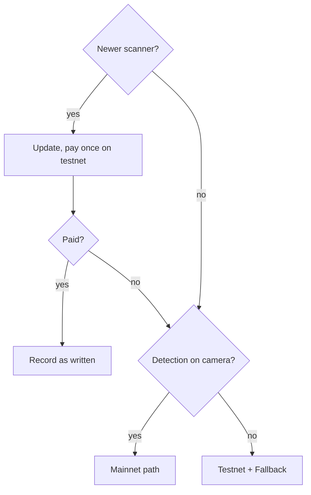
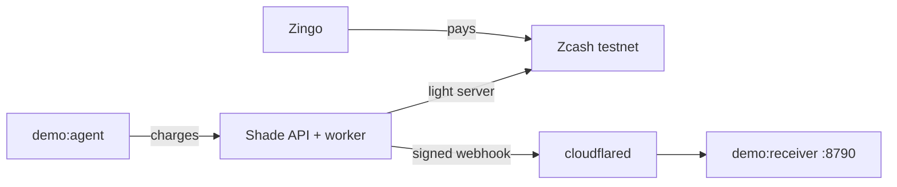
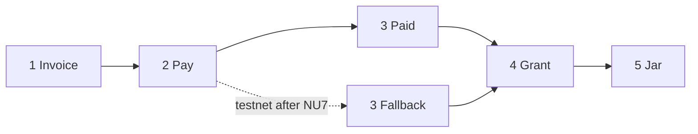
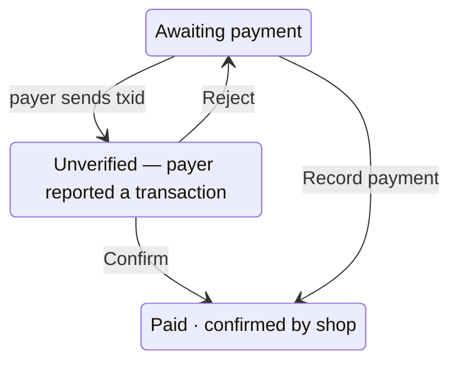

# Shade — the 90-second demo

**Title:** Shade — private invoices and agent jars on Zcash · **Track:** Zcash · **Network:** testnet, or mainnet on
the [Mainnet path](#mainnet-path)

**Rule:** every step is real: shielded payments, signed webhooks, an agent calling the jar API. Never fake a step or a
status.

## Before you start: pick a path

NU7 went live on testnet at height 4,465,026 on 2026-10-04. Shade's scanner, `@ledgerhq/zcash-utils` 2.5.0 (newest
release on 2026-10-06), cannot read post-NU7 transactions (error "invalid consensus branch id 0x77190ad9"), so on
testnet it misses the step 3 payment; once that is mined, Settings → Detection shows "Needs attention" and "Shade's
scanner cannot read payments made since the latest network upgrade yet." To update it, bump the pinned version in
`backend/package.json` and redeploy (Zcash facts: [AGENTS.md](../AGENTS.md) §3).



## Setup (off camera)



Commands are bash (Git Bash, macOS, Linux). In PowerShell or cmd, move each `NAME=value` into `backend/.env`; the demo
scripts load it.

1. **Server.** Shade at its public URL, its worker (the scanner) running with `SHADE_SCAN_INTERVAL_SEC=5` (default 20);
   keep `SHADE_MIN_CONFIRMATIONS_TESTNET=1` (default). Detection needs a seal keypair, so only the worker reads viewing
   keys: `npm run -s keys:seal -w @shade/backend`, `VIEWING_KEY_SEAL_PUBLIC_KEY` on the API,
   `VIEWING_KEY_SEAL_PRIVATE_KEYS` on the worker only.
2. **Detection.** Settings → Detection: paste the full viewing key (`uviewtest1…`; it also reveals outgoing payments) of
   a dedicated receive-only testnet account, keep **Use this key's address** on → **Turn on detection**. The receive
   address becomes the key's; status "Watching for payments".
3. **Webhook receiver** (Shade posts only to public HTTPS URLs): run `cloudflared tunnel --url http://127.0.0.1:8790`
   and paste its `https://` URL under **Webhooks** → **New endpoint** → **Add endpoint**. In "Signing secret":
   **Copy secret** → **I saved it** (shown once). Start
   `SHADE_WEBHOOK_SECRET=whsec_… npm run demo:receiver -w @shade/backend` → **Send test**: it prints
   `webhook.test - - verification=-` (no invoice).
4. **Payer.** Zingo (phone or desktop), testnet, synced, at least 0.02 TAZ (testnet ZEC) in the Ironwood pool (sent to
   its Orchard receiver after testnet NU6.3, height 4,134,000). Older Orchard or Sapling funds cross pools, and the
   explorer shows the amount that crossed. Faucet: <https://zcashfaucet.jinolabs.xyz>.
5. **Merchant wallet.** Open the wallet with the receive-only account; let it sync (the Fallback uses it).
6. **Sign in fresh (last):** **Sign out** and back in right before recording and each retake. **Agent key** (step 5),
   viewing-key upload, adding an endpoint and switching to mainnet need a sign-in under 15 minutes old, else a
   "Confirm it is you" password dialog appears on camera (in setup, type your password).

## Script



### 1. Invoice (0:00–0:10)

- **Invoices** → **New invoice**: **Amount (ZEC)** `0.01`, **Memo** `order_1042`, **Label (for grants)** `payroll` →
  **Create invoice** → **Open pay page** (new tab): "Pay privately with Zcash.", `0.01 ZEC`, the QR code, **Open in
  wallet**. Click **Copy payment link**.
- **Say:** "This is a standard ZIP-321 payment link, the same one the QR code holds. The wallet reads the amount and the
  memo from it."

### 2. Pay (0:10–0:28)

- Scan the QR code with Zingo and send. Cut the wait; caption the real time, e.g. "about 30 seconds later".
- Open Zingo's transaction id on testnet.zecblock.com: a shielded transaction, no amount, no addresses.

### 3. Paid (0:28–0:40)

Testnet before a scanner update: record the [Fallback](#fallback) instead. Otherwise show:

- Pay page tab (it checks every 3 seconds): "Paid."
- Desk tab: the invoice row reads "Paid · found by wallet scan".
- **Webhooks**, Deliveries: `invoice.paid` reads "Delivered" and "last answer HTTP 200".
- Receiver terminal: `invoice.paid inv_… 0.01 verification=ivk_scan`.
- **Say:** "The receiver checked Shade's signature before it printed this. The webhook carries a hash of the memo, never
  the memo."

### 4. Grant (0:40–1:02)

- **Grants** → **New grant**: **Only invoices with a label**, **Label** `payroll`, **Share for** **10 minutes**.
  Shows "Share view for 10 minutes. Scope: invoices labelled payroll. You can revoke anytime."
- **Create grant** → **Copy view link** → **I saved it** ("Share this view link" dialog). Open the link in a private
  window (no desk session): the 0.01 receipt, "Found by wallet scan" ("Confirmed by shop" after the Fallback).
  **Download receipts (CSV)** saves the file.
- On the desk, **Revoke**: "Revoke stops new access from us. Delete the file on their machine too." → **Revoke** in the
  dialog. Within 10 seconds the auditor window shows "Access revoked." and "The shop ended this view."
- **Say:** "The receipts download stops working too (HTTP 410)."

### 5. Jar (1:02–1:24)

- **Jars** → **New jar**: **Cap (ZEC)** `0.006`, **Label** `research-agent` → **Create jar**.
- Jar card: **Agent key**. In "Agent key for research-agent", fill the command below via **Copy agent key** and **Copy
  jar id** → **I saved it** (key shown once). `<your Shade URL>` is the site address, e.g.
  `https://shade-zcash.vercel.app` (also in the dialog). Run:

  ```bash
  SHADE_AGENT_KEY=ag_… SHADE_API_URL=<your Shade URL> npm run demo:agent -w @shade/backend -- --jar <jar_id> --times 4
  ```

- The agent prints the lines below; the jar card reads "Cap 0.006 ZEC. Spent 0.006. Left 0." and "Jar empty. The
  agent cannot spend."

  ```text
  authorized 0.002 · left 0.004
  authorized 0.002 · left 0.002
  authorized 0.002 · left 0
  402 JAR_EMPTY · Jar empty. The agent cannot spend.
  ```

- **Kill**: "Stops new charges. Move leftover ZEC in your wallet." → **Kill jar**: the card reads "Killed" and "Jar
  closed. The agent cannot spend."

### Close (1:24–1:30)

**Say:** "Zcash hides the money. Shade is how a product uses that without becoming a cryptographer."

## Fallback

After a scanner update, use it only if step 3 has not flipped within two minutes. Confirm or record a payment only once
the merchant wallet shows 0.01 ZEC with the memo `order_1042 (shade:…)`: Shade cannot see either. It checks that the
transaction is shielded, newer than the invoice and mined with the minimum confirmations.



- **Payer reports it:** paste Zingo's transaction id on the pay page → **Send transaction id**: "Payment reported. The
  shop is checking it." On the desk, **Confirm** → **Confirm payment**.
- **Shop records it:** on the desk row, **Record payment** (hidden while a payer's report waits), paste the merchant
  wallet's transaction id → **Mark paid**.
- Either way: "Paid · confirmed by shop" (desk), "Paid." (pay page),
  `invoice.paid inv_… 0.01 verification=merchant_accept` (receiver).
- **Say:** "The shop confirmed this payment. Shade did not find it by scanning."

## Mainnet path

Shows automatic detection while testnet's is down. Record before mainnet NU7 (planned for about 2026-11-05); after it,
scanner 2.5.0 fails there too. Record steps 1–4 on mainnet (a grant shows only its own network's receipts); step 5 may
stay there (a jar moves no ZEC).

- **Server:** `SHADE_NETWORKS=testnet,mainnet`. Mainnet waits for `SHADE_MIN_CONFIRMATIONS_MAINNET` confirmations
  (default 10): cut the wait.
- **Desk:** Settings → Receive addresses & network → **Switch to mainnet** → **Use real ZEC**; upload a mainnet viewing
  key (`uview1…`) under Settings → Detection.
- **Webhook:** endpoints are per network: add the tunnel URL again (**Webhooks** → **New endpoint**), restart the
  receiver with the new secret, **Send test**.
- **Payer:** Zodl (store build), 0.01 ZEC.
- **Evidence:** the PRD goal "One real shielded testnet payment detected" ([prd.md](../prd.md)) needs testnet proof.
  The only pre-NU7 proof is `backend/test/fixtures/zcash/live-ironwood-notes.json`: real testnet payments Shade's
  scanner found on 2026-10-02, sent to a public test account, not a Shade invoice. Say so if you show them.
