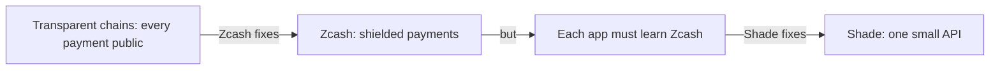
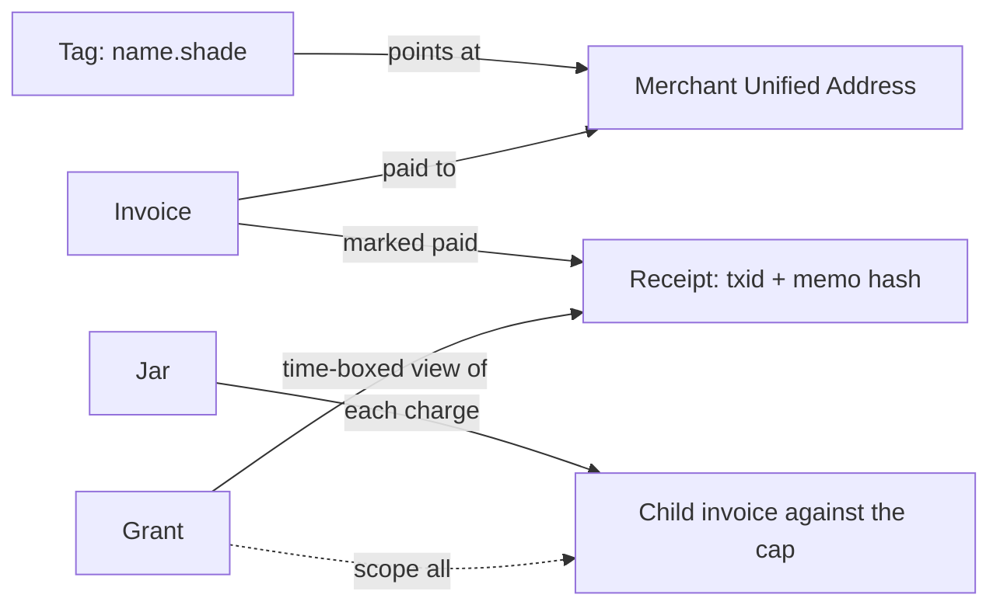
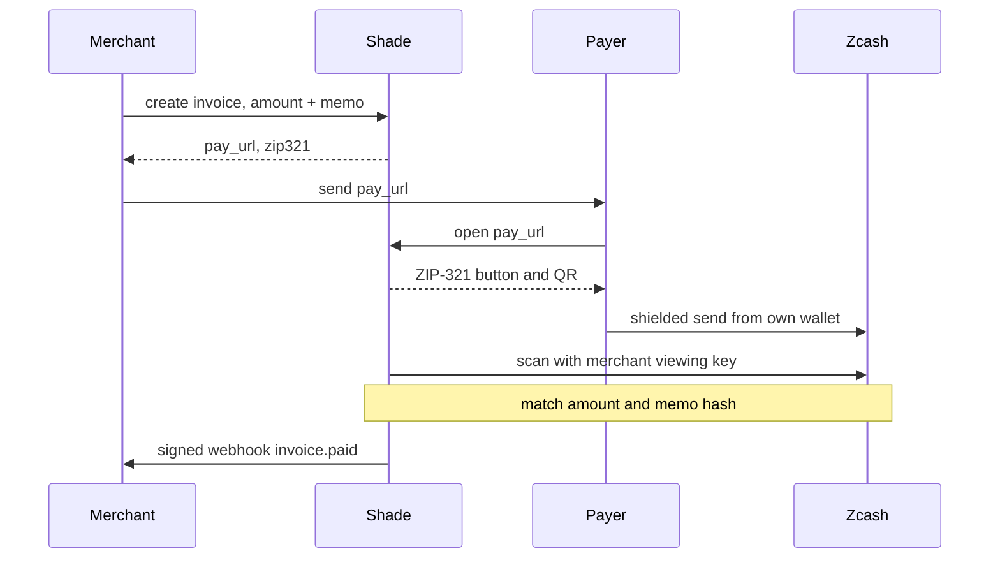
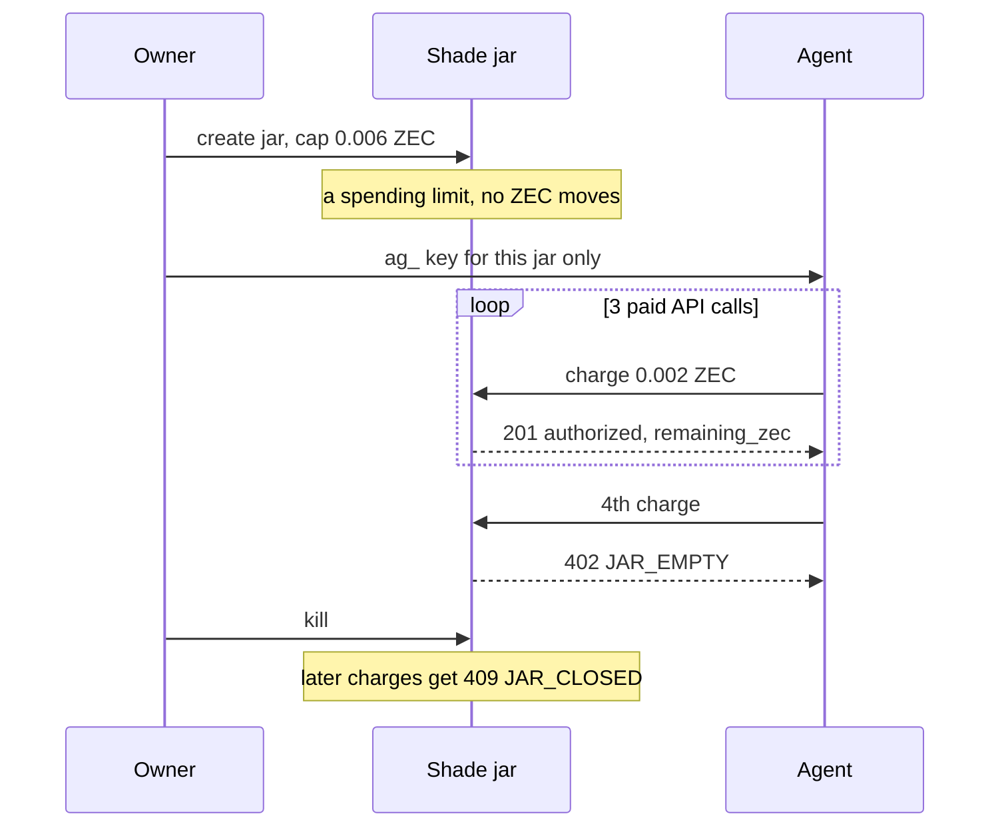
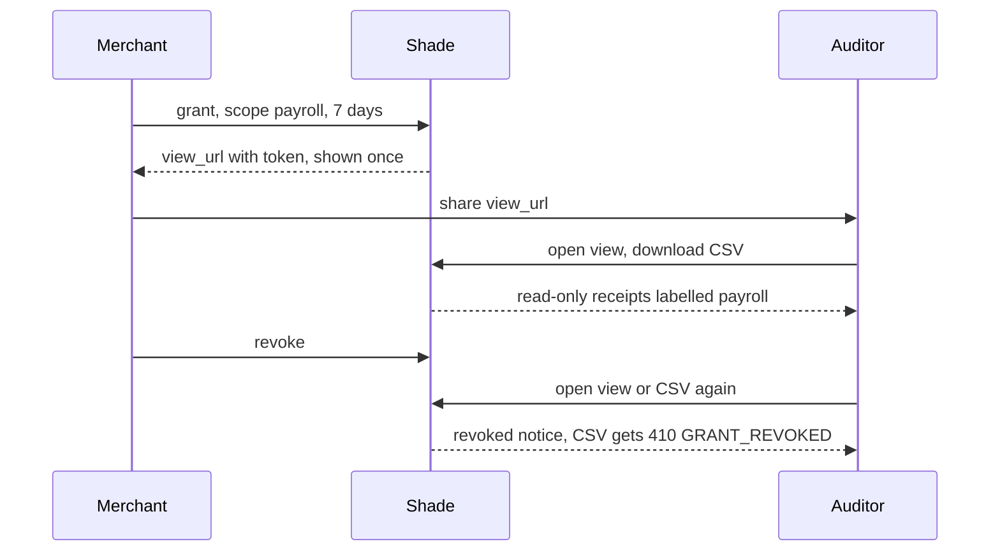

# Shade — Product Requirements

**Website:** https://shade-zcash.vercel.app  
**Chain:** Zcash only (Orchard / Unified Addresses). No other blockchain.  
**Version:** 0.2 · **Date:** 2026-09-30  
**Status:** Build this. World’s Fair Zcash track (deadline in §13).  
**For:** coding agents and humans shipping v0.

[AGENTS.md](AGENTS.md) §2 lists the main ways the build differs and wins over this file. “v0” is the first release
this plan covers. Code cites section and step numbers: never renumber them.

## Theme (use this everywhere)

**Shade is a curtain in front of Zcash.**  
Zcash already hides the money. Shade hides the *work of using it* from vendors and agents.

Voice:
- Short sentences.
- No “first private blockchain.”
- No “quantum-safe” claims in v0.
- Product words: invoice, jar, grant, kill, receipt, tag.
- Never show: Groth16, Halo, note commitment, nullifier, proving key.

Tagline: **Pay in the dark. Prove in the light. Keys stay yours.**

Site copy default: “Your tools spend. Your ledger should not narrate.”

## 0. Agent operating rules

Read this section before writing code.

1. Ship a **working pay loop**, not a wallet competitor.
2. Users pay from their own shielded wallet (Zodl, Zucchini, Zingo) via **ZIP-321** links. Shade holds no seeds in v0.
3. Default network: **Zcash testnet** until mainnet is a checkbox.
4. Asset in v0: **ZEC only**. No USDC. No ZSAs (custom Zcash tokens) until production-ready.
5. One happy path on camera: create invoice → shielded pay → webhook `invoice.paid` → viewing grant → revoke → agent
   jar empty fails.
6. If a feature needs a full node, a custom proving service, or a new consensus rule, **cut it**.
7. Do not scrape social media, store seeds, or log plaintext memos on the server.
8. Tests matter more than slides. A demo that lies about “on-chain” is a failed build.

### Suggested repo

- Planned: `apps/web` (Next.js site), `apps/api` (Node: invoices, webhooks, grants), `packages/sdk` (`@shade/sdk`),
  `packages/zip321` (payment URI helpers), `packages/agent` (jar + MCP-shaped tools), `docs/demo.md` (90s script).
- Built: `frontend/` (Vite SPA), `backend/` (Hono API and worker), `backend/sdk/` (`@shade/sdk`). See
  [AGENTS.md](AGENTS.md) §4.1.

### Stack (v0)

- Next.js + TypeScript
- Postgres (invoices, grants, webhook deliveries)
- ZIP-321 payment URIs
- Unified Address (one address, several receivers) as merchant receive address
- Incoming view key (IVK: read-only, sees incoming payments) **only on merchant device or encrypted-at-rest vault
  they control**
- lightwalletd or a public testnet light wallet endpoint to detect payment
- Optional: Zucchini `@zucchinifi/dapp-sdk` for browser pay
- Deploy: Vercel + one small API box

## 1. One sentence

Shade is the **vendor layer** on Zcash: create a private invoice, get a webhook when shielded ZEC lands, share or revoke
a viewing key, and give an AI agent a jar it can empty but not overflow.

Zcash hides sender, receiver, and amount.  
Shade hides integration pain.

## 2. Why this, why now

Transparent chains make every payment public. Fine when people sent money once a week; not now.

- **AI.** Agents pay for APIs. A public ledger records “this agent bought that model.” Prompts already leak strategy;
  receipts should not leak the budget too.
- **Cyber.** Public payroll, retainers, incident fees and bug bounties show attackers who matters and what they earn.
- **Surveillance by default.** Transparent checkout ties a shopper’s whole history to a store; companies tie their
  treasury size to a ticker.
- **Quantum (honest line).** If asked: Zcash is on a multi-year path to post-quantum wallets. Shade v0 uses **today’s
  shielded payments**; we market it as *private now, upgrade the curve when the chain does*, never as quantum-proof.
- **The hole.** Wallets (Zodl, Zucchini) serve *people* sending ZEC; gateways exist. Missing: a thin API a SaaS, agent
  runtime or payroll tool can call without becoming a Zcash engineer.



## 3. What Shade is not

- Not a Zcash wallet.
- Not a mixer.
- Not Aztec, not a rollup, not a new coin.
- Not “privacy invented here.”
- Not a portable-memory / soul product.
- Not multi-chain in v0.

If a judge can replace “Shade” with “Zodl” and the sentence still works, rewrite the sentence.

## 4. The four objects

Everything in the product is one of these.

| Object | Plain meaning | Lives |
|---|---|---|
| **Tag** | `asharib.shade`: a human name that points at a Unified Address | Shade API |
| **Invoice** | “Pay this much ZEC for this memo.” Returns a ZIP-321 URI + pay page | API + web |
| **Jar** | Prepaid private budget with a cap. An agent spends from it. Owner can kill it. | API metadata + UA |
| **Grant** | Time-boxed share of a viewing key. Revoke ends it. | API + merchant vault |

Receipt = invoice marked paid + txid + memo hash. On chain, only a viewing-key holder sees the amount (limit: §5).



## 5. Privacy model (one grade in v0: shielded)

A shielded payment **is** the top grade: an explorer shows only that a shielded transaction happened, not who paid
whom or how much. Limit: moving funds between pools shows the amount that crosses.

Shade adds no new cryptography, only **policy on top**:

- Merchant detects *their* payment with *their* incoming view key.
- Merchant creates a **grant** so an accountant sees this month only.
- Owner can **kill** a jar so an agent stops paying.
- Server never needs a spending key.

Transparent ZEC addresses are **opt-in and discouraged**. Default receive = Unified Address, shielded.

Built: detection uses a full viewing key, which also shows outgoing payments. A grant covers one label or all, for 10
minutes to 90 days, with no date filter. Transparent and TEX addresses are refused; transparent receivers are stripped
from Unified Addresses.

## 6. Users

| Who | Job to be done |
|---|---|
| Merchant / SaaS | Invoice → webhook `invoice.paid` → fulfill |
| Agent runtime | Jar of N ZEC, spend per call, stop at the cap (fail closed) |
| Human owner | Fund jar, read activity, revoke grants, kill jars |
| Auditor | Open a grant, export receipts, lose access at expiry or revoke |
| Payer | Pay privately from their own wallet (§10) |
| World’s Fair judge | Understand the loop in 90 seconds |

## 7. UX copy (ship this text)

| Where | Text |
|---|---|
| **Pay page** | “Private pay · Zcash. They will not see your history. We will not see your seed.” |
| **Merchant dashboard** | Invoices · Jars · Grants · Webhooks |
| **Grant dialog** | “Share view for 7 days. Scope: invoices tagged payroll. You can revoke anytime.” |
| **Jar** | “Cap 0.05 ZEC. Spent 0.012. Kill returns the rest to you.” |
| **Error when jar empty** | “Jar empty. The agent cannot spend.” |

Shipped ([AGENTS.md](AGENTS.md) §2): the jar line is “Cap 0.05 ZEC. Spent 0.012. Left 0.038.” (no promised
return, §8.2); the grant dialog says “labelled”, not “tagged”.

Never: “generating proof…,” “syncing sapling tree…,” “nullifier.”

## 8. Flows

### 8.1 Merchant invoice



Webhook body (no spending keys, no raw view key):

```json
{
  "type": "invoice.paid",
  "invoice_id": "inv_...",
  "amount_zec": "0.042",
  "memo_hash": "sha256:...",
  "txid": "...",
  "paid_at": "2026-10-10T12:00:00Z"
}
```

`amount_zec` is fine: the **merchant already knows the invoice amount**. Attach the payer’s Unified Address only if
the payer opted in.

### 8.2 Agent jar



v0 honesty: Shade holds no spending key, so **kill = freeze invoices + mark jar closed**. Leftover ZEC moves only from
the owner’s own wallet (§15): never call it “returned” or fake a protocol-level clawback.

### 8.3 Grant and revoke



Original plan: the auditor gets an exported UFVK/IVK slice. Zcash has no scoped or time-boxed viewing key, so Shade
serves read-only receipts and never hands out a key ([AGENTS.md](AGENTS.md) §2).

v0 honesty: a copied CSV (or key, in the original plan) cannot be erased from the auditor’s laptop. Shade **stops
issuing new data** and **ends the grant**. Say that in the UI (§15).

## 9. API (v0 — implement these only)

Base: `https://shade-zcash.vercel.app/v1`  
Auth: `Authorization: Bearer sk_live_...` (merchant)  
Agent: `Authorization: Bearer ag_...` scoped to one jar.

### Invoices

`POST /v1/invoices`

```json
{
  "amount_zec": "0.01",
  "memo": "order_1042",
  "expires_in_sec": 3600
}
```

Response: `id`, `pay_url`, `zip321`, `address`, `expires_at`.

`GET /v1/invoices/:id`  
`POST /v1/invoices/:id/cancel`

### Jars

`POST /v1/jars` `{ "cap_zec": "0.05", "label": "research-agent" }`  
`POST /v1/jars/:id/charge` `{ "amount_zec": "0.002", "memo": "api:search" }`  
`POST /v1/jars/:id/kill`

Charge creates a child invoice counted against the cap. Over cap → `402` `{ "error": "JAR_EMPTY" }`.

### Grants

`POST /v1/grants` `{ "scope": "payroll", "days": 7 }`  
Response includes a **one-time** view payload the merchant already authorized.  
`POST /v1/grants/:id/revoke`

### Webhooks

`POST /v1/webhooks` `{ "url": "https://vendor/hooks/shade" }`  
Sign bodies with `X-Shade-Signature` (HMAC SHA-256 of raw body).

### Tags

`POST /v1/tags` `{ "name": "asharib" }` → `asharib.shade`  
Resolves to the merchant Unified Address.

SDK shape:

```ts
const shade = new Shade({ apiKey });
const inv = await shade.invoices.create({ amountZec: "0.01", memo: "demo" });
// send user to inv.payUrl
```

## 10. Pay page (shade-zcash.vercel.app/pay/:id)

Must work on a phone.

1. Show amount + memo + “Pay privately with Zcash.”
2. Big button: **Open in wallet** (ZIP-321 deep link).
3. QR of the same URI.
4. Status poll: unpaid → paid.
5. “Need a wallet?” link to Zodl / Zucchini. Shade does not create wallets or seed phrases.

ZIP-321 profile for v0: **one recipient, explicit ZEC amount, optional memo ≤ 512 bytes UTF-8.**

## 11. How we know it paid (v0)

Preferred order:

1. Merchant scans for shielded payments matching amount + memo + time window, or Shade does, if they uploaded an
   **encrypted** incoming view key.
2. Fallback for demo: payer pastes txid; Shade checks it is a shielded tx in the window. Show `paid_unverified` and
   `paid` as different states.

Never require a transparent (public) “marker” payment that reveals the payer.

## 12. World’s Fair demo (do this first)

**Title:** Shade — private invoices and agent jars on Zcash  
**Track:** Zcash  
**Video ≤ 90s**

1. Merchant creates 0.01 ZEC invoice on shade-zcash.vercel.app.
2. Payer pays from Zodl/Zucchini. Explorer: shielded, no amount.
3. Webhook fires. Dashboard flips to Paid.
4. Open a 10-minute grant. Show receipt list. Revoke. Export dies.
5. Fund a jar 0.006 ZEC. Agent pays 3 × 0.002. Fourth call returns `JAR_EMPTY`.

Script last line: “Zcash hides the money. Shade is how a product uses that without becoming a cryptographer.”

## 13. World’s Fair constraints

- Deadline: **12 Oct 2026, 23:59 PT**
- Prize track: Zcash, $100k / 10 teams
- Do not claim Grand Prize as the plan
- Do not submit a Solana build to this product
- Workshops to borrow wording from: Zcash 101, Z3/RPC, FROST + payment URIs — **use ZIP-321 in the video**

## 14. Later (not v0)

- FROST threshold spend (several signers approve) for company jars
- Encrypted memos as structured receipts
- ZSAs when production-ready
- Mainnet + production lightwalletd
- Hosted incoming-view-key HSM
- True on-chain clawback
- Post-quantum when Zcash ships it: update Shade, do not fork it.

## 15. Risks and the honest line in the UI

| Risk | What we tell the user |
|---|---|
| View key copied | “Revoke stops new access from us. Delete the file on their machine too.” |
| Kill jar | “Stops new charges. Move leftover ZEC in your wallet.” |
| Detection lag | “Shielded confirmations can take a minute.” |
| Quantum question | “We use Zcash Orchard today. When Zcash upgrades keys, Shade follows.” |

Shipped quantum line ([AGENTS.md](AGENTS.md) §2): “Payments use Zcash's shielded pool today. When Zcash upgrades keys,
Shade follows.”

## 16. Done when

- [ ] `shade-zcash.vercel.app` landing + pay page
- [ ] `POST /invoices` + ZIP-321 + webhook
- [ ] One real shielded testnet payment detected
- [ ] Grant create + revoke
- [ ] Jar cap + `JAR_EMPTY`
- [ ] `@shade/sdk` with those five calls
- [ ] 90s video
- [ ] README a stranger can run

Out of scope: a whitepaper, a token, a wallet, a quantum slide.

## 17. Coding-agent checklist

When implementing, prefer this order:

1. ZIP-321 helper + pay page mock (fake paid button for UI only, behind `DEMO_FAKE_PAID=1`)
2. Invoice table + webhook signer
3. Testnet detect loop
4. Jar + 402
5. Grant + revoke
6. Delete the fake-paid path before submit
7. Record the video

Commit messages: `inv: ...`, `jar: ...`, `grant: ...`, `pay: ...`.  
If a task is not in §9, do not build it.
